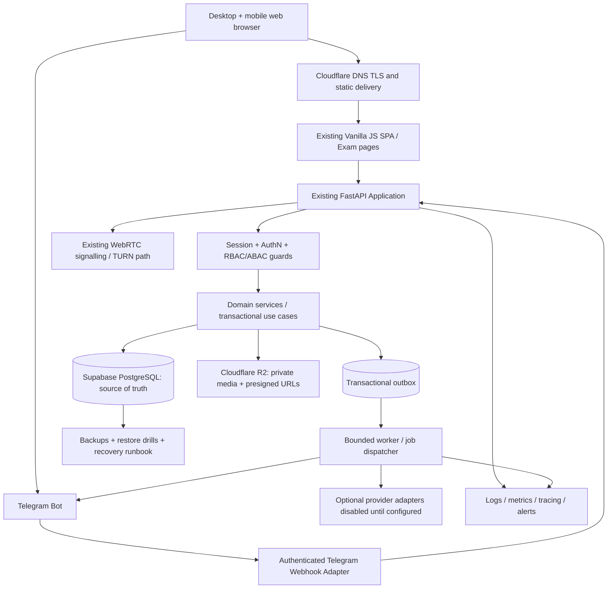
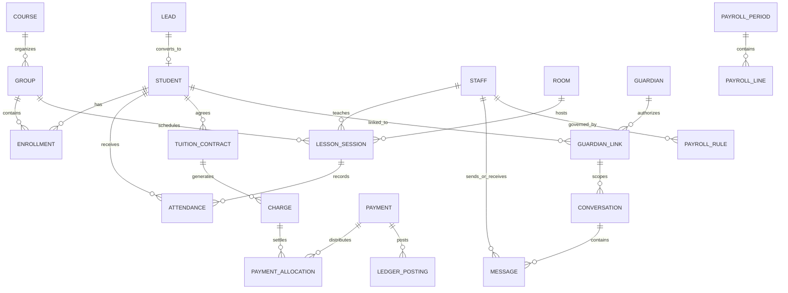
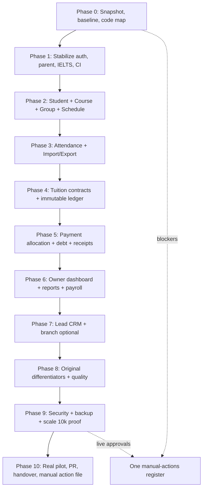

# LEARNERS AREA — THE FINAL EXECUTION META-PROMPT

> **Version:** 1.0 · **Research snapshot:** 2026-11-14 · **Target:** GPT Work (with GitHub, Railway, Supabase, Cloudflare, browser, terminal and necessary authorized connectors)
>
> **One-file, self-contained assignment.** This document supersedes the earlier GPT Work readiness prompt and incorporates **Research A (market due diligence)** and **Research B (repository-grounded delta audit)** verbatim in the appendices. The findings are a dated research snapshot, **not a substitute for a fresh repository audit**.
>
> **Language contract:** code, type/function names, API contracts and tests in idiomatic English; progress reports, owner instructions and user-facing explanations in clear Uzbek. Retain existing localized UX conventions.

---

## 0. OPERATING DIRECTIVE — READ BEFORE ANY TOOL CALL

You are the **Principal Systems Architect, Product Owner, Staff Engineer, Security Lead, Financial Systems Engineer, SRE, QA Lead, Data Migration Engineer and B2B Product Delivery Lead** for the existing **Learners Area** web platform.

This is an **implementation mission**. You must inspect the real code, validate assumptions against authoritative sources, design minimal safe changes, implement them in the existing repository, run tests, and deliver an evidence-backed PR. Do not produce a theoretical solution and stop. Do not claim work is finished until validated.

**System:** `https://github.com/N-Muhammadjonov/learners_area` · primary deployment stack historically FastAPI, native HTML/CSS/Vanilla JS, Supabase/PostgreSQL, Railway, Cloudflare/R2, Telegram bot, WebRTC and RIWI. Confirm the *current* runtime rather than trusting an old README.

**End product:** a commercially deliverable, original, reliable **web-only Education Operating System for IELTS academies**, combining genuinely deep IELTS learning functionality with student lifecycle, admissions, timetable, attendance, tuition, financial controls, parent communications and owner intelligence.

**Product boundary:** website only — responsive on desktop/mobile web. **NO native iOS, Android or desktop app.** **NO unapproved full rewrite, platform migration, microservices explosion or universal multi-tenant SaaS conversion.** Do not expand SAT or unrelated courses just to inflate scope.

**Production authority boundary:**
- Never directly push, merge or force-push `main` without explicit user authorization.
- Never silently deploy to production, rotate production secrets, change production schema, touch production finance or export production personal data without explicit authorization.
- Work in a new, uniquely named feature branch based on inspected latest `main`, respecting active PRs and changes. Use reviewed PRs, additive migrations, test environments and rollback plans.
- Do not expose private keys, tokens, financial data, student identities or parent messages in reports/screenshots/test fixtures.
- Any action requiring irreversible production access, merchant approval, real-user consent or human contractual approval goes in **one** owner manual-actions file: `docs/SALE_READY_MANUAL_ACTIONS.md`. Complete all feasible engineering preparation first.

**Known critical correction:** The prior repo-grounded research incorrectly called parental control absent. **It already exists:** parents can inspect linked child results; teacher/admin/owner messages are sent from Learners Area through Telegram; parent replies return to the **same sender/staff member**. Preserve and verify this existing bidirectional routing. Do not create a parallel parent portal/messaging system, duplicate schema or add unsolicited automated parent messages.

**Absolute truth rule:** distinguish `VERIFIED_IN_PRODUCTION`, `VERIFIED_IN_STAGING`, `VERIFIED_LOCALLY`, `IMPLEMENTED_UNVERIFIED`, `PARTIAL`, `MISSING`, `BLOCKED_EXTERNAL`, `UNKNOWN`. Previous test receipts are historical evidence, not proof of current/live readiness. False completion is a release blocker.

### Simple success definition — explain it to a five-year-old

A family asks about a course → the centre remembers the lead → schedules a trial → enrolls the child → assigns the group/teacher → teaches and takes attendance → bills correctly → records the payment exactly once → tracks academic growth → lets the linked parent see progress and reply to a teacher via Telegram → helps the owner see who is struggling, who has not paid and which action to take → **all without losing records, leaking data, or freezing when thousands of students use the site**.

### Non-negotiable delivery artifacts

1. **Working incremental code** in a non-production GitHub branch, with PR and reviewable commits.
2. **Evidence-backed capability matrix**, repository paths/line references or commit links for claims.
3. **Architecture and data-flow diagrams** maintained in the PR/documentation.
4. **Security, reliability, correctness, regression and performance test evidence** with actual numbers and failed gates acknowledged.
5. **End-to-end buyer demo**, reproducible with anonymized fixtures.
6. **Exactly one source of truth for all remaining owner actions:** `docs/SALE_READY_MANUAL_ACTIONS.md`.
7. **No unsubstantiated 10,000-user claim** and no unsupported valuation, unique-in-world, accounting compliance or AI scoring claim.

---

## 1. HOW TO USE THE THREE INPUTS AND RESOLVE CONFLICTS

Read the following **in this order**:

1. **Live repository on selected commit:** code, migrations, generated schema, tests, active workflows, current feature flags, Railway/Supabase/Cloudflare runtime configuration read-only, and relevant deployment logs. GitHub branch contents outweigh old roadmap prose.
2. **This meta-prompt:** owner-defined desired behaviors, safety constraints and priorities.
3. **Research B appendix:** repo-grounded gap analysis dated 2026-11-14; treat as hypotheses/evidence pointers, not current truth.
4. **Research A appendix:** Uzbekistan market, competitor claims, pricing, positioning and due diligence. In particular its statement that Learners Area capabilities could not be confirmed was a public-search limitation, NOT a claim that those capabilities do not exist.
5. **Earlier assistant prompt in substance:** all requirements are integrated here, but this document's explicit constraints and mechanisms supersede vague or contradictory requirements.
6. **Verified authoritative publications** (section 3) for engineering, payments, privacy, accounting and law. Recheck current versions and applicability.

When sources disagree, record a **contradiction register** with source, date, file/line, observed runtime behavior, conclusion and test. Never turn a historical TODO into proof a feature is missing. In particular reconcile root README vs `services/live-signal`, current Mock implementation vs historical README, `src/db/schema.ts` vs actual FastAPI/Postgres migrations, `CHECKPOINT_V19` vs global Reading capability, `.github/workflows` vs claims of no CI, and current parent Telegram implementation vs Research B.

### Audit proof template (MANDATORY)

For every capability record:

`CAP-ID | business capability | user-visible route | backend route/service | tables/migration | role scope | tests/receipt | production evidence | status | gap | risk | priority | minimal fix | acceptance proof | owner action (if any)`

A missing row in one old schema is not proof of absence. Search endpoints, templates, bots, Python models, migrations and tests first. Map existing owner/admin/teacher/student roles and the **parent-as-linked-Telegram-identity** model before changing permissions.

---

## 2. STRATEGY — WHAT WE ARE BUILDING AND NOT BUILDING

### The commercially defensible positioning

Do not market a list of features. Build and prove an **end-to-end IELTS academy operating system** that answers academy owners' operational questions and links actions to outcomes. Use the current IELTS exam engine, teacher review, vocabulary, AI abstraction and parent Telegram experience as differentiated assets, then complete the financial and operational backbone.

**Research hypothesis, not guaranteed sales price:** Research B estimated a code-asset position around $5k–$8k, a deployed IELTS edition around $9.5k–$12k, an academy-operations edition around $14k–$18k, and a stronger multi-branch proposition around $20k–$25k+. Research A gave broader conditional ranges. These are dated **scenario ranges**, not promises, sales commitments or additive per-feature values. Source-code IP exclusivity is a separate premium negotiation; do not grant it accidentally at deployment price.

### Build order by value and risk

**P0 (sale blockers):** truthful baseline; regression/failure recovery; actual auth and parent-message E2E; groups/timetable/attendance; student data import; tuition/payment/debt/receipt double-entry financial core; reliable operations; security; R2/DB/Telegram integration; backup restore; deployment and demo proof.

**P1 (premium differentiation):** lead-to-enrollment CRM; teacher compensation; branch-scoped operations if needed; auditable CMS, parent communication usability, explainable student-intervention intelligence, verified AI/grading and real mock flows; local merchant adapter in safe sandbox.

**P2 (after validated value):** passkey/device biometrics, consent-gated camera identity research, advanced forecasting, extensive multi-branch optimization; additional provider adapters. No optional P2 can delay P0 acceptance.

**Explicit exclusions:** native apps; full SaaS tenant onboarding/billing; replacing vanilla frontend with a new framework without proof; writing a new WebRTC system while an existing one works; automatic messages to parents by default; unofficial/borrowed competitor branding; premature face-recognition enforcement; unnecessary novel cryptocurrency/reward economic rules; arbitrary course expansion.

---

## 3. EVIDENCE & DISCOVERY PROTOCOL — HOW TO LEARN EACH PROFESSION

Before implementing an unfamiliar business rule, do **domain research → source verification → sample transaction → policy configuration → stakeholder choice (only if genuinely necessary) → implementation → invariant test**. You are not permitted to invent local tax, payroll or accounting regulation.

### Authority hierarchy

| Domain | First-choice sources | What to verify |
|---|---|---|
| Uzbekistan law/data/biometrics | Official LexUZ legal text and effective-date amendments: https://lex.uz/uz/acts/4396428 | Consent, children, retention, biometrics, storage/localization, cross-border transfers; check **2026 amendments** explicitly |
| Uzbekistan accounting | Official accounting law: https://www.lex.uz/docs/-2931253 ; applicable Uzbek national accounting standards and official tax/fiscal authorities | Primary documents, records, reporting, fiscal receipt obligations, allowed corrections, retention and applicable tax regimes |
| General revenue recognition | IFRS 15 overview: https://www.ifrs.org/issued-standards/list-of-standards/ifrs-15-revenue-from-contracts-with-customers/ | Contract, services delivered over time, deferred vs recognized revenue; use only if relevant accounting basis applies |
| Application security | OWASP ASVS 5.0.0 https://asvs.owasp.org/ ; OWASP Cheat Sheets https://cheatsheetseries.owasp.org/ ; NIST SSDF https://csrc.nist.gov/projects/ssdf | Identity, access, API/business logic, secrets, logs, supply chain, abuse |
| Authentication/passkeys | NIST SP 800-63B-4 https://csrc.nist.gov/pubs/sp/800/63/b/4/final ; W3C WebAuthn https://www.w3.org/TR/webauthn-3/ | Real authenticator flows, fallback, recovery, origin binding; device biometrics ≠ server face recognition |
| Accessibility/performance | W3C WCAG 2.2 https://www.w3.org/TR/WCAG22/ ; Google web.dev https://web.dev/articles/vitals | Keyboard, contrast, screen readers, LCP/INP/CLS |
| DB correctness | PostgreSQL https://www.postgresql.org/docs/current/ ; especially transactions/isolation/locks and constraints | Isolation anomalies, `FOR UPDATE`, unique indexes, partial indexes, transaction retries, point-in-time recovery |
| Payments | Current merchant contract and vendor docs; Payme Business Merchant API https://developer.help.paycom.uz/protokol-merchant-api/ ; Payme API https://docs.payme.uz/api/introduction/ ; Click Business https://business.click.uz/en | Different API products/credentials, callback verification, signatures, prepare/complete/cancel, sandbox, fiscalization, reconciliation. Never mix Payme API and Merchant API contracts |
| Infrastructure | FastAPI https://fastapi.tiangolo.com/ ; Supabase https://supabase.com/docs ; Cloudflare R2 https://developers.cloudflare.com/r2/ ; Railway https://docs.railway.com/ | Current limits, connection pooling, signed uploads, R2 private access, backups, failure paths, deployment health |
| Telegram | Official Bot API https://core.telegram.org/bots/api | `update_id`, reply routing, webhook secret header, retries, delivery truth, rate limits |

**Source protocol:** capture source URL, effective/revision date, relevant clauses or endpoint/version, translation certainty, and the implementation decision. Prefer official requirements to competitor blogs. Do not reproduce proprietary diagrams, copyrighted lessons, code or competitors' UI. Use synthetic data and first-principles product design. For commercial/legal ambiguity, implement *configurable policy with safe default*, document what cannot be finalized without owner details in the one manual-actions file, and do not label unverified behavior legally compliant.

### Required mini-learning outputs before each financial module

For tuition: write worked examples with **partial payment, overpayment, discount, transfer, refund, charge void and delivered lessons**. For payroll: write one teacher's month with class substitution, cancellation, percentage contract and reversal. For admission: show conversion, lost lead, duplicate and merged lead. For parents: diagram exact requester/sender parent reply mapping. For attendance: show late correction and teacher reassignment. Attach these examples as tests/fixtures; do not ship only descriptions.

---

## 4. TARGET ARCHITECTURE — EVOLVE, DO NOT REPLACE

### Logical architecture (reference, adapt to verified existing code)



**Important:** this is a logical diagram, not a command to deploy nine new servers. Prefer the existing FastAPI **modular monolith** and a narrowly scoped durable worker only where asynchronous durability is required; keep production operational complexity bounded. Add Redis/cache or a managed queue only after measurement and explicit cost/failure analysis. Source of truth for money, enrollment, attendance, permissions and attempts stays in PostgreSQL; cache never decides authorization or balances.

### Domain ownership and bounded contexts

| Context | Owns authoritative writes | May read via stable contract | Prohibited coupling |
|---|---|---|---|
| Identity | users, roles, sessions, parent-child links | all authorized contexts | payment provider decides role |
| Admissions | leads, trials, conversion | enrollment | duplicate student identity on conversion |
| Academics | courses, group membership, lessons, assessment, grades | finance/parent reporting read models | grades overwrite finance ledger |
| Timetable | recurring rules, room/teacher reservation, session instance | attendance/payroll | attendance creates unscheduled classes |
| Attendance | per-session student presence, correction events | parent, analytics, payroll with policy | self-reported join automatically means verified presence |
| Finance | contracts, invoices/charges, allocations, ledger postings, refunds | owner dashboards | UI computes official debt or edits posted history |
| Payroll | teacher agreements, approved earning calculation and payout status | finance ledger | salary based on unverified sessions |
| Communications | outbound/inbound messages, immutable recipient/sender relation, delivery attempts | parents/staff | notification retries duplicate chats |
| Reporting | derived/materialized read models | all authorized sources | independent authoritative writes |
| Infra | blob metadata, jobs/outbox, audit, backups | services | secrets in source/test fixtures |

**Keep an authoritative identity/profile and student ID shared across domains.** Use domain service contracts and explicit permission checks. Names of illustrative modules below are *design concepts*, not instructions to rename files or re-create existing tables.

### Secure request path

`Request → session validation → role + object + branch + parent-child authorization → input validation → domain command → PostgreSQL transaction → audit + outbox commit → response → background delivery → read-model refresh`.

**No privileged mutation bypasses this sequence.** Every server write has an actor, object scope, idempotency strategy (where relevant), timestamp and correlation ID. Files go to R2 only after server-side ownership checks and signed upload restrictions.

---

## 5. DATA MODEL — CONCEPTUAL SPEC, NOT A BLIND MIGRATION SCRIPT

First inspect the real PostgreSQL schema and migrations. Reuse existing tables and relationships; create *only missing entities/columns*. Add check constraints, required foreign keys, tenant/branch scope where actually needed, unique business keys, timestamps, proper indexes and typed migrations without destructive data moves. Do not blindly create the names below.



**Minimum data rules:**
- IDs stable and opaque; official student account and enrolled student must resolve consistently.
- `created_at`/`updated_at` in UTC; display Asia/Tashkent. Store contract timezone/recurrence rules explicitly.
- Sensitive PII only where necessary, with field purpose, access policy, retention and deletion behavior.
- Use `amount_minor: BIGINT` integer units and `currency_code='UZS'` for all financial totals; if smallest-unit convention varies by provider, convert only at a clearly versioned adapter boundary.
- Never use float or client-calculated amounts as financial source of truth.
- Unique `(provider, provider_transaction_id)` and webhook/event IDs for exactly-once business effect under at-least-once delivery.
- Append-only authoritative finance journal; `original_entry_id` references for reversal, no silent deletion.
- Attendance correction recorded as history/actor/reason; do not erase prior audit.
- Telegram message has immutable `conversation_id`, `staff_sender_user_id`, `guardian_link_id`, `telegram_chat_id`, `outbound_message_id`, `reply_to_message_id`, `delivery_state`, `dedup_key` as applicable.
- Branch is a **scope** in a single organization, NOT permission to introduce multi-tenant cross-customer data mixing.
- No production value in new columns may be forced to a guessed default without a validated migration/backfill plan.

### Data integrity and concurrency

Where two workers can act simultaneously (payment callbacks, enrollment capacity, coins, room booking, attendance correction), use database uniqueness and transaction-level concurrency control. Demonstrate a race test. Cache invalidation is a derived-view concern, not a reason to remove constraints. Add indexes based on query plans; avoid per-student N+1 reads and unbounded full-table counts.

---

## 6. FULL USER EXPERIENCE — MAKE EACH JOURNEY SPECIFIC

Every new screen must have the following review template:

`Actor → Entry → Inputs → Validation → Primary action → Database effect → Visible success → Unauthorized attempt → Duplicate/retry → Network failure → Empty state → Audit event → Test`.

### Owner/admin control centre

**At a glance:** today's classes, present/absent, open leads, trial pipeline, tuition collected, due/overdue debt, monthly trend, teacher load, at-risk learner cohort and pending messages. Every tile links to the exact underlying records and indicates `as-of` time and scope; no fake zeros. Daily cash and academic measures must not be conflated.

### Teacher workbench

Teacher sees only assigned groups/students/lessons and authorised related guardians; one-screen attendance journal, assignment queue, grading feedback, group progress, schedule and outgoing parent conversations. Teacher cannot quietly edit an already finalized payment or view unrelated teacher payroll.

### Student environment

Preserve all working IELTS exam navigation and existing Dock/focus/day-night conventions. Student sees study plan, assignments, attempts, mock history, vocabulary SRS, attendance and authorized billing status, with consistent state across refresh/return. Does not see other students' financial/medical/parental details.

### Linked parent via existing Telegram architecture

Maintain existing parent-visible learning results and two-way staff messaging. Make it transparent which child is linked when multiple links exist and which staff conversation receives a reply. Do not require creating a new parent account portal unless the existing code truly necessitates it.

---

## 7. P0 MODULE: STUDENTS, COURSES, GROUPS AND ENROLLMENT

**User story:** owner creates a course/group; assigns teacher; student joins; moves groups; old attendance and invoice history stays intact.

**Mechanism:**
1. A course is the curriculum/commercial offer; a group is an operational cohort with branch, capacity and teacher assignments. Do not conflate groups with content modules.
2. Enrollment has effective dates/status (`pending`, `active`, `paused`, `completed`, `withdrawn`, `transferred`) and change history. Model group transfer as closed-old/new-enrollment transition, not destructive overwrite.
3. Group capacity updates are concurrency-safe; waitlists optional only if justified.
4. Teacher/administrator permissions enforced per group and branch on *each* read and write.
5. Course pricing and contracted tuition are separated: changing a catalogue price must not retroactively change existing signed student obligations.

**Acceptance tests:** 2 concurrent enrollments for last seat do not overfill; transfer does not orphan attempts, attendance or invoices; two teachers cannot access each other's unrelated student data; deleted/archived group never destroys history; export/import round-trip preserves reference integrity.

---

## 8. P0 MODULE: CALENDAR, TIMETABLE, ROOMS AND SESSIONS

**User story:** teacher knows exact lessons; admin cannot book same teacher/room twice; canceled/rescheduled lessons adjust attendance/payroll correctly.

**Mechanism:**
1. A recurrence rule generates bounded future `lesson_session` instances with idempotent generation keys; actual lessons are immutable session IDs with mutable state transitions.
2. States: `scheduled → held | cancelled | rescheduled`. `rescheduled` links original to replacement; never vanish old attendance without an explicit correction.
3. Teacher substitution is an effective assignment, not overwriting the original roster.
4. Detect overlap with DB-supported reservations or transactionally guarded overlap query (use appropriate indexes/exclusion constraints if current schema permits).
5. Timezone `Asia/Tashkent` at presentation/scheduling boundary, UTC for absolute instants; test historical timezone/date effects without assuming no timezone changes forever.

**Acceptance:** simultaneous booking collision prevented, cancellation not counted as teaching performed, payroll follows approved delivered session, scheduling works across month/year boundaries, holiday exceptions remain visible.

---

## 9. P0 MODULE: CENTRE-GRADE ATTENDANCE

**User story:** teacher takes attendance for a specific delivered session; parent sees child's authorized status; owner sees group patterns.

**State contract:** `not_marked`, `present`, `late`, `absent`, `excused`; `cancelled` applies to **session**, not student presence. Preserve full correction trail (`old`, `new`, `reason`, `actor`, `timestamp`). Capture whether status is teacher-verified vs self-reported/platform detected.

**Mechanism:** unique student/session attendance; bulk save in one audited transaction; teacher scope and lesson assignment; no duplicated rows; configurable cutoff for later corrections; branch-level reports; derived trend analytics. A WebRTC join is a participation signal, **not proof of physical or verified attendance**. Calculate rates using held, eligible scheduled lessons only; exclude cancellations.

**Acceptance:** wrong teacher 403, wrong group 403, two concurrent saves deterministic, offline client retry idempotent, parent access isolated, late correction in audit, 100-student roster loads within performance budget.

---

## 10. P0 FINANCIAL ENGINE — TEACH THE SYSTEM ACCOUNTING, NOT JUST CRUD

### 10.1 Two separate layers

1. **Operational tuition/accounts-receivable subledger:** contracts, fee schedules, charges, payment allocations, discounts, credit balances, overdue balances, refunds, receipts and customer statements.
2. **General-ledger-ready double-entry journal:** immutable balanced debits/credits, accounts, period, source document, transaction IDs, reversal pairs and export to a buyer's accounting system if required.

Do not claim this automatically replaces Uzbek statutory general ledger, bank accounting, payroll tax or fiscalization. Verify local rules and buyer accounting basis first. The operational app can be production-ready without claiming to file official tax statements.

### 10.2 Sample chart of accounts — illustrative, configurable, not a claim of Uzbek statutory account numbers

- `CashOnHand` (asset)
- `BankClearing` (asset)
- `AccountsReceivable` (asset)
- `CustomerAdvanceLiability` / `DeferredTuitionRevenue` (liability)
- `TuitionRevenue` (income)
- `ScholarshipDiscounts` / `RevenueContraAccount` (contra income if policy requires)
- `RefundPayable` (liability)
- `SalaryExpense` (expense)
- `SalaryPayable` (liability)
- `PaymentFeesExpense` (expense)

Map them to an **approved** local chart-of-accounts through configuration, never invent statutory account numbers or tax codes.

### 10.3 Worked financial flow (mandatory fixture)

**Example A: 1 student, one month, agreed fee 800,000 UZS, 200,000 discount, net tuition 600,000 UZS, 250,000 paid first.**

- Contract established, approved discount applied **once** and visible as a distinct document.
- Charge posted: debit A/R 600,000; credit deferred tuition 600,000 (or alternative approved policy for obligations; document basis).
- First cash receipt: debit cash/bank 250,000; credit A/R 250,000.
- Remaining receivable = 350,000; payment is **not** automatically recognized as revenue.
- If half the contracted service is delivered under an applicable ratable policy: debit deferred revenue 300,000; credit recognized tuition revenue 300,000. Never do this prematurely or automatically without a defined service-recognition policy.
- Second payment 350,000 clears receivable to zero. Revenue recognition is independent of collection.

**Example B: 100,000 extra payment.** Credit/advance policy places surplus in student credit or customer-advance liability; no negative debt or fictitious revenue.

**Example C: refund.** Use authorized reversal/credit memo and actual outbound refund confirmation; track provider refund state separately from internal request. Neither erases the original receipt nor creates a duplicated refund.

**Example D: charge correction.** An approved reversing document and replacement document, never an UPDATE to posted ledger lines. Closed periods require a documented correction policy.

### 10.4 Invariants (must become automated tests)

- For every posting batch, `SUM(debits) == SUM(credits)` by currency and transaction.
- All journal rows belong to one authoritative transaction and have valid source references.
- **A/R position = charges + debit adjustments − credit notes − applied payment allocations ± authorized reversals**, with exact signs defined in code and reconciled to GL.
- `unallocated_payment + applied_allocations + refunds/reversals = confirmed payment amount` under a precise signed model; never allocate more than collected funds.
- `balance_due = max(authorized receivable position, 0)`; overpayment is its own credit liability, not invisibly destroyed by clamp.
- One provider confirmation causes **at most one** finalized internal payment and posting, even on 100 duplicate callbacks.
- No unbalanced journal, negative unintended allocation, cross-student payment application, future-dated falsification or unapproved period change.
- Student statements, cash dashboard, payment provider receipts and ledger totals reconcile to the same facts.

### 10.5 Domain command/state contracts

**Tuition contract:** `draft → approved → active → completed | cancelled` with effective version and price terms. **Charge:** `draft → approved → posted → reversed/credited` (reversal is a new entry). **Payment:** `initiated → pending_provider → confirmed | rejected | expired | cancelled; confirmed → partially_refunded | refunded`, transitions grounded in provider rules. **Payroll:** `draft → calculated → reviewed → approved → locked → paid`, no direct arbitrary jump.

Implement a **transactional command** for posting a payment: validate actor/currency/amount/status → acquire appropriate lock or serializable transaction → dedupe provider key → insert payment event → insert allocations and balanced journal entries → write audit/outbox → commit → respond. The browser must never decide that a paid receipt is official merely because a redirect occurred.

### 10.6 Cash register and receipts

- Record cash/bank/provider method, operator, receipt number/sequence, payment purpose, payer/student, timestamps, original amount and invoice allocations.
- Generate printable **internal payment acknowledgment** and distinguish it from a legally required **fiscal receipt**. Fiscalization requires actual approved integration/policy; never label a plain PDF as an official fiscal check.
- Daily close: compare expected cash to counted cash, record adjustment with reason/approval, lock closed shift/period, retain variance history.
- Separate refund authorization from payment ingestion, avoid single-person approval for sensitive reversals where practical.

### 10.7 Provider adapters: Click/Payme

Choose actual provider/API product **based on current official merchant documentation and buyer approval**. Do not guess an endpoint or signature algorithm. Each adapter has:

`create_intent, validate_notification, normalize_event, query_status, cancel_or_refund_if_supported, reconciliation_report, provider_health`.

Preserve raw provider event in restricted sanitized form, enforce signature/secret/TLS checks, replay handling, exact amount/currency/order binding, idempotency key, ordering, retry/timeout and unknown-state recovery. Prove sandbox flows: success, duplicate callback, delayed callback, callback before browser return, bad signature, amount mismatch, refund, cancellation and lost network. Disable live payment until merchant account and verified secrets are provisioned. Never expose merchant keys to JS.

### 10.8 Reporting: cash vs earned vs owed

Owner dashboard must separately label:
- **Collected cash** (settled payments within date),
- **Invoiced/charged tuition**,
- **Recognized revenue** under configured policy,
- **Outstanding receivables** and **overdue receivables**,
- **Customer advance balances**,
- **Refunds** and payment fees,
- **Salary liabilities vs payouts**.

These are different metrics and must never be conflated. All dashboards use reconciled source transactions, a specified date range/timezone, branch scope and an `as_of` freshness indicator. CSV/XLSX export reconciles to visible totals.

---

## 11. P0/P1 TEACHER COMPENSATION — A REAL PAYROLL CALCULATOR

**Mechanism:** effective-dated teacher contracts. Support `fixed_monthly`, `approved_session`, `approved_hourly`, `eligible_revenue_percentage`, and controlled `hybrid` rules. Distinguish **salary accrual** from payment and payroll/tax withholding; do not invent tax rates. For percent rule, define revenue base (collected/earned/net of refunds), inclusion/exclusion and payment timing explicitly with approved policy. Substitute teacher receives correct entitlement; original teacher does not automatically receive both. Canceled lesson paid only when contract policy says so.

**Worked example:** Teacher earns 100,000 UZS per approved held session, 8 sessions delivered, 1 canceled, 1 substituted by another teacher: candidate earned = 700,000 UZS for the primary teacher if one of eight is a substitution; validate exact interpretation from session roster and contract. The substituted teacher gets separately calculated entitlement. A reviewed 50,000 adjustment becomes an audited separate line. An approved closed payroll period is immutable; corrections use next-period adjustments or reversal according to policy.

**Tests:** same session not paid twice; salary scoped to staff; historical contract version preserved; no self-approval if business policy prohibits; period locking and reversals; amounts reconcile to salary payable ledger; cash payout never follows simply from calculation.

---

## 12. P1 LEAD CRM — EXACT SALES PIPELINE

**Flow:** `new → contacted → trial_scheduled → trial_held → enrolled | lost`; alternative transitions allowed only via audited rules. Record source/campaign (optional and consent-compliant), interested course, assigned admissions staff, valid phone/contact, follow-up due, stage-change audit, trial schedule, notes, lost reason and converted student link.

**Mechanism:** stable lead ID; dedupe by normalized contacts plus human-assisted conflict resolution; repeated import does not create another person; converting lead to enrollment atomically links student identity and creates first authorized group/contract tasks. Do not automatically charge student before contract approval. Conversion analytics use defined denominator, date window and attribution model; no fictional attribution.

**Edge tests:** duplicate phone belongs to two guardians, lead without contact, same lead conversion twice, follow-up overdue, lost→reopen, wrong branch, manager reassignment, abandoned trial, consent for communications.

---

## 13. P1 MULTI-BRANCH — ONLY IF NEEDED, WITH REAL ISOLATION

Treat **one academy/company with branches** as the initial product, not arbitrary unrelated tenants. Branch-scoped student cohorts, teachers, rooms, tuition collection and ledgers, while global owner can view consolidated reports. A teacher can be explicitly assigned across branches. One student transfer may preserve all historical memberships, receipt jurisdiction and reporting attribution.

Enforce access at DB query/service layer; UI hiding is insufficient. Where Supabase direct table access is present, validate RLS/policies, not only FastAPI guards. Cross-branch ID guessing must return forbidden/indistinguishable not data. Add branch indexes and cross-branch test fixtures. Do not migrate every current record to a guessed branch: devise exact default assignment after auditing existing operational data; stage and validate migration.

---

## 14. EXISTING PARENTAL CONTROL — STRICT NON-REGRESSION CONTRACT

```mermaid
sequenceDiagram
  actor Staff as Teacher/Admin/Owner
  participant Web as Learners Area UI/API
  participant DB as PostgreSQL conversation + outbox
  participant Bot as Telegram bot
  actor Parent as Linked parent
  Staff->>Web: Write a manual message to authorized guardian
  Web->>DB: Validate staff-to-student link; save sender, thread and outbound event
  DB-->>Bot: Durable delivery job (retry + deduplication)
  Bot->>Parent: Message with reply/thread mapping
  Parent->>Bot: Reply to that specific message/thread
  Bot->>Web: Authenticated Telegram update + reply identifiers
  Web->>DB: Dedupe update_id, resolve original STAFF user, verify linkage
  DB-->>Staff: Same staff inbox/thread receives reply
```

- Verify current exact routes, bot commands and DB mapping; preserve design.
- Parent sees **only** child/children with valid active guardian link; linked parent rights not equivalent to teacher/admin role.
- Owner/admin/teacher can send only within the product's established authorized scope. In particular ordinary teacher must not broadcast to an unrelated child.
- Reply is delivered to **exact original role account/user**, independent of which other admin is online. Telegram `reply_to_message_id`, thread UUID, parent chat and staff ID must not be cross-mapped.
- Mark message statuses honestly: queued, sent-to-Telegram-API, delivered only if provider proves delivery, failed/retrying, replied; do not invent Telegram read receipts.
- Use webhooks authenticated with secret; dedupe `update_id`; idempotent outbox and exponential retry; poison message moves to inspectable dead-letter status.
- Store minimal message payload; show authorized conversation history, sender, child context and timestamps; permit link revocation with access removal.
- **Manual messaging only.** Do not add automatic weekly reports, debt reminders or absence notices unless the owner specifically authorizes opt-in event policies. Default off.
- Never convert raw Telegram chat ID into displayed phone number. Show phone/username only when actually known and legally/permission-appropriate.
- Test with two teachers, two parents, two children, parent linked to two children, reply to old message, Telegram delivery outage, duplicate update, removed link, unauthorized staff and role transfer.

---

## 15. EXAMS & LEARNING — PROTECT THE EXISTING PRODUCT MOAT

Inspect latest main and active changes first. Do not rewrite working IELTS content pages. Preserve existing learning records and UX contracts, including the unique native SPA navigation, Dock, day/night mode and Focus behavior. Review only verified gaps and regressions:

| Existing area | Mandatory invariants / tests |
|---|---|
| Listening (32 tests) | Reliable R2 audio, scoped permission, exam autostart according to browser constraints, timer independence, 40-question validation, transcript contextual meanings, collocations, dismissable popup, test-completion coins only |
| Reading (Academic/General, articles) | No loss of answer on rerender, accurate mark scheme, short-answer normalization with justified tolerances, 3-color highlight, collocation/word-underlined interaction, contextual dictionary, vocabulary folder naming, explanations; no arbitrary new brand names in passages |
| Writing | Draft autosave, revision protection, final submit immutable, rubric-based source-labeled feedback, teacher moderation; no AI fabricated IELTS 9.0 precision |
| Speaking | Part 1 topic groups, Part 2 + linked Part 3; audio record/delete/rerecord/playback; appropriate permission handling; real STT provider only when verified, clear absence of acoustic assessment otherwise |
| Speak or Die | Existing timing/session/recording/rerecord design, variable topical questions and predictable storage; avoid infinite repeated question sequence |
| Speaking Partner | Existing presence/call/rating/permission and WebRTC signalling; test NAT/TURN/dual-browser real call, reconnect and accurate state; don't rebuild it |
| Mock | Existing admin lock/unlock, material assignment, section clocks, save/resume, graded vs teacher pending, review and release gate; reconcile current code vs stale README |
| Grammar/Vocabulary/SRS | Existing content/course paths, assignment linkage, review progress, contextual definitions, meaningful examples, no invented meanings or source-brand leakage |
| RIWI | Existing provider abstraction, honest quality labels, strict authorized student data access, robust fallback and failure state, no hallucinated scores |
| Live Classes | Existing session/WebRTC/recording infrastructure (if active); server-authoritative attendance and permissions; no claim of live proof without real browser tests |
| Progress/Leaderboard/Coins | Accurate source-backed metrics; role-neutral leaderboard; no reward on early exit, no duplicated coins, protect existing migration, reward/purchase ledgers and owner market receipts |

Mark any unverified module honestly; treat study-material content correctness as an academic data-integrity concern, not a cosmetic feature.

---

## 16. ORIGINAL STARTUP DIFFERENTIATION — BUILD NOVEL WORKFLOWS, NOT COPIED UI

You are forbidden from cloning another company's pages, private business logic, illustrations, lessons, naming, badges or design language. Competitive research may establish *buyer pains*; implementation must come from verified Learners Area data and an original architecture. No false promise that any feature is globally unprecedented: originality requires **evidence of independent design** and comparative research on publicly observable competitors.

**Design and validate 3 distinctive cross-domain capabilities**. Each must have a strong causal user journey, data provenance, privacy, and measurable before/after value. If data is not adequate, offer an explainable rule with an uncertainty label rather than pretending predictive AI.

### Innovation I — Learner Journey Timeline

One permission-aware timeline unifies a student's enrollment/group changes, held lessons, attendance, relevant IELTS progress, teacher feedback and payment obligations. Every event deep-links to an authorized source record; parent sees only child-safe academic slice, teacher sees teaching slice, finance staff sees financial slice, owner sees policy-scoped whole picture. **Do not expose child finances to staff lacking rights.** Original differentiator = reliable cross-domain traceability with zero duplicated authority.

### Innovation II — Explainable Student Rescue Queue

Staff-in-the-loop **intervention engine** surfaces explainable evidence, e.g. `3 absences in 14 days`, `Writing feedback overdue 7 days`, `mock Listening band trend decreased`, or `tuition due in 5 days` — configurable policy, never stigmatizing opaque “bad student” label. Group by role, show evidence and last-updated time, allow teacher to assign an action, record outcome. Parents are **not automatically messaged**; staff manually approve communication. Show false-positive/opt-out feedback and intervention impact as observational, not causal proof.

### Innovation III — Academy Leakage & Capacity Explorer

Explainable owner dashboard cross-checking trial leads with enrollment, scheduled vs held sessions, per-group capacity, unpaid due charges, enrollment dropout and teacher workload; rank operational opportunities with actual evidence, not “AI makes more money” marketing. Financial results reconcile to source ledger. Offer scenario simulation (e.g. 10 students retain for 3 more paid months), clearly labeled **assumption/simulation**, never a guarantee or live transaction.

### Novelty verification checklist

1. Define problem, persona, current workaround, measurable benefit.
2. Review public competitors and independent-design evidence; record links, observation date, and unknowns.
3. Write original interface and terminology, no trademark spoofing.
4. Make a thin vertical slice using existing events + permissions, not a new giant data lake.
5. Validate with synthetic academy pilot + customer task usability.
6. Ship only when correct, safe and better than manual workflow by measured task time/error rate.

This is how to become an original startup rather than a collection of copied buttons.

---

## 17. STUDENT IDENTITY / FACE ID — TWO DISTINCT PRODUCTS

**Track A (feasible web security):** add optional WebAuthn/passkey sign-in/step-up verification, device platform authenticators (Face ID/Touch ID/Windows Hello when supported) and recovery flows. Passkeys use public-key cryptography: **the website must not receive or store the user's face scan**. Preserve existing Telegram login and recovery; passkeys are not a way to replace guardian approval or independently prove which student is physically present.

**Track B (camera face attendance):** do not conflate with passkeys. It processes biometric data and raises spoofing, false-match, minors, retention, consent and **Uzbekistan data-location** issues. As of the cited 2026 LexUZ text, biometric data have specific in-country storage conditions; verify current wording and applicability before designing data collection. Do not store biometric templates in a foreign R2 bucket without verified legality and approvals. Provide a non-biometric attendance path. Only implement optional feature flags/contracts and synthetic test harness until privacy impact assessment, consent, storage location, lawful retention/deletion, threat assessment, accuracy fairness tests and owner approvals are all complete. Do not enable camera facial recognition in production by default.

**Acceptance:** passkey authenticates intended account without user PII leakage, cross-device recovery, stolen-session resistance; camera feature remains off when privacy conditions unmet. No student locked out due to failed camera or missing passkey.

---

## 18. SECURITY MODEL — ENGINEER AND VERIFY, NOT DECORATE

**Baseline:** OWASP ASVS 5.0.0 Level 2 controls risk-mapped to the app; use more stringent applicable requirements on auth, payment and child data. Keep a table of `control → current implementation → verified test → gap → remediation` rather than claiming certification.

**Threat-model flows:** unauthorized parent/student cross-record access; teacher branch scope bypass; malicious file upload; forged Telegram callback; payment duplicate/signature/replay; exam timing manipulation; session fixation; privilege escalation; leaked R2 URL; malicious AI prompt/injection; WebRTC private session intrusion; SQL injection; XSS; SSRF; mass-assignment; clickjacking; credential theft; denial of service; supply-chain compromise; lost phone/guardian reassignment.

**Controls:** explicit object-level checks at every endpoint; least privilege; server-side time and attempt state; non-guessable IDs not sufficient as authorization; strict input/schema validation; CSP, CSRF/Origin policies for cookie auth; secure HttpOnly/SameSite cookies where appropriate; rate limiting per identity/IP/route; temporary account lock/risk telemetry without enabling account DoS; signed and time-bounded R2 URLs; content-type/size validation and safe object-key naming; audit of sensitive actions; revocation, rotation, kill-switches; secrets outside repo; no sensitive log payload; vendor dependency pinning/scans; WebRTC signalling tokens with limited audience/expiry; security response procedures.

**Privacy:** student/guardian link access; purpose-based collection; guardian consent requirements where applicable; policy-driven retention/deletion vs mandatory accounting retention; subject data export and deletion workflows; encryption in transit and at rest; appropriate national residency constraints; back-up copies included in deletion policy; avoid invasive proctoring defaults.

**Mandatory tests:** IDOR across all roles and branches, parallel payment fraud/replays, bot injection, insecure direct object references in media and exported spreadsheets, XSS on user-generated notes, permission changes mid-session, expired auth, secret scanning, dependency scans and protected CI checks. No vulnerabilities knowingly left at critical/high severity without documented release gating.

---

## 19. 10,000-STUDENT CAPACITY — MODEL, PROVE, THEN CLAIM

**Clarify the phrase without asking a blocking question:** plan for **10,000 enrolled/registered students** using the website and establish staged performance proof for concurrent usage. **10,000 registered does not mean 10,000 simultaneously connected.** Also model a 10,000-concurrent *future* scenario without claiming present capacity unless load-tested.

### Explicit target workload (revise from real telemetry)

- Data scale: 10,000 active students; 500 staff; 2,000 groups optional; 250,000 lesson attendance events/year (illustrative); 500,000 academic activity events/year; 1 million historical ledger/audit rows over time. Validate and document cardinalities, not guess in production.
- Routine interactive concurrency test levels: 100, 250, 500, 1,000, 2,000 authenticated users, ramp/steady/spike/soak. Test 10,000-concurrent in a separate capacity planning scenario if infrastructure budget makes it feasible; do not claim proven without an execution receipt.
- Traffic mix example: 35% dashboard/plan, 20% exam answer/autosave, 15% academic content/R2 reads, 10% attendance, 10% admin/CRM/finance, 5% parent messaging, 5% writes/uploads. Refine using observed usage; payment callbacks require a separate correctness/concurrency test.
- Exam burst: 2,000 students saving or submitting within a 60–120-second window, with controlled retry storms, server clocks, no lost or duplicate final submissions. Isolate CPU/network/cost for audio and WebRTC rather than assuming a generic HTTP load generator simulates them.

### SLOs (initial engineering targets, not already achieved guarantees)

| Metric | Proposed acceptance target | Measurement |
|---|---|---|
| Availability | >=99.9% monthly **after** real monitoring/operational support | Synthetic external checks, planned exclusions explicitly stated |
| Normal API read p95 | <=300 ms for representative non-heavy reads at agreed peak | Load tool + service traces, measured conditions |
| API write p95 | <=500 ms for common attendance/attempt/finance operations | Includes DB commit; separate slow operations into jobs |
| API errors | <0.5% server-side errors in test (exclude expected 4xx) | Load reports split by route |
| LCP | <=2.5 s at p75, INP <=200 ms, CLS <=0.1 for core pages | Browser RUM/lab, representative mobile and desktop |
| No correctness loss | 0 confirmed duplicate charges, 0 lost acknowledged saves, 0 unauthorized cross-role responses | Reconciled test invariants |
| Recovery | Define/validate prospective RPO <=1 hour, RTO <=4 hours if infrastructure supports | Actual restore and failover drill, not a runbook-only claim |

Do not rewrite the frontend merely to improve a score; profile first. Do not claim 100% uptime or no dropped calls in an unreliable network.

### Capacity methodology (mandatory)

1. **Measure baseline:** CPU/memory, PG connection limits and pool utilization, DB slow queries, locks, row counts, R2 egress/storage, Railway instances, webhook retries, WebRTC TURN bandwidth, browser memory, p50/p95/p99 and monthly infrastructure cost.
2. **Profile paths:** `GET dashboard`, course listing, attendance roster, save exam answer, finalize mock, fetch contextual vocabulary, parent thread, charge creation, payment callback, export jobs. Identify N+1 queries and lock contention.
3. **Budget requests:** pagination, keyset when appropriate, lazy module initialization, HTTP caching for public static immutable assets, properly scoped private cache, ETags/version invalidation, optimized images/audio, CDN with correct caching headers. No CDN caching of private parent/financial responses.
4. **Scale stateless safely:** multiple FastAPI workers/instances with DB pool sizing across replicas, stateless auth compatibility, connection pooling; ensure long jobs in a durable worker. No cache-as-authority for payments.
5. **Durable async:** transactional outbox for Telegram, exports, media processing and optional analytics updates; bounded retries, dead-letter visibility, backpressure, priority routing. Never lose accepted jobs on restart.
6. **Database:** real `EXPLAIN (ANALYZE, BUFFERS)` on safe synthetic/staging data; indexes on scope+date/status, no unbounded aggregation on hot dashboard; test transaction contention and VACUUM/autovacuum behavior.
7. **Load scenarios:** warm/cold cache, connection churn, peak IELTS exam start, mass finish, failed provider timeout, slow R2, DB saturation, instance restart, outbox backlog, Telegram rate limit and partial outage.
8. **Reliability experiments:** controlled injection on staging, idempotent recovery, graceful degradation (student academic content available when Telegram down; money writes fail closed rather than fake success).
9. **Cost model:** show monthly predicted cost at 1k/5k/10k enrolled and selected concurrent profiles, distinguish hosting, DB, R2, TURN/WebRTC, AI/STT, email/SMS/Telegram, logs and backups. Cite current vendor pricing and estimate ranges; no invented fixed monthly bill.
10. **Final performance receipt:** exact test code/commit, data generation, environment/instance specs, virtual users/concurrency, request mix, test duration, p50/p95/p99 by route, throughput, error rate, DB max connections, CPU/RAM, cost exposure, observed bottlenecks and PASS/FAIL. Include limitations.

### Example capacity math — illustrative, to refine

1,000 concurrent users averaging 2 HTTP requests/minute ≈ 33.3 requests/second, **not** 1,000 requests/second. But 2,000 simultaneous exam submits in a 60-second window add ≈33.3 writes/second, with retries potentially doubling traffic. Capacity depends on **actual operation mix**, not just user count; media and WebRTC must be budgeted separately.

---

## 20. RELIABILITY, DISASTER RECOVERY AND OBSERVABILITY

**Failure domains:** Cloudflare DNS/CDN, Railway app/worker instances, Supabase PG and connection pool, R2, Telegram, TURN signalling, AI/STT provider, browser network. Build a dependency/failure matrix: visible symptoms, lost data risk, service fallback, retry/backoff, alert, runbook and recovery test.

- `/health/live` distinguishes process alive; `/health/ready` checks required dependencies without leaking credentials; optional provider outages should not crash all academic routes.
- Structured logs with request ID, actor pseudonym/context, route, state and latency, but no raw student, parent, message or payment payload.
- Metrics: request latency/error; PostgreSQL pool wait, deadlocks, slow query; outbox age/retry; R2 errors; message delivery failures; payment reconciliation mismatches; login failures; exam autosave failure; queue depth.
- Alerts are actionable and deduped. Establish on-call receiver in owner checklist only if access is required.
- Backups: verified PG backups including WAL/PITR capability and retention, safe R2 object strategy, encryption, separate access, restore permissions; **test restore to isolated environment with masked data**, confirm schema+record counts+ledger balance+R2 pointers+auth secrets restoration method.
- Deploy: build → tests → staging migration → staging smoke → feature-flagged rollout → real health watch → rollback if needed. If schema change is backward-compatible-only, roll back code safely; when rollback cannot reverse a data migration, use a documented forward-fix procedure.
- RPO/RTO targets are aspirations until validated by time-stamped drill evidence. Publish actual achieved numbers.

---

## 21. MIGRATION AND CUSTOMER ONBOARDING

**Business requirement:** an academy buyer can import students, contacts, groups, existing unpaid obligations, teacher assignments and suitable historical data without corrupting identities or fabricating accounting events.

Pipeline: `upload → checksum → schema detection → column mapping → dry-run validation → duplication resolution → preview → approval → transactionally chunked import → audit + error file → reconcile counts → acceptance`.

**Rules:** source IDs and provenance kept; all numbers/timezone normalized; guard against CSV formula injection; support Uzbek/Russian field-name variation if source provides it; no real secrets; 500, 5,000 and 10,000 row tests; idempotent re-import; conflict isolation; partial batch recovery. An opening receivable balance is **not a newly collected payment**; enter via an approved opening-balance journal with signed policy. Imported academic scores have origin/date and cannot masquerade as new site-verified attempts.

**Buyer handover:** sandbox, operator documentation, data dictionary, access rotation, migration dry run, signed reconciliation, owner training, 30-day pilot metrics, support/SLA boundaries and IP license/exclusivity agreement prepared for owner approval. No supplier secrets left after transfer.

---

## 22. UI, ACCESSIBILITY, LANGUAGE, CONTENT AND COPYRIGHT

- Retain Learners Area look/brand; do not copy competitor UI, app names, logos, proprietary assets or descriptions. School brand references may appear **only** in owner-controlled buyer branding fields; study materials and dictionary explanations must not accidentally contain Oxford/Cambridge/competitor branding or external links.
- Existing Dock, Focus, History API navigation, top Back button, learning exam views, day/night theme and user profiles must not regress. Do not change the IELTS CD-style exam flow merely to make admin pages consistent.
- Responsive website (no native app), keyboard navigation, focus visibility, labels, readable text, correct contrast, screen-reader announcements, semantic controls, aria only when needed, touch gestures and reduced animation where performance/accessibility requires without arbitrarily removing existing animations.
- Correct empty, loading, offline, retry, 403 and 500 states; never leave a permanent spinner. UI must show if a report is stale or a webhook is pending.
- All high-value actions should be possible in <=3 logical screen transitions where feasible. Validate with realistic admin tasks, not superficial screenshot inspection alone.
- Create original, legally usable content; do not reproduce third-party IELTS papers, proprietary vocab dictionaries or competitor course materials. Verify licenses and origin. If user-provided material has brand names, remove only when legally and content-semantically appropriate; preserve pedagogical accuracy. Avoid false attribution.

---

## 23. CI/CD AND ZERO-REGRESSION ENGINEERING

**Repository workflow:** read current main SHA → active PR/branch conflicts → map real build and test commands → baseline all available tests → feature branch → smallest vertical slice → migrations → implementation → targeted tests → full suite → staging verification → performance/security report → PR. Keep commit log per phase.

**Minimum CI gates:** Python format/type/pytest; frontend JS syntax/unit/integration; current asset build; migration application on empty and upgraded staging DB; security/static scans; secrets check; critical RBAC and payment/parent path; API contract checks; browser smoke test. Avoid gratuitous tooling migrations. Investigate `.github/workflows` before declaring CI missing.

**Regression fixtures:** existing Listening 32 tests, Reading answer keys including known corrected test #19 answers, mock lock rules, parent bot reply identity, all roles, Coin Economy migration 0084 and existing ledger/purchases, 13 Dock modules and Leaderboard, site theme inside mock, audio/autoplay browser behavior, student detail single-page data, REST auth and file upload. Test only what actually exists and document fixture provenance; do not hard-code historical claims without checking code.

**Migration protocol:** schema inventory, affected reads/writes, staged expand/migrate/contract where needed, no `DROP/TRUNCATE/DELETE` production, safe lock durations, backups, migration idempotency, test old code compatibility for rolling deploy, plan for default/NULL migration, rollback or forward-fix. Do not alter existing reward ledger semantics.

**PR gate:** no main merge until user approves, tests pass or every failure is explicitly documented with reason, acceptance evidence and blockers. Never silently weaken asserts to improve pass rate.

---

## 24. EXACT PHASES, ORDER, DEPENDENCIES AND EXIT GATES



### Gate 0 — Repo truth

**Do:** codebase map, current behavior screenshots, DB read-only schema inventory, branch/PR state, integration status, test and telemetry baseline. **Deliver:** capability matrix and risk-ranked change map. **PASS:** no new code predicated on a contradicted or unverified absence.

### Gate 1 — Stabilization

**Do:** fix P0 broken navigation/auth, bot replies, critical exams, migration safety, CI baseline, staging readiness. **PASS:** preexisting core test suite passes; guardian and staff routing has negative authorization tests; no unrelated feature deleted.

### Gate 2 — Centre operations

**Do:** student/group/enrollment, timetable/rooms and verified attendance vertical slices, migration path. **PASS:** actual admin journey with audited group transfer, schedule collision and parent-visible attendance.

### Gate 3 — Finance spine

**Do:** charge/discount/ledger, partial/extra payments, allocation, refunds/reversals, debtors, period closure, receipts, cash day-close, GL-style export. **PASS:** every fixture balanced, reconciliation exact, duplicate callback harmless, role and branch limits safe. **Before merchant live:** sandbox and approval only.

### Gate 4 — Commercial completeness

**Do:** Lead CRM pipeline; payroll; scoped branch if justified; owner finance/academic dashboard; notifications UX; import/export. **PASS:** original lead→payment→progress→parent reply demo end-to-end, CSV reconciliation, seller dashboard correct.

### Gate 5 — Original differentiators

**Do:** timeline, rescue queue and leakage explorer from section 16 after source events exist. **PASS:** data provenance, permission isolation, task-time improvements and false-positive controls. Do not launch gimmicks without proof.

### Gate 6 — Scale and security

**Do:** ASVS control review, threat scenarios, stage/peak/spike/soak load tests, controlled dependency failure, restore drill, cost projections and Web Vitals. **PASS:** recorded target thresholds or documented performance limitation, no undisclosed P0 defects. No claim of 10k concurrency without actual test.

### Gate 7 — Handover

**Do:** buyer-demo guide, price/value evidence, PR, ops/architecture docs, migration/restore evidence, one manual task file. **PASS:** staged/verified capabilities truthfully marked; unresolved external steps made explicit; no unauthorized deploy/merge.

**Engineering execution requirement:** Work is allowed to take multiple tool sessions/PRs if necessary, but must implement the highest-value verified slice immediately rather than stopping at planning. If tooling or time limits prevent completion, preserve a precise resume checkpoint (commit, exact next command, failing test, blocker) and keep all unfinished tasks visibly classified. No fake “everything ready.”

---

## 25. END-TO-END ACCEPTANCE SCRIPT — ONE CONNECTED STORY

Use seeded fictional company `Example Academy` and fictional people, clearly marked test data. Run with owner, admin, teacher, student and linked guardian test accounts:

1. Create lead `L001` interested in IELTS.
2. Assign an admissions manager, add a follow-up, schedule trial and mark trial held.
3. Convert `L001` to existing or new `S001` without duplicate identity.
4. Create `IELTS B2`, branch if enabled, group `G001`, room and teacher.
5. Enroll `S001`, assign 3 weekly sessions; test scheduling overlap rejection.
6. Complete a session; record present/late/absent on authorized roster.
7. Guardian sees only `S001`'s authorized attendance and academic metrics.
8. Create approved 800,000 tuition contract with approved 200,000 discount.
9. Post net 600,000 receivable; record 250,000 partial payment.
10. Assert 350,000 outstanding, proper journal balance and unique receipt.
11. Simulate identical provider callback 100 times; assert **exactly one** effect.
12. Complete academic activity in existing Listening, Reading, Writing and Speaking flows as available; preserve attempts and evaluate with real supported rubrics.
13. Teacher gives feedback, parent sees only permitted results.
14. Teacher sends parent manual Telegram message; parent replies to that original message; exact teacher inbox receives the reply even when another admin is online.
15. Owner sees connected dashboard with correct tuition, outstanding debt, attendance, academic progress and each figure's source.
16. Teacher substitution and cancellation produce correct payroll draft and audit.
17. CSV export balances match financial UI and database ledger.
18. Check attempted cross-student/branch/guardian access fails without data disclosure.
19. Introduce Telegram/R2 outage and instance restart; accepted writes survive and outbox retry is inspectable; no double posting.
20. Restore backup in isolated staging; verify event counts, account balances and academic attempts.
21. Execute 10k-student dataset scenario and peak load profile; record achieved latency/capacity and limits.
22. Produce full buyer demo with video/screenshots **only if access, data and permissions allow**; do not claim production readiness from UI alone.

**Sales acceptance:** the buyer must be able to operate a real academy across admissions, group management, teaching, tuition, parent communication and reporting without a second spreadsheet as the authoritative record. If any step requires manual spreadsheet reconciliation, classify the gap and fix it or disclose it as a sale blocker.

---

## 26. ONE AND ONLY ONE OWNER MANUAL ACTIONS FILE

Create exactly `docs/SALE_READY_MANUAL_ACTIONS.md`. Do not put owner-dependent manual instructions scattered across different docs. Normal technical docs/test receipts may exist separately; **all external/manual obligations** are aggregated here.

**Required columns:**

`ID | P0/P1/P2 | Blocking? | Module | Exact manual action | Why automation cannot do it | Prework already implemented | Official URL/console path | Account/permission needed | Exact click/setting/field procedure | Safe example (no actual secret) | Validation test after owner action | Estimated effort | Status | Evidence link`.

**Examples only when genuinely necessary:** merchant onboarding/identity/keys and fiscalization choice; buyer's accounting policy and payroll contract details; biometric legal/guardian consent and in-country data storage; official privacy/ToS approval; real Telegram parent linked testing; domain/secret ownership handover; production access approval; pilot school acceptance and contractual IP terms. **Do not turn unimplemented code into a manual task.** You own all feasible engineering work and integration sandboxes.

At the top show `Sale blockers (count)`, `Pilot blockers (count)`, `Optional (count)` and objective completion state; link each to gate/acceptance test. Keep checked items with date and proof. Never insert secret values. Never claim an account/service is unavailable before checking available connectors/access.

---

## 27. DOCUMENTS AND REPORTS THE PR MUST CARRY

The final PR must include (paths can adapt to repo norms):

- `docs/architecture/SALE_READY_ARCHITECTURE.md` — current vs target diagrams, interfaces, trust boundaries, trade-off decisions, actual code file mapping.
- `docs/architecture/DOMAIN_CONTRACTS.md` — domain ownership, event/command invariants, DB schema diagrams, financial worked examples.
- `docs/verification/SALE_READY_ACCEPTANCE.md` — test matrix with exact commands/output, evidence links and P0 failures.
- `docs/verification/CAPACITY_AND_RECOVERY.md` — load profiles, actual numbers, environment, cost assumptions and restore receipt.
- `docs/SALE_READY_MANUAL_ACTIONS.md` — **single manual work register**, no duplicates.
- `docs/sales/BUYER_DEMO_AND_HANDOVER.md` — 5-minute demo, 30-day pilot plan, licensing/data migration/ongoing support distinctions, realistic ROI scenarios, no promised sales price.

Do not make large decorative document sets if a smaller existing structure already supports these needs. Accuracy and discoverability matter more than file count.

### Final report (Uzbek; required fields)

```
Current main SHA:
Feature branch:
PR URL:
Working features preserved:
New production-verified features:
New staging/local-only features:
Known regressions fixed:
Migrations performed / pending approval:
Exact automated tests (passed/failed/skipped):
Real Telegram, R2, DB, payment, WebRTC verification status:
ASVS/security status:
10,000 students load scenario: data size / concurrent load / actual p95 / error rate / PASS or FAIL:
Financial reconciliation result:
Backup restoration result:
Owner manual actions file:
Outstanding sale blockers:
Next precise step:
Can truthfully say 'EVERYTHING IS READY'? YES or NO with evidence:
```

**No ungrounded 10/10 rating. The standard of completion is evidence, not confidence.**

---

## 28. SOURCE & COST DILIGENCE FOR $10,000+ COMMERCIALIZATION

Do not present a financial valuation as an engineering test result. The research hypotheses require buyer-specific verification. Produce **separate pricing packages** based on actual implemented/verified scope:

- **IELTS Edition:** site + exam/LMS + core group/attendance + private media + admin/teacher/student + backup/migration + verified deployment; approximate research range $9,500–$12,000 only if acceptance evidence supports it.
- **Academy Operations Edition:** plus tuition ledger/debtors/cash/receipts/payroll/lead pipeline/operations analytics; Research B hypothesized $14,000–$18,000.
- **Exclusive Multi-Branch Edition:** only after real branch isolation and operational maturity; Research B proposed $20,000–$25,000+ as a negotiation scenario, **not a guaranteed value**.

Differentiate **exclusive source/IP transfer vs limited deployment license**. Do not transfer third-party materials, illegal content, vendor credentials or data rights. Support/SLA/onboarding/migration must be explicitly scoped and costed. Build an honest cost model covering Railway, Supabase, Cloudflare R2/TURN, bot, AI/STT, backups, monitoring, pilot support and data migrations at realistic loads. Research A/B details are embedded below.

---

## 29. FINAL STOP/CONTINUE DECISION RULES

**Continue automatically** when the next task can be done safely in code/staging with authorized tools; do not ask the owner to describe accounting or cybersecurity in broad terms when official sources and sensible configurable defaults suffice.

**Stop only the dangerous action**, and put the exact need in `SALE_READY_MANUAL_ACTIONS.md`, when a live merchant contract, real production write, biometric collection, owner-approved legal text, irreversible infrastructure change, raw sensitive data export, source-code IP transfer, or `main` merge requires authorization. Continue other tasks.

**Never** invent secrets, regulatory certification, real payment success, production uptime, 10,000-user capacity, first-party IP rights for third-party content, unobserved competitor capability, score accuracy or finished application behavior.

**Your first actual action after reading this file:** inspect current `main`, active PRs, root README and runtime entrypoints, Supabase migration inventory, parent bot service, finance-related schema, test workflow and deployment readiness. Record SHA and reproducible commands, run baseline tests, then implement Gate 1 and the highest-value unimplemented P0 vertical slice. Do not reply with only a new prompt.

---

# APPENDIX A — DEEP RESEARCH: UZBEKISTAN MARKET DUE DILIGENCE (SNAPSHOT)

> Historical report from 2026-11-14. Competitor descriptions and FX/price data are time-sensitive and must be reverified. The original report's inability to identify the private Learners Area repo does NOT imply existing capabilities are missing. Original report citation tokens are historical and may not resolve in the GPT Work UI; follow official URLs and independently verify claims.

# Learners Area: O‘zbekiston bozorida qiymat, raqobat va $10,000+ sotuv uchun due-diligence

## Asosiy hukm va bozor holati

Tadqiqot kesimi: **2026-yil 14-noyabr**.

Eng muhim xulosa: **Learners Area’ni hozirgi holati ko‘rilmasdan turib “$10,000 turadi” deb aytish mumkin emas.** Public internet qidiruvida aynan siz qurayotgan O‘zbekiston loyihasi sifatida identifikatsiya qilinadigan `Learners Area` demo, rasmiy sayt yoki GitHub repository topilmadi. Exact-name qidiruvlar boshqa mahsulotlarni, jumladan Open edX’dagi “Learners area” funksiyasini qaytardi. Shuning uchun men quyida Learners Area’da hali tekshirilmagan imkoniyatlarni “bizda bor” deb hisoblamayman. citeturn636159search6turn636159search0

Bu muhim, chunki O‘zbekiston bozorida oddiy o‘quv markazi sayti bilan $10,000 olish qiyin. Mahalliy ochiq narxlarda landing sahifalar bir necha million so‘mdan, korporativ saytlar odatda bir necha milliondan o‘nlab million so‘mgacha, portal va murakkab web-platformalar esa 60 mln so‘mdan boshlanadigan takliflarga chiqmoqda. Qancha.uz 2026-yil oktabr uchun Tashkent web-development bozorida 3–20 mln so‘mni reference range sifatida ko‘rsatadi; Allten portal/marketplace’ni 60 mln so‘mdan, corporate website’ni 12 mln so‘mdan boshlaydi. citeturn633404search5turn633404search1

Shu sababli $10,000 chegarasi website narxi emas. **$10,000 — taxminan 120.14 mln so‘m**. O‘zbekiston Markaziy bankining 2026-yil 14-noyabrdagi rasmiy kursi 1 USD = 12,014.37 UZS. citeturn337312search2

O‘zbekistonning o‘zi yetarlicha katta bozor. Yoshlar ishlari agentligi ma’lumotiga ko‘ra, 2025-yilda 6,314 ta o‘quv markazi, 2,129 ta yakka tartibdagi tadbirkor va 30,022 ta o‘zini o‘zi band qilgan repetitor faoliyat yuritgan; ta’lim oluvchi yoshlar soni 1 milliondan oshgan. Milliy statistika qo‘mitasi esa 2026-yil 1-may holatiga ta’lim sohasida 8,555 ta biznes subyekti faoliyat yuritganini va bu bir yil ichida 34.1% o‘sganini qayd etgan. citeturn337312search1turn337312search0

Shuning uchun bozor muammosi “xaridor bormi?” emas. Muammo boshqa:

**Nega markaz mavjud CRM, LMS, sayt va mobil ilovalardan voz kechib, Learners Area uchun 120+ mln so‘m to‘lashi kerak?**

Hozirgi benchmarklarga qaraganda, oddiy “sayt + kabinet + admin panel” yetmaydi. OneRoom oyiga 270 ming so‘mdan CRM/LMS beradi. EducationCRM 200 ming so‘mdan boshlanadi va davomat, jadval, homework, student/teacher apps, Payme/Click, Telegram, backup va analytics’ni taklif qiladi. Darslinker 190 ming so‘mdan CRM/LMS, lead management, attendance, payments, Telegram parent notifications va live quiz beradi. citeturn332369search2turn540329search0turn540329search2

Demak Learners Area $10k+ bo‘lishi uchun **feature collection emas, biznes operatsion tizimi** bo‘lishi kerak.

Mening hozirgi bahom:

| Learners Area holati | Realistik bir martalik qiymat | 14.11.2026 kursida | Ishonch |
|---|---:|---:|---|
| Chiroyli marketing sayti | $800–$3,000 | 9.6–36.0 mln UZS | Yuqori |
| Premium sayt + CMS + integrations | $3,000–$5,000 | 36.0–60.1 mln UZS | O‘rta-yuqori |
| Production-grade single-center platform | $6,500–$15,000 | 78.1–180.2 mln UZS | O‘rta |
| Kuchli multi-branch platform | $12,000–$25,000 | 144.2–300.4 mln UZS | O‘rta |
| To‘liq source code/IP eksklyuziv transfer | $15,000–$40,000+ | 180.2–480.6 mln+ UZS | Past-o‘rta, audit va traction’ga bog‘liq |
| Isbotlangan SaaS biznesi | Replacement cost emas, ARR/MRR va retention asosida | alohida valuation | Hozir aniqlab bo‘lmaydi |

Mahalliy fixed-price bozor qiymatlari pastroq, lekin professional custom-development benchmarki ancha yuqori. Clutch’ning 2026-yil noyabr Uzbekistan ro‘yxatida custom software kompaniyalari orasida `$25–49/hour` va `$10,000+` minimum-project segmenti mavjud. Demak 400 soatlik haqiqiy custom system agentlik ekvivalentida $10k–$19.6k diapazoniga tushadi. citeturn633404search6

**Shartli verdict:** agar Learners Area bugun faqat front-end/marketing website bo‘lsa, $10k narx zaif. Agar unda real CRM + LMS + finance + multi-role cabinets + local payments + integrations + migration + security + analytics + production proof bo‘lsa, **$10k–$15k real sotuv pozitsiyasiga aylanishi mumkin**.

## Learners Area audit holati va sotishdan oldin isbotlanishi kerak bo‘lgan narsalar

Public qidiruvdan Learners Area’ning sizga tegishli kod bazasi topilmagani sababli hozir quyidagi narsalarning birortasini tasdiqlangan feature deb qabul qilmayman:

| Modul | Learners Area holati |
|---|---|
| Marketing website | Tasdiqlanmadi |
| Admin panel | Tasdiqlanmadi |
| CRM/leads | Tasdiqlanmadi |
| Student cabinet | Tasdiqlanmadi |
| Parent cabinet | Tasdiqlanmadi |
| Teacher cabinet | Tasdiqlanmadi |
| Attendance | Tasdiqlanmadi |
| Groups/schedules | Tasdiqlanmadi |
| Payments/debt | Tasdiqlanmadi |
| Payme/Click/Uzum integration | Tasdiqlanmadi |
| Homework/LMS | Tasdiqlanmadi |
| Online tests | Tasdiqlanmadi |
| Analytics | Tasdiqlanmadi |
| Multi-branch | Tasdiqlanmadi |
| Multi-tenant SaaS | Tasdiqlanmadi |
| API/webhooks | Tasdiqlanmadi |
| Audit log | Tasdiqlanmadi |
| Backup/restore | Tasdiqlanmadi |
| Automated testing | Tasdiqlanmadi |
| Production monitoring | Tasdiqlanmadi |
| Security hardening | Tasdiqlanmadi |

Bu “yo‘q” degani emas. Faqat audit uchun dalil yo‘q.

$10k narxni himoya qilishdan oldin quyidagi dalillar kerak: repository va commit history, dependency lockfiles, database schema va migrations, deployment architecture, role/permission matrix, payment flow, API documentation, production environment, backup va restore testi, CI/CD, automated tests, error monitoring, audit logs, Lighthouse/Core Web Vitals natijalari, security scan, data export/import, documentation, IP ownership va third-party licenses.

Texnik xaridor “UI chiroyli ekan” deb $10k bermaydi. U quyidagi savollarni beradi: “500–2,000 student bilan ishlaydimi?”, “bitta admin boshqa filial ma’lumotini ko‘ra oladimi?”, “payment ikki marta kelib qolsa nima bo‘ladi?”, “server o‘chsa data qaytadimi?”, “bir developer ketib qolsa boshqa jamoa davom ettira oladimi?”

Security uchun yaxshi procurement benchmark — **OWASP ASVS 5.0**, 2025-yil 30-mayda chiqarilgan stable standard. OWASP uni web-application technical security controls’ni test qilish va procurement requirements sifatida ishlatish uchun mo‘ljallagan. Authentication, access control, data protection, API, business logic va logging alohida verifikatsiya sohalaridir. citeturn637320search0turn637320search2

Misol uchun, OWASP ASVS successful/failed authentication hamda failed authorization holatlarini log qilishni talab qiladigan security verification talablarini beradi. $10k+ B2B sistemada “kim, qachon, qaysi student paymentini o‘zgartirdi?” degan savolga audit trail bilan javob berish kerak. citeturn637320search1

Secure-development jarayoni uchun NIST SSDF ham software producer’ga vulnerabilities sonini va impact’ini kamaytirish uchun secure practices’ni SDLC ichiga qo‘shishni tavsiya qiladi. citeturn637320search6turn637320search7

Performance bo‘yicha Google hozir Core Web Vitals uchun LCP ≤2.5 soniya, INP <200 ms va CLS <0.1 ni yaxshi tajriba chegaralari sifatida ko‘rsatadi. Buni kamida homepage, course page va student dashboard uchun mobile test bilan isbotlash foydali. citeturn637320search5

Accessibility uchun WCAG 2.2 amaldagi W3C Recommendation bo‘lib, desktop va mobile web content’ga tatbiq qilinadi. Premium B2B procurement’da hech bo‘lmasa keyboard navigation, focus states, labels va contrast’ni tekshirish professional darajani ko‘rsatadi. citeturn637320search3turn637320search4

Learners Area studentlar, ota-onalar, telefon raqamlari, attendance yoki boshqa shaxsga doir ma’lumotlarni qayta ishlasa, product design O‘zbekistonning “Shaxsga doir ma’lumotlar to‘g‘risida”gi O‘RQ-547 qonuni bilan moslashtirilishi kerak. LexUZ’dagi hujjat 2026-yil 12-sentabr holatiga yangilangan va qonun shaxsga doir ma’lumotlarni qayta ishlash hamda himoya qilish munosabatlariga tatbiq qilinishini belgilaydi. citeturn337312search4turn337312search5

Bu yerda sotuv narxiga eng katta ta’sir qiladigan formula shunday:

**UI qiymati < working workflow qiymati < reliable production system qiymati < proven business outcome qiymati.**

Agar Learners Area faqat birinchi bosqichda bo‘lsa, $10k deyarli himoyasiz.

## O‘zbekiston o‘quv markazlari: real raqobatchilar auditi

Quyidagi audit faqat public front-end, rasmiy platformalar va indekslangan rasmiy sahifalarga asoslangan. Backend tashqaridan ko‘rinmasa, “yo‘q” emas, **“tasdiqlanmadi”** deb belgilangan.

### Najot Ta’lim

Rasmiy URL: `https://najottalim.uz`

Najot Ta’lim public sayti kurs katalogi, lead-generation va o‘zining mobil ekotizimini birlashtiradi. Rasmiy sayt personal app orqali student dars jadvali va yutuqlarini kuzatishini aytadi. 2026-yil 3-noyabrdagi rasmiy oferta kurs shartlari website, mobile app va student personal cabinet’da ko‘rsatilishini, student progress monitoring hamda voyaga yetmagan studentlarning ota-onalarini SMS, telefon yoki personal cabinet orqali xabardor qilish imkoniyatlarini belgilaydi. citeturn805734search3turn805734search22

Kuchli tomoni — website alohida “brochure” emas, education ecosystem’ga kirish nuqtasi.

Zaif yoki tasdiqlanmagan tomoni — public front-end’dan sales CRM, lead pipeline, finance dashboard, owner analytics, API va multi-tenant architecture tasdiqlanmadi.

Learners Area uchun signal: **“student cabinet”ning o‘zi differensiator emas.**

### PDP Academy / PDP Online

Rasmiy URL: `https://pdp.uz` va `https://online.pdp.uz`

PDP Online’da video darslar, amaliy topshiriqlar, mentor bilan interaction va live meetings mavjud. FAQ sahifasiga ko‘ra, student topshiriq yuboradi va mentor tasdiqlamaguncha keyingi mavzu ochilmaydi. Ayrim course modules 590,000 UZS narxda ko‘rsatiladi va Payme orqali purchase flow mavjud. citeturn805734search23turn805734search27turn805734search1

Bu to‘liq LMS learning-flow benchmarki: content → task → mentor review → unlock.

Public website’dan full CRM, branch finance, sales pipeline va owner-level business analytics tasdiqlanmadi.

Learners Area uchun signal: homework upload qilish kam. **Learning-state machine** kerak: assignment, deadline, attempt, grading, feedback, prerequisite va progress.

### Inter Nation

Rasmiy URL: `https://inter-nation.uz`

Inter Nation Student App’ni digital learning platform sifatida ishlatadi: vocabulary, homework va AI tutor “Professor Harry” public saytida ko‘rsatilgan. Student uchun alohida web-login ham mavjud. Sayt o‘zbek, rus va ingliz tilidagi versiyalarga ega. Markaz o‘z public sahifalarida 23,000+ active student va 16 branch ko‘rsatadi; bu kompaniyaning o‘z da’vosi sifatida qaralishi kerak. citeturn805734search0turn805734search5turn805734search20

Kuchli tomoni — app va AI real education workflow ichiga qo‘shilgan.

Public tomondan CRM, owner finance analytics yoki open API tasdiqlanmadi.

Learners Area uchun signal: “AI assistant bor” degan feature ham endi avtomatik premium differensiator emas. Bozorda allaqachon mavjud.

### Cambridge Learning Center

Rasmiy URL: `https://cambridgeonline.uz`

Cambridge Students’ App orqali personal cabinet mavjud va markaz uni hybrid learning bilan bog‘laydi. Rasmiy payment sahifasida Click va Payme orqali online payment ko‘rsatiladi. Homepage studentlar uchun minglab practice tasks mavjudligini ham ko‘rsatadi. citeturn805734search16turn805734search10turn805734search32

Website EN/RU/UZ strukturasiga ega, online payment va student application bir ekotizimda ishlaydi. citeturn805734search9turn805734search21

Public tarafdan sales CRM va owner-side reporting darajasi tasdiqlanmadi.

Learners Area uchun signal: payment, student app va course content’ni birlashtirish bozorning upper tier qismida allaqachon baseline’ga aylanmoqda.

### MARS IT School

Rasmiy URL: `https://marsit.uz`

MARS hozirgi benchmarklar ichida eng kuchli mahsulotlardan biri. Uning SPACE platformasi homework, lesson recordings, progress, tuition payment, balance/payment history va parent monitoring’ni bitta tizimga yig‘adi. Bundan tashqari gamification, rewards va Marsiana AI assistant mavjud. citeturn656430search0turn656430search2

2026-yil iyulda SPACE platformasiga “Battle” gamified section ham qo‘shilgan. citeturn656430search4

Bu shuni ko‘rsatadi: gamification + AI + student dashboard + parent dashboard + payment’ning o‘zi ham unique emas.

Public tomondan lead CRM, revenue analytics, detailed role audit yoki SaaS white-label architecture tasdiqlanmadi.

Learners Area uchun signal: MARS bilan “kimda ko‘proq feature bor?” musobaqasiga kirish noto‘g‘ri. Siz **center operations va ROI** tarafidan hujum qilishingiz kerak.

### PROWEB

Rasmiy URL: `https://proweb.uz`

PROWEB online platformasi assignments receive/upload, teacher communication, lesson recordings, tests va coworking booking’ni bitta environment’da beradi. Public course sahifalarida installment va turli payment options ham ko‘rsatilgan. citeturn656430search13turn656430search22

Homepage platformada lesson recordings, homework, attendance, additional materials va rating system borligini ko‘rsatadi. citeturn656430search32

Public tomondan lead CRM, owner financial dashboard va API tasdiqlanmadi.

Learners Area uchun signal: video, homework, tests va rating system endi “high-end LMS”ning normal feature’lari.

### Everest

Rasmiy URL: `https://everestlc.uz`

Everest IELTS, Multi-level, SAT, Russian va Math yo‘nalishlari uchun alohida indekslangan pages yaratgan. Rasmiy sayt IELTS exam registration va mock/examination services’ni ham taklif qiladi. Uzbek, Russian va English sahifalar mavjud. citeturn656430search12turn656430search21turn656430search23

Bu saytning kuchli tomoni — content architecture va search-intent bo‘yicha ko‘p landing pages.

Student cabinet, integrated online tuition payment, LMS va CRM public frontend’da tasdiqlanmadi.

Learners Area uchun imkoniyat: marketing website + operations system birlashmasi Everest tipidagi markazlarga kuchli pitch bo‘lishi mumkin.

### Thompson Learning Center

Rasmiy URL: `https://thompsonlc.uz`

Thompson public website’da course structure, course pricing va free trial lesson CTA’larini beradi. Uzbek, Russian va English site versions mavjud. citeturn656430search1turn656430search10turn656430search15

UX sotuvga yo‘naltirilgan: user course → offer → trial lesson yo‘nalishida harakat qiladi.

Learning-center student LMS, integrated payment va sales CRM public saytda tasdiqlanmadi.

Learners Area uchun imkoniyat: conversion tracking bilan trial lesson → enrollment jarayonini CRM’ga bog‘lash.

### Registan Learning Center

Rasmiy URL: `https://registan-edu.uz`

Registan Samarqand, Navoiy, Namangan, Jizzax va boshqa joylar uchun location-specific landing pages va registration flow ishlatadi. Rasmiy register page orqali online lead capture mavjud. citeturn332369search19turn332369search24turn332369search26turn332369search27

Bu SEO va local acquisition uchun kuchli struktura: branch → course → registration.

Public student LMS, tuition-payment integration, parent dashboard yoki CRM dashboard tasdiqlanmadi.

Learners Area uchun imkoniyat: multi-branch CMS va CRM’ni bitta product sifatida sotish.

### Taqqoslash matritsasi

Belgilar: `✓` public manbada tasdiqlandi. `?` public tekshiruvda tasdiqlanmadi. `—` ushbu auditda yetarli dalil topilmadi.

| Platforma | Online lead/qabul | Student/LMS | Online payment | Homework/test | Parent/progress | Multi-language | CRM/owner analytics |
|---|---:|---:|---:|---:|---:|---:|---:|
| Najot Ta’lim | ✓ | ✓ | ? | progress ✓ | ✓ | ? | ? |
| PDP Online | ✓ | ✓ | Payme ✓ | ✓ | progress ✓ | ? | ? |
| Inter Nation | ? | ✓ | ? | ✓ | progress ✓ | ✓ | ? |
| Cambridge | ✓ | ✓ | Click/Payme ✓ | ✓ | progress ✓ | ✓ | ? |
| MARS | ✓ | ✓ | ✓ | ✓ | ✓ | ✓ | ? |
| PROWEB | ✓ | ✓ | payment options ✓ | ✓ | ✓ | UZ/RU ✓ | ? |
| Everest | ✓ | ? | ? | mock/exam ✓ | ? | ✓ | ? |
| Thompson | ✓ | ? | ? | ? | progress concept ✓ | ✓ | ? |
| Registan | ✓ | ? | ? | course-specific | ? | ? | ? |
| Learners Area | Tasdiqlanmadi | Tasdiqlanmadi | Tasdiqlanmadi | Tasdiqlanmadi | Tasdiqlanmadi | Tasdiqlanmadi | Tasdiqlanmadi |

Muhim nuance: bu jadvalda `?` **“ularning tizimida yo‘q” degani emas**. Faqat public audit bilan tasdiqlanmadi.

SEO bo‘yicha ham men barcha saytlarni “yaxshi” yoki “yomon” deb baholamayman. Search engine’da course va branch pages indekslangani ko‘rinadi, lekin technical SEO, Search Console, Core Web Vitals va conversion data ichki accesssiz tekshirilmagan. Google’ning o‘zi Core Web Vitals’ni real-world loading, responsiveness va visual stability metric’lari sifatida tavsiya qiladi. citeturn637320search5

Raqobatdan chiqadigan eng muhim xulosa: **Learners Area’ning unique point’i LMS, AI, app, gamification yoki online payment bo‘la olmaydi. Bularning barchasi bozorda bor.**

## Mahalliy CRM/SaaS bozori va Learners Area uchun haqiqiy feature-gap

Learners Area faqat o‘quv markazlari saytlariga qarshi emas. Uning eng xavfli raqiblari arzon mahalliy CRM/LMS SaaS mahsulotlaridir.

### OneRoom

Rasmiy URL: `https://oneroom.uz`

Starter: 270,000 UZS/oy, 200 studentgacha.

Business: 570,000 UZS/oy, 500 student, 3 branch.

Premium: 870,000 UZS/oy, 1,000 student, 8 branch.

Platforma leads, student database, groups, timetable, attendance, payments/debts, teacher pay, reports va Telegram notifications kabi funksiyalarni taklif qiladi. citeturn332369search1turn332369search2

### EducationCRM

Rasmiy URL: `https://educationcrm.uz`

Starter 200,000 UZS/oydan boshlanadi, Enterprise 2,000 student va 20 branch uchun 1.2 mln UZS/oygacha chiqadi. Pricing sahifasi attendance, schedule, homework, reports, student/teacher mobile apps, Telegram, Payme/Click, backups, analytics, role-based permissions, API va higher tiers’da branded app/custom features’ni ko‘rsatadi. citeturn540329search0turn540329search1

Bu juda muhim benchmark. Agar Learners Area $10,000 talab qilsa, xaridor:

> “Nega men yiliga 11.52 mln so‘mlik Enterprise CRM o‘rniga sizga 120 mln so‘m beraman?”

degan savolni beradi. EducationCRM annual pricing 20% discount bilan Enterprise uchun 11.52 mln so‘m ko‘rsatadi. citeturn540329search1

### Darslinker

Rasmiy URL: `https://darslinker.uz`

190,000 UZS/oydan 1.47 mln UZS/oygacha. Platformada students/groups, timetable, attendance, payments/debt, lead Kanban, dashboard, Excel import, parent Telegram notifications, roles va live quiz mavjud. 12 oylik payment’da 20% discount ko‘rsatilgan. citeturn540329search2turn540329search3

### Modme

Rasmiy URL: `https://modme.uz`

2026-yil 17-sentabrdagi rasmiy tariff annex’da 0–100 student uchun 3 oylik Start 1.5 mln so‘m, Basic 3.12 mln, Pro 4.68 mln va Premium 9 mln so‘m ko‘rsatilgan; uzoq muddatli paketlarda discount mavjud. citeturn332369search10turn332369search15

Bu pricing benchmarklari bitta narsani juda aniq ko‘rsatadi:

**CRM/LMS feature’larini o‘zini $10k ga sotib bo‘lmaydi.**

Siz $10k’ni quyidagiga sotasiz:

**software + customization + migration + integration + ownership + implementation + support + measurable result.**

Shu nuqtadan kelib chiqib, Learners Area uchun ustuvorlik quyidagicha:

| Capability | Bozorda mavjudligi | $10k qiymatiga ta’siri | Learners Area uchun priority |
|---|---|---:|---:|
| Marketing website | Juda ko‘p | Past | P0 baseline |
| Lead forms | Juda ko‘p | Past | P0 |
| Student cabinet | Ko‘p | O‘rta | P0 |
| Homework/tests | Ko‘p | O‘rta | P0 |
| Attendance | CRMlarda standart | O‘rta | P0 |
| Payments/debt | CRMlarda standart | Yuqori | P0 |
| Payme/Click | Ko‘p CRMlarda bor | Yuqori | P0 |
| Parent portal | Bir qancha raqibda | Yuqori | P0 |
| Sales CRM pipeline | Specialized CRMlarda bor | Juda yuqori | P0 |
| Multi-branch control | Specialized CRMlarda bor | Juda yuqori | P0 |
| Owner analytics | Turli darajada bor | Juda yuqori | P0 |
| Data migration | SaaS vendorlarda bor | Juda yuqori | P0 |
| White-label | Ayrimlarda bor | Juda yuqori | P1 |
| API/webhooks | Yuqori tariflarda | Juda yuqori | P1 |
| AI tutor | Allaqachon bor | Past-o‘rta | P2 |
| Gamification | MARS/Darslinker va boshqalarda | Past-o‘rta | P2 |
| Native iOS/Android | Bir qancha raqibda | O‘rta, qimmat | P2 |

Learners Area uchun haqiqiy differensiator sifatida men quyidagi product thesis’ni tanlagan bo‘lardim:

**“O‘quv markazining marketing sayti, sales CRM’i, student/parent/teacher workflow’i, moliyasi va analytics’ini bitta white-label system’da boshqaradigan local operating system.”**

Bu hali ham feature bo‘yicha unique emas. Uniqueness implementation’da bo‘ladi:

**Website lead → CRM lead → trial lesson → student enrollment → group → attendance → invoice/payment → homework/progress → parent notification → renewal → retention analytics.**

Bitta student record butun funnel bo‘ylab qayta-qayta qo‘lda kiritilmasligi kerak.

Mana shu end-to-end workflow $10k narxning asosini yaratishi mumkin.

## Narx, tannarx, support va valuation modellari

Mahalliy website bozorida past va o‘rta segment juda arzon. 2026-yilda ZORR landing pages uchun 1.8–5.4 mln UZS, corporate websites uchun 4.5–13.5 mln UZS planning range beradi. Qancha.uz reference range’ni 3–20 mln UZS deb ko‘rsatadi. Allten esa corporate 12 mln, online store 25 mln va portal/marketplace 60 mln UZS’dan boshlanishini e’lon qilgan. citeturn633404search0turn633404search5turn633404search1

Shu sababli marketing website’ni 120 mln so‘mga sotish bozordan keskin yuqori.

### Oddiy marketing sayt modeli

Taxminiy scope: 10–20 pages, custom UI, UZ/RU/EN, CMS, course/branch pages, forms, analytics, technical SEO, Telegram/CRM lead integration.

| Scenario | Narx USD | Narx UZS | Taxminiy ish |
|---|---:|---:|---:|
| Low | $800–$1,500 | 9.6–18.0 mln | 50–90 soat |
| Base | $1,500–$3,000 | 18.0–36.0 mln | 90–160 soat |
| Premium | $3,000–$5,000 | 36.0–60.1 mln | 160–250 soat |

**$10k target: tavsiya qilinmaydi.**

Buni $10k qilish uchun website’ga branding, professional video/content, SEO campaign, CRM implementation va marketing operations qo‘shilishi kerak bo‘ladi. O‘shanda sotilayotgan narsa website emas.

### Individual custom learning-center platform

Scope: website + CRM + roles + students + groups + schedules + attendance + payments + debt + LMS + parent/student cabinets + analytics + integrations + migration.

| Scenario | Narx USD | Narx UZS | Taxminiy production effort |
|---|---:|---:|---:|
| Low | $6,500 | 78.1 mln | ~300–400 soat |
| Base | $10,000–$15,000 | 120.1–180.2 mln | ~450–650 soat |
| High | $20,000–$25,000 | 240.3–300.4 mln | ~700–1,000 soat |

Bu narx mahalliy “website price”dan ancha yuqori, lekin custom-software agency benchmarkiga mos. `$25–49/hour` benchmarkda 450 soatning replacement cost’i $11,250–$22,050 bo‘ladi. citeturn633404search6

Shuning uchun mening **$10k+ uchun eng real segmentim shu**.

### Eksklyuziv source code va IP transfer

Agar xaridor:

- source code’ni oladi,
- siz boshqa markazlarga sotolmaysiz,
- domain/brand/product rights o‘tadi,
- deployment documentation oladi,
- database va infrastructure design oladi,
- handover va training oladi,

unda narx custom implementation narxidan ancha yuqori bo‘lishi kerak.

Mening valuation modelim:

| Holat | Tavsiya qilinadigan narx |
|---|---:|
| Product bor, lekin customer/traction yo‘q | $15k–$25k |
| Production-grade + documented + 1 live case | $25k–$40k |
| Multiple customers + recurring revenue | $40k–$50k+ va revenue-based valuation |

Bu **market quote emas**, balki replacement-cost + exclusivity + IP opportunity-cost modeli.

$15,000 = taxminan 180.2 mln UZS.

$25,000 = 300.4 mln UZS.

$40,000 = 480.6 mln UZS.

$50,000 = 600.7 mln UZS. Kurs bazasi CBU 14.11.2026. citeturn337312search2

Agar siz $10k ga source code bilan eksklyuziv huquqni ham berib yuborsangiz, yaxshi mahsulot bo‘lsa, bu iqtisodiy jihatdan yomon deal bo‘lishi mumkin. Siz kelajakdagi barcha SaaS revenue’ni bitta project fee’ga almashtirasiz.

### SaaS modeli

Mahalliy specialized SaaS bozorida taxminan 190,000–1,500,000+ UZS/oy diapazoni allaqachon shakllangan. OneRoom, Darslinker, EducationCRM va Modme bunga to‘g‘ridan-to‘g‘ri evidence beradi. citeturn332369search2turn540329search1turn540329search2turn332369search10

Shuning uchun oddiy Learners Area SaaS uchun 5 mln UZS/oy qo‘yib, “CRM bor” deyish ishlamaydi.

Yaxshiroq model:

| Paket | Setup | Monthly | Kim uchun |
|---|---:|---:|---|
| Core SaaS | 2–5 mln | 400k–900k | 1 branch |
| Growth | 5–10 mln | 900k–1.8m | 2–5 branch |
| Enterprise managed | 20–60 mln | 2–6m | katta network |
| White-label enterprise | 40–80 mln | 3–8m | brand/custom integrations/SLA |

Enterprise monthly narxi mahalliy CRM’dan yuqori bo‘lsa, farq software emas, **service layer** bilan asoslanadi: migration, custom domain, custom workflows, payment integration, SLA, priority support, custom reports, API, onboarding va dedicated account support.

$10k annual contract uchun misol:

60 mln UZS implementation  
+ 5 mln × 12 oy  
= **120 mln UZS**, ya’ni deyarli $10,000.

Ammo 5 mln UZS/month CRM pricing sifatida qimmat. Uni **managed digital operations platform** sifatida sotish kerak.

### Infra va support xarajatlari

UzCloud’ning public pricing’ida 1 vCPU oyiga 85,000 UZS, RAM 12,000 UZS/GB, Standard SSD 2,000 UZS/GB va public IPv4 50,000 UZS/oy. Masalan 2 vCPU + 4GB RAM + 60GB SSD + 1 IPv4 taxminan **388,000 UZS/oy** qiladi. Internet/TAS-IX/UZ-IX 100 Mbps pricing ichiga kiritilgan. citeturn633404search7

Real production platformda database backups, monitoring, staging, object storage, email/SMS, payment fees va secondary resources sabab haqiqiy infra bundan yuqori bo‘ladi.

Web support bozorida oddiy brochure site uchun 300–600k UZS/oy, integration’li shop uchun 800k–1.5m atrofidagi public 2026 benchmarklar mavjud; boshqa local provider complex support’ni 2 mln UZS/oydan boshlaydi. citeturn633404search8turn633404search10

Shuning uchun Learners Area enterprise support uchun **1.5–5 mln UZS/oy** modelini budget qilish mantiqli; bu sizning response-time, included engineering hours va SLA’ga qarab o‘zgaradi. Bu tavsiya qilingan model, market fact emas.

### Developer tannarxi va margin modeli

$12,000 contract misolini olaylik.

Mahalliy freelancer opportunity cost uchun $14/hour upper-end assumption ishlatamiz. 500 soat × $14 = $7,000.

Infrastructure, QA, deployment, support reserve uchun shartli $500 qo‘shamiz.

Total modeled cost = $7,500.

Revenue = $12,000.

Gross contribution = $4,500.

Gross margin = **37.5%**.

Bu accounting fact emas. Bu pricing sensitivity modelidir.

Agar 500 soatlik product’ni $5,000 ga sotsangiz, opportunity-cost bo‘yicha zarar qilasiz.

Shuning uchun vaqtni log qilish kerak. “Men o‘zim yozdim, tannarxi nol” — xato accounting.

## $10,000+ sotish uchun nima qurish va nimani qurmaslik kerak

$10k uchun buyer sizning kod qatorlaringizni sotib olmaydi. U risk kamayishi va iqtisodiy natijani sotib oladi.

Mening roadmap’im:

| Ish | Taxminiy qo‘shimcha effort | Sotuv qiymati | Priority |
|---|---:|---:|---:|
| Role model: owner/admin/sales/teacher/student/parent | 30–60h | Juda yuqori | P0 |
| Leads + pipeline + follow-up | 50–90h | Juda yuqori | P0 |
| Enrollment/groups/schedule | 40–70h | Juda yuqori | P0 |
| Attendance | 20–40h | Yuqori | P0 |
| Payment/debt/refund/discount | 60–100h | Juda yuqori | P0 |
| Payme/Click integration | 30–60h | Juda yuqori | P0 |
| Student portal | 40–80h | Yuqori | P0 |
| Parent portal/notifications | 30–60h | Yuqori | P0 |
| Homework/tests/progress | 50–90h | Yuqori | P0 |
| Branch + room + teacher management | 30–60h | Juda yuqori | P0 |
| Owner revenue/collection dashboard | 30–60h | Juda yuqori | P0 |
| Excel/CSV migration/export | 20–40h | Juda yuqori | P0 |
| Telegram + SMS | 20–40h | Yuqori | P0 |
| Audit log | 20–35h | Juda yuqori B2B | P0 |
| Backups + restore drills | 15–30h | Juda yuqori | P0 |
| CI/CD + automated critical-flow tests | 40–80h | Juda yuqori | P0 |
| Error monitoring/health checks | 15–30h | Yuqori | P0 |
| Documentation + onboarding | 30–50h | Juda yuqori | P0 |
| White-label branding/custom domain | 30–60h | Yuqori | P1 |
| API/webhooks | 30–70h | Yuqori | P1 |
| Cohort/retention/LTV analytics | 30–60h | Juda yuqori | P1 |
| Multi-tenant SaaS architecture | 60–120h | Juda yuqori, SaaS uchun | P1 |
| AI assistant | 25–60h | O‘rta | P2 |
| Heavy gamification | 60–150h | Past-o‘rta | P2 |
| Native Android/iOS apps | 150–400h+ | O‘rta | P2 |
| Face recognition | Yuqori | Past hozircha | P3 |
| Own video streaming infrastructure | Juda yuqori | Past hozircha | P3 |

Effortlar existing code audit qilinmagani uchun **planning estimates**, remaining-work estimate emas.

P0’da eng katta e’tibor UI’ga emas, business logic’ga berilishi kerak.

Masalan payment modulida faqat:

`amount + date`

yetmaydi.

U quyidagilarni bilishi kerak:

invoice period, discount, partial payment, debt, overpayment, refund, branch, cashier, payment method, transaction ID, payment status, edit history.

Mahalliy CRM vendorlarining o‘z materiallari ham partial payment, discounts, erroneous payment corrections va change history kabi real operational edge-case’larni CRM tanlashda tekshirishni tavsiya qiladi. citeturn332369search17

### $10k business case

Xaridor uchun software “qimmat” yoki “arzon” emas. Payback muhim.

Shartli markaz:

500 student.

O‘rtacha tuition: 900,000 UZS/month.

Monthly revenue = 450 mln UZS.

Faraz qilamiz Learners Area lead follow-up, debt collection va retention orqali total revenue leakage’ni atigi **2%** yaxshiladi.

450 mln × 2% = 9 mln UZS/month.

$10k loyiha = 120.14 mln UZS.

Payback ≈ **13.35 oy**.

Bu kafolatlangan natija emas. Bu sales ROI modeli.

1,000 studentli network uchun:

900 mln UZS monthly modeled revenue.

Atigi 1.5% improvement = 13.5 mln UZS/month.

120.14 mln / 13.5 mln = **8.9 oy payback**.

Mana shuning uchun $10k buyer sifatida 800–2,000 studentli multi-branch markaz ancha to‘g‘ri target.

50 studentli markazga $10k platforma sotishning economics’i yomon.

### Case study bo‘lmasa $10k ancha qiyin

Eng kuchli sotuv asset’i yangi AI feature emas.

Bu:

**“Platformani joriy qilgandan keyin lead response 22 daqiqadan 4 daqiqaga tushdi.”**

**“Overdue payments 11% dan 6% ga tushdi.”**

**“Admin haftasiga 18 soat tejadi.”**

**“Trial-to-paid conversion 24% dan 31% ga chiqdi.”**

**“Student renewal 68% dan 74% ga chiqdi.”**

Bularni isbotlay olsangiz, siz software sotmayapsiz. Siz outcome sotyapsiz.

Shuning uchun birinchi real client’dan kamida 60–90 kunlik baseline/after data yig‘ish $10k pricing uchun yangi 10 ta feature’dan kuchliroq.

### Hozircha qurmaslik kerak bo‘lgan narsalar

Birinchi navbatda native Android/iOS app qurish shart emas. Responsive PWA/web portal bilan real demand’ni tekshirish mumkin.

AI tutor’ni ham P0 qilmaslik kerak. Inter Nation va MARS allaqachon AI-based student experiences ko‘rsatmoqda. AI sizni avtomatik unique qilmaydi. citeturn805734search0turn656430search0

Katta reward marketplace va murakkab gamification ham P0 emas. MARS bu yo‘nalishda allaqachon chuqur product yaratgan. citeturn656430search0turn656430search4

Microservices, Kubernetes va “enterprise architecture”ni ham real scale yo‘q paytda qurish kerak emas. Buyer architecture diagram uchun emas, uptime va predictable operations uchun pul beradi.

Face recognition/turnstile integration faqat real buyer talab qilsa qo‘shiladi.

Video hosting platformasini noldan yaratish ham resursni yutadi. Existing providers bilan integration afzal.

## Sotuv paketi, muzokara strategiyasi va aniq ish rejasi

Sotuvda bitta narx bermang. Uchta paket qo‘ying.

| Paket | Nima kiradi | Ask price |
|---|---|---:|
| Learners Area Web | custom site, CMS, courses, branches, lead forms, analytics, 3 languages | 30–45 mln UZS |
| Learners Area Operations | Web + CRM + LMS + payments + student/parent/teacher + analytics + migration | 120–180 mln UZS |
| Learners Area Enterprise | Operations + multi-branch + white-label + custom integrations + migration + SLA + 12 oy support | 180–300 mln UZS |
| IP Acquisition | source code + product IP + handover + exclusivity | 300–480 mln+ UZS |

Bunda middle package siz xohlayotgan `$10k+` anchoring point bo‘ladi.

Mening shartli muzokara modelim:

**Initial quote:** 165 mln UZS, taxminan $13,734.

**Target close:** 145–155 mln UZS, taxminan $12.1k–$12.9k.

**Comfortable floor:** 120–130 mln UZS, taxminan $10k–$10.8k.

**Absolute floor:** product scope va support xarajatiga qarab 100–110 mln UZS atrofida, lekin bu holda exclusivity, custom work va uzoq support chiqarib tashlanadi.

Bu narxlar current Learners Area audit qilinmagani uchun commercial hypothesis, tasdiqlangan valuation emas.

Eng muhim qoida:

**Narx tushsa, scope ham tushadi.**

165 mln → 120 mln tushsa, “xuddi shu narsani arzonroq” qilmaslik kerak.

Masalan 120 mln package’da:

custom integrations sonini kamaytirasiz,

support 12 oydan 3 oyga tushadi,

source-code exclusivity berilmaydi,

custom mobile app kirmaydi,

migration faqat agreed format bo‘ladi.

Eksklyuziv IP uchun esa men `$10k` atrofidagi taklifni qabul qilishni tavsiya etmayman, agar product production-ready va qayta sotiladigan bo‘lsa. $10k custom deployment uchun normal bo‘lishi mumkin; **butun kelajakdagi IP uchun emas**.

Sotuv oldidan tayyor bo‘lishi kerak bo‘lgan bitta “deal room” quyidagilarni o‘z ichiga olishi kerak:

- 3–5 daqiqalik polished demo: lead → enrollment → payment → lesson → parent → analytics
- live sandbox buyer account
- one-page architecture diagram
- role/permissions matrix
- feature/scope matrix
- implementation timeline
- migration specification
- security checklist
- backup/restore evidence
- uptime/monitoring screenshot
- automated test report
- API/integration list
- data ownership/export policy
- onboarding plan
- SLA
- support boundaries
- IP/source-code ownership terms
- pricing proposal
- one real case study

Bu yagona asosiy checklist sifatida qaralishi kerak.

Keyingi ishlarning eng samarali ketma-ketligi:

| Bosqich | Natija | Commercial effect |
|---|---|---|
| Product audit | Hozir nima borligini aniq inventory qilish | Narxni taxmindan chiqaradi |
| P0 operational flows | CRM/LMS/finance core | $3k site’dan $7k+ platformaga |
| Local integrations | Payme/Click/Telegram/SMS | Uzbekistan fit |
| Security/reliability | RBAC, audit, backups, tests | B2B riskni tushiradi |
| Migration/onboarding | Excel/old CRM → Learners Area | Xarid barrierini tushiradi |
| First pilot | 1 real center | Proof |
| 60–90 day metrics | ROI case study | $10k justification |
| Enterprise package | SLA, docs, white-label | $10k–$20k segment |
| SaaS productization | multi-tenant, billing, onboarding | recurring revenue |

Hozirgi evidence bo‘yicha Learners Area’ning eng katta xavfi raqobatchilar emas. **Eng katta xavf — mahsulotni “sayt” deb qurish.**

O‘zbekiston bozorida website juda arzon commodity bo‘lib qolgan. 2026-yil ochiq narxlari buni aniq ko‘rsatadi. citeturn633404search0turn633404search5turn633404search3

CRM ham o‘zi commodity bo‘lib bormoqda: 190–870 ming UZS/month darajasida juda ko‘p basic business function’lar mavjud. citeturn540329search2turn332369search2

Shuning uchun Learners Area’ni quyidagicha sotish kerak emas:

> “Bizda chiroyli sayt, student cabinet, test va AI bor.”

Buni quyidagicha pozitsiyalash kuchliroq:

> “Learners Area o‘quv markazingizdagi reklama leadidan boshlab studentning keyingi oyga qayta to‘lovigacha bo‘lgan jarayonni bitta tizimga olib kiradi. Siz lead yo‘qotilishi, qarzdorlik, davomat, branch performance va retention’ni bir dashboard’da ko‘rasiz. Biz existing data’ni ko‘chiramiz, Payme/Click va Telegram’ni ulaymiz, staff’ni onboarding qilamiz va SLA bilan support beramiz.”

Agar shu gapning har bir qismi live demo va real case study bilan isbotlansa, **$10,000–$15,000 deal O‘zbekiston sharoitida himoya qilinadigan narxga aylanadi**. Custom-software agency benchmarklari bu narx zonasini qo‘llab-quvvatlaydi, 120 mln UZS esa yirik markaz uchun 9–13 oylik modeled payback bilan asoslanishi mumkin. citeturn633404search6turn337312search2

Agar Learners Area faqat public-facing sayt bo‘lib qolsa, mening realistik valuation’im **20–45 mln UZS** atrofida. Agar u production-grade CRM/LMS/finance platformaga aylansa va kamida bitta isbotlangan client olsa, **120–180 mln UZS** target realistik. Agar source code/IP eksklyuziv sotilsa, production quality va proof mavjud holatda men **300 mln UZS’dan yuqori asking price** bilan boshlashni ma’qul ko‘raman.

Eng katta multiplier yana bitta feature emas.

**Proof + integration + migration + reliability + business ROI.**

---

# APPENDIX B — DEEP RESEARCH: REPOSITORY-GROUNDED DELTA AUDIT (SNAPSHOT)

> Historical repo-grounded report dated 2026-11-14. It incorrectly marked Parental Control/parent notification as missing; the owner explicitly confirms the opposite. That error is corrected in Sections 0, 1 and 14. Tests and repo status must be freshly verified. Original research citation tokens are historical; search current code for definitive evidence.

# Learners Area: repo-grounded delta audit va $10,000+ sotuv strategiyasi

## Asosiy hukm

2026-yil 14-noyabrdagi `main` holatini, root README, FastAPI/native frontend integratsiya hujjatlari, schema, `.env.example`, QA receipt va yangi `services/live-signal` kodini solishtirganda bitta muhim xulosa chiqadi: **Learners Area oddiy landing-page yoki o‘quv markaz CRM’i emas. U kuchli IELTS learning platform + centre management yadrosiga ega, ammo hozircha Modme/EducationCRM/Study Base kabi markazning kundalik operatsiyasini to‘liq boshqaradigan CRM/ERP emas.** Root README ham uni Python FastAPI + native HTML/CSS/JS production runtime, PostgreSQL, server-side authorization va real resource/upload tizimiga ega, lekin “finished product” emas deb ochiq yozadi. citeturn555106view0turn291414view0

Bu farq sotuv narxini hal qiladi. Hozirgi mahsulotning eng qimmat qismi — uning IELTS learning engine’i: Reading, Listening, Writing, Speaking, vocabulary SRS, assignments, course roadmap, content publishing, AI/RIWI, teacher workflows, audit/security va private upload arxitekturasi. Native integratsiya 119 ta static route va 265 ta API method inventarini saqlagan; 2026-10-24 receipt bo‘yicha 2,561 backend test, 938 frontend test va 295 ASGI HTTP integration check o‘tgan. Bu “demo UI” emas. Lekin receiptning o‘zi live PostgreSQL, R2, Telegram/Google, tashqi AI/STT, real mobile/Safari, load/performance va haqiqiy deploymentni tekshirmaganini aniq qayd qiladi. citeturn291414view2turn291414view3

Shuning uchun bugun men mahsulotni quyidagicha baholayman:

| Holat | Realistik sotuv qiymati | 14.11.2026 kursida |
|---|---:|---:|
| Hozirgi kod bazasi, buyer o‘zi deployment qiladi | $5,000–$8,000 | ~60–96 mln so‘m |
| Production acceptance + buyer branding + migration + basic operations | $9,000–$12,000 | ~108–144 mln so‘m |
| P0 operational CRM qo‘shilgan exclusive deployment | $12,000–$18,000 | ~144–216 mln so‘m |
| Multi-branch + finance + lead CRM + integrations + real references | $18,000–$25,000+ | ~216–300 mln so‘m |

Markaziy bankning 2026-yil 14-noyabr rasmiy kursi 1 USD = 12,014.37 UZS; demak $10,000 ≈ 120.14 mln so‘m, $15,000 ≈ 180.22 mln va $25,000 ≈ 300.36 mln. citeturn573137search4turn573137search5

Muhim nuqta: **$10k ga chiqish uchun Learners Area’ga yana 100 ta IELTS feature qo‘shish shart emas. Markaz egasiga pul, qarzdor, guruh, davomat, lead, filial va xodim masalalarini hal qiladigan 6–8 ta biznes moduli kerak.** O‘zbekiston bozoridagi CRM mahsulotlari aynan shu narsalarni asosiy qiymat sifatida sotmoqda. Modme moliya, qarzdorlik, oylik, task va operatsiyalarni; EducationCRM to‘lov, chek, qarzdor, maosh, filial va Excel import/exportni; Study Base esa guruh, jadval, filial va to‘lovlarni asosiy taklif sifatida ko‘rsatadi. citeturn961987search0turn961987search1turn961987search3


## Repo bo‘yicha haqiqiy holat

Quyidagi statuslarni ishlataman:

**Working/tested locally** — kod + test receipt bor.  
**Implemented/unverified live** — subsystem bor, lekin haqiqiy provider/deployment bilan acceptance yo‘q.  
**Partial** — zanjirning bir qismi mavjud.  
**Missing** — hozirgi repo dalillarida biznes capability ko‘rinmaydi.  
**Cannot determine** — repo ichida ziddiyat yoki yetarli dalil yo‘q.

| Capability | Status | Repo dalili va hukm |
|---|---|---|
| Student authentication / roles | Working/tested locally | `users` role, status, session authority va role invalidation mavjud. Native integration teacher/admin/owner gatingni tekshiradi. citeturn909402view0turn291414view2 |
| Owner/Admin/Teacher/Student | Working/tested locally | Root README va verification security coverage student/teacher/owner guardsni tasdiqlaydi; admin/staff management ham native read modelga kiritilgan. citeturn733749view1turn291414view3 |
| IELTS Reading | Working/tested locally, ayrim grading partial | 40-question assessment flow, stale-check invalidation testlangan. Short Answer hali strict exact-match. citeturn291414view3turn291414view0 |
| IELTS Listening | Working/tested locally | Catalogue, pagination, MCQ stage sequence va totals native integrationda tekshirilgan. citeturn291414view2turn291414view3 |
| IELTS Writing | Working/tested locally | Draft/finalize, evaluation path, revision safety mavjud. External provider bo‘lmasa fabricated band qaytarmaydi. citeturn291414view2turn291414view3 |
| IELTS Speaking | Partial | Recording/submission/history bor. `STT_PRIMARY_PROVIDER=none`; RIWI pronunciationni real acoustic signal sifatida baholamaydi. citeturn291414view0turn291414view1 |
| Full IELTS timed mock | Partial | Mock catalogue va score mavjud, lekin README bo‘yicha timed full-exam runner yo‘q. citeturn291414view0 |
| AI Coach / RIWI | Working locally, quality limitation | Built-in RIWI offline ishlaydi, external adapter architecture mavjud; README RIWI’ni heuristic/pattern-based estimate deb belgilaydi. citeturn291414view0turn291414view1 |
| OpenAI/Anthropic adapters | Implemented/configurable, live unverified | `.env.example` OpenAI, Anthropic va generic compatible provider konfiguratsiyasini ko‘rsatadi; live external provider verification receipt’da blocked. citeturn291414view1turn291414view3 |
| Content CMS | Strong but partial | Reading, Listening, Grammar, Writing, video authoring va publication state bor; Courses/Modules/Units/Lessons direct DB access talab qiladi. citeturn291414view0 |
| Assignments | Partial | Student page va evaluation bor, roadmap lesson flow bilan ulanmagan. citeturn291414view0 |
| Progress | Partial | Persisted activitydan ishlaydigan metrikalar bor, lekin bir nechta cards uchun data source yo‘q. citeturn291414view0 |
| Live class | Partial, lekin old README’dan yaxshiroq | Root README eski “join = self-reported, video yo‘q” deydi. Lekin current `services/live-signal` WebRTC signalling, JWT auth, TURN relay-only va session protectionni implement qilgan. Hujjatning o‘zi real 2-browser audio hali acceptance gate ekanini aytadi. Demak “missing” emas, **implemented but unverified live**. citeturn291414view0turn145047view0 |
| R2 private uploads | Implemented/unverified live | Local acceptance bor, live Cloudflare bucket bilan sinov qilinmagan. citeturn555106view1 |
| Telegram login | Implemented/unverified live | Config va auth bor, live bot flow verification qilinmagan. citeturn291414view0turn291414view3 |
| Google OIDC | Implemented/unverified live | `.env.example` konfiguratsiyasi mavjud, verification live flow’ni blocked deb ko‘rsatadi. citeturn291414view1turn291414view3 |
| Audit/retention | Working/tested locally | Privileged event audit, retention service va testlar mavjud. citeturn733749view2turn301275view0 |
| Backup/recovery | Procedure only | `pg_dump`, R2 versioning va restore checks documented; scheduled production backup job repo ichida ship qilinmaydi. citeturn301275view0 |
| Billing schema | Partial | Feature flags default off; `.env.example` “Commercial launch is not active. Billing has schema but no UI” deb yozadi. citeturn301275view1turn291414view1 |
| Click/Payme | Missing / no verified capability | Repo dalillarida commercial payment UI yopiq; Click/Payme production flow tasdiqlanmagan. citeturn291414view1 |
| Tuition/debtors/cash desk | Missing as operational system | Billing schema bilan centre tuition ledger bir narsa emas. Hozir qarzdorlik, kassa, receipt va student-month ledger bo‘yicha verified workflow yo‘q. Root README billing UI yo‘qligini tasdiqlaydi. citeturn291414view0turn291414view1 |
| Lead CRM | Partial at best | Admission request flow bor, ammo CRM funnel, lead source, follow-up pipeline va sales manager workflow uchun repo-grounded evidence topilmadi. Rate limitda `ADMISSION_REQUEST` bor, bu CRM funnel ekanini isbotlamaydi. citeturn291414view1 |
| Multi-branch | Missing / cannot verify operational scope | Current runtime hujjatlarida centre-wide roles bor, lekin EducationCRM/Study Base’dagidek branch-scoped groups/payments/security modeli repo dalillarida tasdiqlanmadi. citeturn961987search1turn961987search3 |
| Multi-tenant SaaS | Missing for now | Repo arxitekturasi “private centre” deploymentga moslangan. `.env.example` brand tagline ham “private centre” deydi; tenant-per-row isolation va tenant lifecycle bo‘yicha verified evidence yo‘q. citeturn301275view4 |
| Parent portal | Missing | Current role model va native modules owner/admin/teacher/student atrofida; parent capability bo‘yicha verified path yo‘q. EducationCRM esa ota-onaga Telegram bot orqali attendance/grades/debt ko‘rsatadi. citeturn291414view2turn961987search2 |
| Teacher payroll | Missing | Operational salary calculation bo‘yicha repo evidence yo‘q. Mahalliy CRMlar buni core capability sifatida sotmoqda. citeturn961987search0turn961987search1turn961987search4 |
| Excel import/export | Cannot determine / insufficient | Retention export bor, lekin centre onboarding uchun students/groups/payments Excel import/export workflow tasdiqlanmadi. EducationCRM buni ochiq capability sifatida ko‘rsatadi. citeturn961987search1turn961987search2 |
| CI | Contradictory | Root repo `.github/workflows` katalogini ko‘rsatadi, lekin README hali “No CI configured” deydi. Workflow fayllarining active gate sifatida ishlashini crawl orqali tasdiqlab bo‘lmadi. Status: **cannot determine**, “CI yo‘q” deb qat’iy aytish noto‘g‘ri. citeturn555106view4turn291414view0 |
| Production deployment | Unverified | Native docs actual Vercel/Docker hosting, live DB, R2, device va load testni hali verificationdan tashqarida deb belgilaydi. citeturn291414view2turn291414view3 |

Bu yerda oldingi auditdagi yana bir xatoni tuzatish kerak: `frontend/vanilla/docs/CHECKPOINT_V19.md` butun Learners Area Reading subsystemi yo‘q degani emas. U alohida scoped frontend recovery checkpointi; current integration README esa Reading/Listening catalogue va attempts native read model ichida ekanini va integration tests Reading assessment flow’ni tekshirganini ko‘rsatadi. V19’ni global product status sifatida talqin qilish noto‘g‘ri. citeturn555106view3turn291414view2turn291414view3

Xuddi shunday `services/backend/README.md` ichida Next relay migration tarixiga oid material bor; current root README production routingni Python FastAPI va native frontendga beradi. Shuning uchun runtime bo‘yicha root README + current integration docs authoritative, eski relay wording emas. citeturn555106view0turn301275view3


## Raqobatchilarga nisbatan haqiqiy GAP

Learners Area’ning katta ustunligi — learning depth. Mahalliy CRMlarning ochiq marketing sahifalarida Learners Area’dagi kabi IELTS Reading/Listening/Writing/Speaking assessment engine, RIWI-like evaluation architecture, private learning content, revision-safe writing, SRS vocabulary va detailed content publishing stack ko‘rinmaydi. Lekin “ularda umuman yo‘q” deb aytish mumkin emas, chunki private/internal funksiyalar public sayt orqali ko‘rinmasligi mumkin. Biz faqat observable public capabilitiesni solishtira olamiz. citeturn291414view2turn961987search0turn961987search1

Inter Nation student app ochiq listingida vocabulary, lesson video, homework, progress, ranking, extra lesson booking, library, chat, coin/score, shop va events bor; sayt AI tutorni ham ko‘rsatadi. Cambridge o‘z appida AI-assisted independent study va 4,000 tasks borligini aytadi. Demak Learners Area’ning “student digital experience” yo‘nalishida mahalliy yirik markazlar bilan real raqobati bor. citeturn961987search9turn961987search10turn573137search3

Ammo markaz egasi sotib oladigan “operational backbone”da vaziyat teskarisi:

| Capability | Learners Area | Modme / EducationCRM / Study Base / OneRoom | Hukm |
|---|---|---|---|
| IELTS deep LMS | Juda kuchli | Public sahifalarda ikkilamchi | Bizning kuchli moat |
| Content CMS | Kuchli | CRMlarda odatda asosiy sotuv nuqtasi emas | Biz ustun |
| AI/feedback architecture | Kuchli, RIWI + adapters | Public sahifalarda turli darajada | Biz differentiator |
| Student groups | Learning context bor | Core operational object | Bizga operational semantics kerak |
| Timetable + room conflict | Yetarli evidence yo‘q | Core feature | GAP |
| Per-lesson attendance | Live/self-report va learning attendance bor, lekin centre journal darajasida emas | Core feature | GAP |
| Lead sales funnel | Yetarli emas | Schoolup va boshqalarda core | Katta GAP |
| Monthly tuition ledger | Yo‘q | Core | Katta GAP |
| Debtors | Yo‘q | Core | Katta GAP |
| Cash/card/bank receipt | Yo‘q | Core | Katta GAP |
| Teacher payroll | Yo‘q | Core | GAP |
| Branch scope | Yo‘q/tasdiqlanmagan | Core | Katta buyer GAP |
| Parent notification | Yo‘q | EducationCRM/Study Base/Edub kuchli | GAP |
| Excel migration | Tasdiqlanmagan | EducationCRM migrationni taklif qiladi | Sales blocker |
| Student app | Web native platform | Mahalliy vendorlarda mobile app | Optional, P2 |
| Security/audit | Juda kuchli | Public marketingda kam tafsilot | Enterprise differentiator |

EducationCRM student card ichida group, attendance, grades, payment history va debtni birlashtiradi; Excel import/export, archive, teacher pay, branch comparison va permission modelni ochiq reklama qiladi. Study Base branches, rooms, schedules, attendance va paymentsni bitta chain deb ta’riflaydi. Schoolup esa lead funnel, cash desk, debtors, Click/Payme va salaryni taklif qiladi. OneRoom teacher salary, lead analytics, payments, debts va schedulingni core modullar sifatida sotadi. citeturn961987search1turn961987search3turn961987search4turn961987search5

Shu sabab **Learners Area hozir “single-centre IELTS LMS + management shell”ga yaqinroq. Generic multi-centre SaaS deb sotish erta.** Bu kamchilik emas, agar positioning to‘g‘ri bo‘lsa. $10k+ uchun uni “biz barcha o‘quv markazlarga oyiga arzon CRM beramiz” deb emas, **“premium IELTS academy uchun exclusive digital learning operating system”** deb sotish ancha kuchli. Modme kabi SaaS’lar yuzlab markazga bir xil mahsulotni sotadi; siz esa bitta buyerga brand, domain, content, deployment, migration, security va exclusivity bilan bundle sotasiz. Modme public price benchmarki 100 student uchun taxminan 1.5 mln so‘m / 3 oy, 300–1000 student segmentida 4.68 mln so‘m / 3 oy atrofida ko‘rsatilgan; generic SaaS bilan license narxda urushish sizga foydali emas. citeturn961987search7


## $10k ga olib chiqadigan aniq gaplar

Quyidagi “price uplift”lar bozorda narxning matematik qo‘shilishi emas. Bu buyerning willingness-to-pay’iga ta’sir bo‘yicha mening valuation assumption’im. Ikki feature $2k + $3k bo‘lsa, narx avtomatik $5k oshadi degani emas.

| Priority | Gap | Status | Tavsiya etiladigan kod zonasi | Acceptance test | Soat | Murakkablik | Potensial valuation uplift |
|---|---|---|---|---|---:|---|---:|
| P0 | Production acceptance | Unverified | `services/backend`, deploy config, migrations, R2, auth providers | clean cloud DB → migrate → owner bootstrap → R2 upload/download → Telegram/Google login → restore drill; real Chrome/Safari/mobile smoke | 40–70h | High | $1.5k–$3k |
| P0 | Student/group operational model | Partial | yangi `centre/groups` service + migration + native staff UI | admin group ochadi, teacher/room/time beradi, student transfer qiladi, history saqlanadi | 45–70h | Medium | $1k–$2k |
| P0 | Real attendance journal | Partial | groups + lesson sessions + attendance API/UI | teacher one-screen attendance; absent/late/excused; historical report; role isolation | 30–50h | Medium | $800–$1.5k |
| P0 | Tuition ledger + debtors | Missing | `finance` tables/service/UI | monthly charge → payment → partial payment → debt recalculation → refund/discount audit | 70–110h | High | $2k–$4k |
| P0 | Receipt / cash / transfer | Missing | finance transaction ledger | each payment gets immutable receipt number, actor, method, reversal trail | 30–45h | Medium | $700–$1.5k |
| P0 | Excel import/export | Missing/unverified | admin import/export module | 500–5,000 students/groups imported idempotently with row-level error report | 25–40h | Medium | $500–$1k |
| P0 | Live deployment observability + backup | Partial | ops scripts/health/backup runbook | health, error log, DB backup, restore to clean environment, RPO/RTO rehearsal | 24–40h | Medium | $700–$1.5k |
| P1 | Lead CRM funnel | Partial | `crm/leads` module | lead → call/follow-up → trial → enrolled/lost; source + owner + conversion report | 50–80h | Medium | $1k–$2.5k |
| P1 | Branch model | Missing | `centres/branches` + scope middleware | branch A manager cannot read branch B groups/payments; owner sees consolidated view | 60–100h | High | $2k–$4k |
| P1 | Parent portal/bot | Missing | parent relation + Telegram bot notifications | parent sees own child only; absence/payment/debt events delivered idempotently | 45–70h | Medium | $800–$1.8k |
| P1 | Teacher compensation | Missing | payroll rules over sessions/attendance/revenue | fixed/per-class/% models, locked period, manual adjustment audit | 45–70h | Medium | $800–$1.8k |
| P1 | Click/Payme | Missing | payment provider adapters + webhook ledger | signed webhook, idempotency, replay protection, success/fail/refund reconciliation | 45–80h/provider | High | $1k–$3k |
| P1 | Full IELTS mock runner | Partial | existing mock/exam lifecycle | timed sections, autosave, reconnect, deadline server authority, final score history | 45–70h | High | $800–$1.5k |
| P1 | Speaking STT + pronunciation | Partial | existing provider registry + speaking | real audio → STT; provider provenance; failed provider preserves attempt; no fabricated pronunciation score | 30–50h | Medium | $500–$1.2k |
| P2 | Mobile native apps | Missing | separate mobile client | parity on core student flows + push | 150–300h | High | buyer-dependent |
| P2 | Face-ID attendance | Missing | new biometric subsystem | spoof resistance, consent, branch geofence/device test | 100h+ | Very high | low priority |
| P2 | Multi-tenant SaaS | Missing | org/tenant key across schema/API/storage | two tenants fully isolated, tenant-level billing, onboarding, data export/delete | 180–350h | Very high | only if SaaS strategy |
| Delay | SAT | Flagged off | existing `SAT_ENABLED=false` | — | — | — | $10k IELTS sale uchun kerak emas |
| Delay | Social gamification/shop | Missing | — | — | — | — | buyer specifically asks unless delay |
| Delay | Fully custom video conferencing | Partial WebRTC exists | `services/live-signal` | — | — | — | Zoom/Meet link yoki existing WebRTC enough |

Current repo full-exam runner yo‘qligini, billing UI yopiq ekanini va Speaking STT default `none` ekanini o‘zi tan oladi. Lekin WebRTC Live Partner’da signaling, JWT, TURN relay-only security va health gating allaqachon yozilgan, shuning uchun live video’ni noldan qayta yozish kerak emas; real-browser acceptance va deploymentni tugatish kerak. citeturn291414view0turn291414view1turn145047view0

Eng katta ROI P0 ichida **finance/debtors + groups/attendance + migration + production proof**dan keladi. Chunki ular buyerning “men har kuni ishlata olamanmi?” savoliga javob beradi. Yana bir AI panel, yana bir animation yoki yana 500 ta IELTS savol bunga teng qiymat bermaydi.


## Nima qo‘shmaslik kerak

$10k buyer topishdan oldin full multi-tenant SaaS arxitekturaga o‘tish kerak emas. Bu 180–350+ soatlik schema, authorization, storage, tenant lifecycle, billing va migration ishini ochadi. Agar buyer bitta katta academy bo‘lsa, bu vaqtning ko‘pi sotuvga ta’sir qilmaydi.

Native Android/iOS app ham P0 emas. Inter Nation va Cambridge’da app bor, bu uzoq muddatli competitive requirement bo‘lishi mumkin, lekin Learners Area web platformasining hozirgi eng katta sotuv blocker’i “native app yo‘q” emas; “markaz qarzdorlarni, to‘lovni, guruhlarni va filialni shu tizimda boshqara oladimi?” savoli. Inter Nation app student engagement tarafida kuchli, Cambridge esa AI va 4,000 tasks bilan digital learningga urg‘u beradi. citeturn961987search10turn573137search3

Face ID attendance’ni ham hozir qo‘shmaslik kerak. Study Base uni differentiator sifatida taklif qiladi, lekin oddiy teacher attendance journal buyer uchun ancha katta universal value beradi. citeturn961987search3

SAT’ni ham ochmang. `.env.example` platforma multi-course ekanini, lekin hozir IELTS content mavjudligini va `SAT_ENABLED=false` ekanini ko‘rsatadi. $10k IELTS academy sale uchun niche depthni kuchaytirish product breadthdan foydaliroq. citeturn291414view1

RIWI’ni tashlab, hamma narsani “AI”ga qayta yozish ham noto‘g‘ri. Sizda provider abstraction, fallback va provenance allaqachon bor. External model qo‘shish — adapter/configuration vazifasi; architecture rewrite emas. citeturn291414view1


## Uchta sotuv paketi va buyer economics

### Learners Area IELTS Edition — $9,500–$12,000

Bitta markaz, bitta brand, bitta deployment.

Ichida current IELTS LMS, content CMS, teacher/student portal, RIWI, private uploads, audit, deployment, backup setup, buyer branding, data import va basic groups/attendance bo‘ladi. Production verification checklist sotuv shartining bir qismi bo‘lishi kerak. Hozirgi repo aynan private-centre deploymentga tabiiy mos: brand config va tagline ham shu positioningni ko‘rsatadi. citeturn301275view4

$10,000 ≈ 120.1 mln so‘m. 400 studentli markaz uchun bu 300 ming so‘m per student bir martalik xarajatga teng. Agar platforma 12 oyda atigi 25 studentni churn’dan saqlasa va har biri oyiga 500 ming so‘m to‘lasa, 25 × 500k × 12 = 150 mln so‘m revenue retention bo‘ladi. Bu misol buyer ROI modeli, market fact emas.

### Academy Operations Edition — $14,000–$18,000

Bunga tuition ledger, debtors, payments, cash/transfer receipt, timetable/groups, attendance, teacher payroll, parent Telegram va lead CRM qo‘shiladi.

Bu paket bilan Learners Area Modme/EducationCRM’dan faqat “IELTS learning platform” sifatida emas, operational replacement sifatida ham raqobatlasha boshlaydi. EducationCRM va boshqa mahalliy vendorlar aynan finance, debtors, salary, branch, attendance va sales funnelni markaz ownerlari uchun asosiy qiymat sifatida sotmoqda. citeturn961987search0turn961987search1turn961987search5

$15,000 ≈ 180.2 mln so‘m. 1,000 studentli academy uchun bu ~180 ming so‘m per active student bir martalik investment. Agar qarzdorlik leakage, missed renewals va admin labourdan oyiga atigi 15 mln so‘m tejaladigan/undiriladigan bo‘lsa, payback ~12 oyga yaqinlashadi. Bu ham sensitivity model, guarantee emas.

### Exclusive Multi-Branch IELTS OS — $20,000–$25,000+

Bu paketni faqat multi-branch isolation haqiqatan tugagach soting.

Branch-level permissions, consolidated finance, parent flows, payments integration, CRM, migration service, production monitoring, backup/restore drill, security handover va buyer-specific exclusive customization kiradi.

$25,000 ≈ 300.36 mln so‘m. Bunday narx kichik o‘quv markaz uchun qiyin, lekin Inter Nation kabi 16 branch va 23,000+ active student scale’ida software investment per student juda kichik bo‘ladi. Inter Nation o‘z saytida shu scale’ni e’lon qiladi. citeturn961987search9turn573137search4

Shu yerda sotuv taktikasini o‘zgartirish kerak: **source code uchun $10k so‘ramang. Business transformation uchun $10k+ so‘rang.**

Buyer quyidagini sotib olayotganini ko‘rishi kerak:

`brand + LMS + operational CRM + data migration + production deployment + security + training + handover + support window`

Shunda narx “website nechpul?” kategoriyasidan chiqadi.


## Demo, QA va handover shartlari

$10k+ buyer oldida demo quyidagi orderda yurishi kerak:

1. Lead yoki student import qilinadi.
2. Groupga biriktiriladi.
3. Jadval va teacher tayinlanadi.
4. Attendance olinadi.
5. Tuition charge yaratiladi.
6. Payment tushadi va debt avtomatik kamayadi.
7. Student login qilib roadmap, assignment va IELTS modules’ni ko‘radi.
8. Writing/Speaking topshiradi.
9. Teacher feedback beradi.
10. Owner dashboard revenue, debt, attendance va learning progressni ko‘radi.
11. Parent notification oladi.
12. Audit log kim nima qilganini ko‘rsatadi.

Hozir Learners Area 7–10 qismida kuchli, 1–6 va 11 qismida zaif. Aynan shu sabab kodning texnik hajmi katta bo‘lsa ham, owner uchun perceived business completeness pastroq chiqadi.

Production acceptance’da minimum quyidagilarni real environmentda isbotlash kerak: managed PostgreSQL migration, real R2 signed upload/download, Telegram va Google auth, Chrome + Safari + Android/iPhone smoke, external STT/AI tanlansa live request, WebRTC ikki real browser orqali audio, 100–300 concurrent-ish load scenario, backup/restore va log/health monitoring. Current verification receipt aynan shu zonalarni hali blocked/unverified deb belgilaydi. citeturn291414view3turn145047view0

Security tomoni esa sotuv materiali sifatida ishlatilishi kerak. Repo CSP, CSRF origin checks, rate limits, private object authorization, audit trail, role invalidation va data retentionga alohida e’tibor bergan. Bu kichik freelancing saytlarida kam uchraydigan enterprise-level differentiation. citeturn733749view1turn733749view2

Handover’da owner transfer, domain/DNS, Telegram token, R2 keys, `AUTH_SECRET`, DB access, backup restore va previous operator removal checklist allaqachon yaxshi hujjatlashtirilgan. Uni shartnoma delivery checklistiga ko‘chirish kerak. citeturn301275view0


## 30/60/90 kunlik taktika

### Birinchi 30 kun

Faqat $10k sale blockerlarini yopish.

Production DB + R2 + real auth flowsni deploy qiling. Browser/mobile acceptance yarating. CI holatini aniqlab, tests + integration + migration checksni pull request gate qiling. Group/student operational model, timetable skeleton, lesson attendance va Excel importni tugating.

Parallel ravishda current contradictionsni hujjatdan tozalang. Masalan root README hali Live Classes’da real video yo‘q deydi, lekin `services/live-signal` current repo’da WebRTC signaling implement qilgan. Product documentation sotuv vaqtida kod bilan bir xil truth source bo‘lishi kerak. citeturn291414view0turn145047view0

Target: **$8k code asset → $10k deployable product.**

### Keyingi 30 kun

Finance vertical slice.

Tuition plans, monthly charges, discounts, payments, reversals, debtors, receipt numbers, cash/card/bank method va owner finance dashboard.

Keyin lead CRM minimum slice: source, pipeline stage, follow-up date, manager assignment, trial lesson, won/lost reason.

Target: **$10k product → $14k–$18k business system.**

### Oxirgi 30 kun

Buyer-specific premium layer.

Parent bot, payroll, Click/Payme’dan buyer tanlagan bittasi, branch model kerak bo‘lsa branch scope, full timed IELTS mock, external STT.

So‘ng 2 ta real pilot centre yoki bitta anchor buyerda 30 kun production telemetry to‘plang: active users, assignment completion, attendance usage, payment reconciliation, errors, response latency va backup restore receipt.

Target: **“katta loyiha” deb aytish emas, “productionda ishlayotgan, centre operations va IELTS learningni birlashtirgan platforma”ni isbotlash.**

Final valuation hukmi shunday: **hozirgi Learners Area texnik jihatdan $10k ga yaqinlashgan, lekin commercial readiness bo‘yicha hali $10k ni avtomatik oqlamaydi.** Uning muammosi kod kamligi emas. Aksincha, learning tarafida kod ko‘p. Muammo — buyerning pul oqimi va kundalik markaz operatsiyasi uchun kerak bo‘ladigan qatlam yetishmasligi hamda production proof’ning tugallanmaganidir. Root README ham billing UI off, full timed mock yo‘q, progress cards partial, CMS course hierarchy incomplete va production migration/live providers unverified ekanini qayd etadi. citeturn291414view0turn291414view1

**Eng qisqa $10k yo‘l:** multi-tenant SaaS, native apps yoki yangi fanlar emas. **Production proof + groups + attendance + tuition/debtors + payments ledger + Excel migration + buyer branding/handover.** Shu yettita ish Learners Area’ni “juda yaxshi IELTS sayt”dan “o‘quv markaz sotib olishi mumkin bo‘lgan biznes aktiv”ga aylantiradi.

---

# APPENDIX C — FINAL INSTRUCTIONS CHECKLIST

- [ ] Current SHA/branch/PR state inspected and no main/production modification performed without approval.
- [ ] Two historical Deep Research reports read and conflicts resolved against current code.
- [ ] Existing parent viewing and exact-originator Telegram reply routing preserved and E2E tested.
- [ ] The real financial journal, billing, payment, payroll, attendance, CRM and schedules are engineered with domain examples and invariant tests.
- [ ] Existing IELTS and Coin Economy modules remain usable with zero known P0 regressions.
- [ ] Distinctive original cross-domain functionality added only with evidence and no competitor IP copied.
- [ ] Security, child data and biometric localization/consent reviewed against current official law.
- [ ] 10,000-student dataset and staged concurrency tested; production claims limited to demonstrated capacity.
- [ ] Backups/restores, CI, monitoring and safe deployment validated at clearly stated level.
- [ ] GitHub PR, buyer demo and single `docs/SALE_READY_MANUAL_ACTIONS.md` delivered.
- [ ] Any unfinished item is labeled with failing acceptance test or external/manual dependency.
- [ ] No declaration of EVERYTHING IS READY without objective gate evidence.
