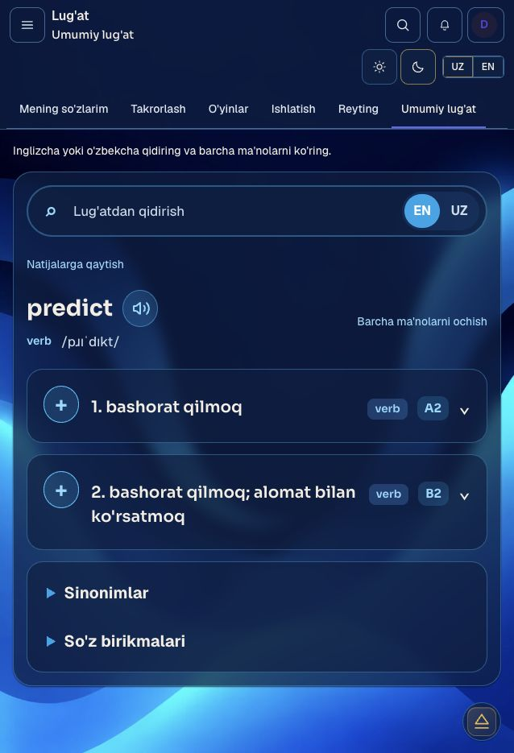
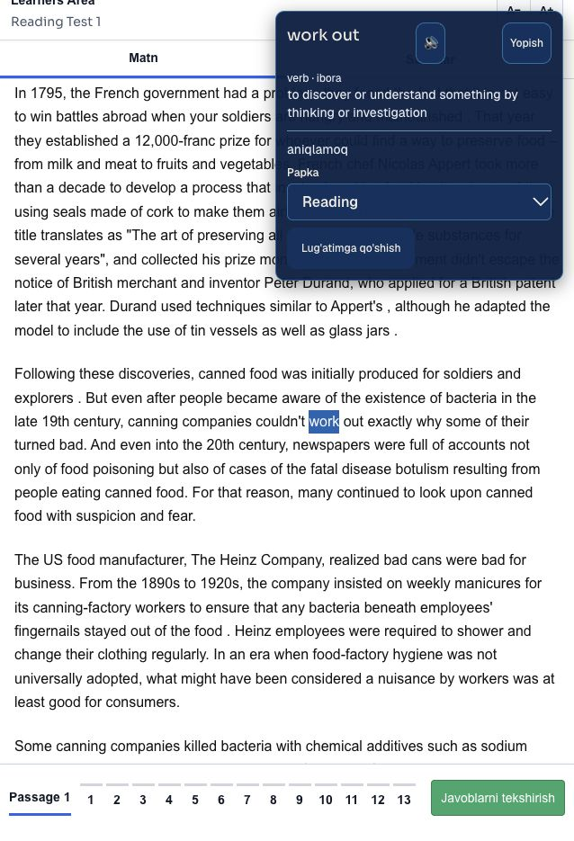

# Dictionary: private R2 index and payload delivery

This is the continuation of PR54. The existing Dictionary APIs, saved vocabulary, folders, SRS, owner drafts and publication flow remain authoritative. Large search postings/previews and full entries live in private R2. PostgreSQL keeps canonical identities, hashes, numeric locations, release controls, mappings and user data.

## Current status and source

The prepared candidate is `rel-v1-e7fa84dde5eec2f502957489`, with **64,616 entries / 109,487 senses**. Its [review plan](evidence/dictionary-worker-production-plan-20261020.json) pins the prepared package, migration and exact course-correction hashes. This file is a review artifact, **not approval to run it**.

The approved upstream source is repository `N-Muhammadjonov/learners-area-dictionary`, commit `64af9c187dee17f2e12eee9b1a4587ab675caa47`. All original **62,376 entry IDs, 105,488 senses and 81,099 examples**, English/Uzbek text, attribution and source forms are unchanged. New forms and senses are additive. See [source preservation](evidence/dictionary-source-preservation-20261020.json).

Material coverage was inspected across 105 Reading passages, 75 Retention texts and 31 nonempty full Listening transcripts. Listening Test 10 and MCQ-day records did not contain full transcripts in the supplied source; missing text was not invented. The 3,851 authored glossary identities are represented. The candidate adds 2,240 entries, 3,845 course senses, 154 attested grammatical senses and 5,377 regular corpus-attested inflection search forms. Inflection aliases never assign a contextual sense.

The exact-ID plan corrects 256 empty/generic course meanings. Context matters: seasoned wood means dried timber, reflection refers to light, and hygiene factors refer to workplace conditions. Original editorial paraphrases, owner-supplied translations, primary English fact checks and AI translation drafts retain separate provenance. These additions have **no claimed independent human review**. Cambridge/Oxford references identify fact checks, not a license to copy their complete dictionaries. Remaining token forms are an explicit review queue; lexical coverage is not declared complete. See [coverage](evidence/dictionary-course-coverage-20261020.json).

## Runtime path

1. The existing Next API checks the session, active account, suspension/revocation, rate limit and stable release on every request.
2. It selects only that release's small routing descriptor for the normalized direction/initial. It sends a 15-second HMAC proof bound to the exact body, purpose and audience to the dedicated `learnersarea-dictionary` Worker.
3. The Worker verifies the proof **before cache or storage access**, loads a small immutable routing page and one relevant leaf/common-prefix page, then returns at most 20 previews. Hot parsed pages require no R2 reads. Cold lookup never scans all partitions or loads the full catalog.
4. Entry details use one bounded R2 Range read for an independently compressed entry member inside one of 256 UUID-prefix objects. Object size/range, bounded decompression, schema, release, canonical IDs and semantic content hash must all match.
5. Saving still resolves the selected sense through the existing canonical mapping and persists through the existing Vocabulary/folder/SRS service. History remains the user's last five searches.

Normalization and exact/form/prefix ranking remain compatible. EN/UZ directions are independent; an Uzbek preview uses the actual matching translation, preferring exact to prefix. ICU en-US ordering is compiled into numeric ordinals, avoiding runtime locale drift. Per-term top 20 per rank is sufficient for exhaustive top-20 results.

The thin gateway was chosen over direct browser access because it retains immediate account/release revocation and existing request contracts. No browser signing secret, public R2 bucket, new CORS exposure or long-lived authorization cache is introduced. The Worker has no second eventually consistent active-release pointer.

## Budgets, security and failure behavior

- Prefix pages/bundles target 128 KiB raw. Immutable descriptors bind compressed/raw SHA-256 and lengths. Index decode has a 2 MiB hard raw limit; packed entry members have stricter per-entry bounds.
- Parsed isolate cache has a 24 MiB conservative accounted budget, five-minute TTL and LRU eviction. At most four actual loads and 48 MiB conservative loading reservations are admitted. Concurrent identical reads coalesce; overload fails with a bounded error.
- Edge cache contains only verified immutable bytes, keyed by release and hash. Errors and corrupt/mismatched data never populate it.
- Requests have a 16 KiB body ceiling. Next-to-Worker fetch has a ten-second deadline and rejects redirects. Unknown keys, arbitrary URLs and extra request properties are refused.
- Client debounce is 150 ms. Up to eight user-scoped immutable entry snapshots may paint provisionally; fresh authenticated API state always determines access and saved status. A failed fresh check clears provisional content. Unmount invalidates its retained keys.
- Existing media Worker, media authorization, audio URLs, R2 privacy and unrelated app modules remain unchanged.

Cloudflare's [Workers limits](https://developers.cloudflare.com/workers/platform/limits/) specify the Free CPU/memory constraints. The small routes and per-entry ranges address cold parse/decompression costs, but **production Free CPU acceptance still requires actual telemetry**. Worker clocks may not advance during CPU-only work; `Server-Timing: 0` is not proof of zero CPU. Local workerd numbers are not global/production latency. No paid upgrade is authorized.

## Owner publication and recovery

The existing job copies compact identity/location metadata, applies reviewed drafts to bounded R2 groups, validates original IDs/source text, and builds the candidate index without creating a full PostgreSQL JSONB or term-index clone. A bundled Node worker thread has a 160 MiB old-heap budget and a disposable parent-owned disk spool. This keeps catalog build CPU out of the Next event loop. Each emitted immutable object is bounded.

`worker_index` uses a durable compare-and-swap lease, 45-second expiry and two-second account/base/lease checks. It works through transaction pooling. A restart retains the same candidate/job. An explicit retry resumes only an index-build failure on that unchanged job/base; it does not activate a partial release. Owner UI exposes the existing publication progress and explicit retry.

Activation verifies every referenced immutable object, canonical inventories, owner and expected base before changing the channel atomically. Rollback selects the retained previous validated release. First installation rolls back to the recorded uninitialized channel; it never invents an older active release. User vocabulary/SRS and immutable R2 objects are retained.

Migration `0065_dictionary_worker_index.sql` is additive: release delivery mode, RLS-protected immutable index controls, numeric entry ranges, a minimal custom-entry flag and durable job lease fields. Range columns must be either fully absent or fully valid. Retired release manifests remain immutable. It does not modify personal vocabulary.

A separate guarded retirement action can remove the **unused** legacy PostgreSQL index after new-release acceptance. It refuses active/previous releases, borrowed shard sources, running/referencing jobs, mismatched manifests or missing mapped senses. It retains provenance/manifest and all old R2 objects. Only an entirely unused term table is truncated to release allocated pages; normal row deletion alone does not promise physical database shrinkage.

## Production checkpoint and approval

Historical executed production work under the **old** approval: migration 0064, the original 62,376-entry private R2 import and validated legacy release `rel-v1-a834010a6ccc72c8b3cd8db9`. It was **not activated**. The last read-only receipt recorded 13 personal vocabulary rows, 386,444,435 database bytes and 302,301,184 bytes in the old term table. These are dated observations, not a fresh production claim.

The old plan SHA `268a15f0a320b34b1d0e766ce253e7fcab440c6d32ed21e80c7510e326ed9bfa` does **not** approve this architecture. New approval must explicitly cover merge, 0065, dedicated Worker, matching service secret/settings, immutable uploads, exact course corrections, deployment, activation and later guarded retirement. No production mutation is part of package preparation or tests.

`worker-release.ts inspect` is offline. Mutating modes require the exact reviewed approval-document SHA, prepared/migration/correction hashes, Railway project/environment/service and expected deployed revision, active owner, matching completed current native QA, a verified application backup/restore within 24 hours and the explicit baseline revision. Stage has a Free-plan capacity check and never activates. Migration verifies every prior journal hash with a five-second lock timeout. No credentials or private backup rows belong in Git.

After approval: fresh backup/isolated restore and target check → exact migration → compatible Worker/Next deployment with matching secrets → immutable stage/import → authenticated staged acceptance → explicit activation → normal-student browser search/detail/exact-save/history checks → latency/CPU/error observation → separately guarded retirement. Roll back the active pointer if acceptance fails. The live site never depends on the Mac or its temporary QA files.

## Verification and reproducibility

The prepared package contains 256 packed payload objects (85,226,623 bytes) and 1,652 index/control objects (51,578,087 bytes), plus its release manifest. The bounded disk build completed in 156.5 seconds with a 160 MiB old-heap limit; observed CLI RSS was 315,840 KiB, including the TypeScript runner. This is an offline preparation measurement, not Worker memory or production request latency.

Use Node 24 and the existing dependencies:

```sh
node --conditions=react-server --import tsx scripts/dictionary/enrich-course.ts VERIFIED_PREPARED MATERIAL_CORPUS.json NEW_SOURCE.json.gz
node --conditions=react-server --import tsx scripts/dictionary/prepare-enriched.ts NEW_SOURCE.json.gz NEW_DIRECTORY
node --max-old-space-size=160 --conditions=react-server --import tsx scripts/dictionary/prepare-bounded-index.ts NEW_DIRECTORY
```

These commands read material-only inputs and never connect to production. Existing scripts refuse overwrite or mismatching immutable bytes. `--verify` on the index builder compares a deterministic rebuild only when a new failure/change warrants it.

Keep type/lint/build, in-process PostgreSQL fixtures, source preservation, UI simulations, native PostgreSQL, actual local workerd/native R2 range behavior, browser HTTP QA and production telemetry as distinct evidence. The current [acceptance status](evidence/dictionary-worker-status-20261020.json) records remaining gates. Do not describe a local success or an older candidate's receipt as production acceptance.

The final candidate also passed [native PostgreSQL + actual local workerd acceptance](evidence/dictionary-worker-native-20261020.json): all 64,616 ICU-ordered identities, 22 exhaustive search cases, all 3,851 course mappings, 256 idempotent guarded corrections and 13 existing saved rows preserved. Dictionary relations occupied **40,648,704 bytes** with zero PostgreSQL search-term or payload/preview rows for this release. Warm local store-to-Worker p50 was 3.1–4.1 ms and p95 4.5–9.2 ms; the first mixed cold search was 391.8 ms, and first entry read 17.4 ms. These are loopback/native-development measurements, not production promises.

[Actual local Next HTTP and browser QA](evidence/dictionary-worker-http-20261020.json) used a fictional isolated student and a test-only signing key. The browser searched/opened/saved the contextual timber sense of `properly seasoned`. Duplicate save preserved SRS; the original 13 records remained intact. Anonymous, student-to-owner, cross-origin, suspended-account, revoked-auth-epoch and stale-release requests were denied. Warm development HTTP search p50 was 41.6–42.3 ms, p95 60.8–109.2 ms; entry p50 49.9 ms, p95 125.3 ms (10 samples each). Development compilation and local transport prevent extrapolating these to production/global latency. The monotonic auth-epoch guard correctly refused an attempted QA teardown decrease; the fixture keeps the newer epoch and requires a fresh QA login.


## Dictionary presentation and contextual lookup

The learner Dictionary keeps the site's blue translucent surfaces and wallpaper in both themes. The active section title sits below the menu/module label inside the blue header. On mobile/tablet it aligns with day/night controls; desktop uses a full-width title row. Speaking is excluded. Vocabulary, Reading, Listening, Grammar and Writing reuse their real section links inside that fixed blue header. TED/Podcast links reuse the existing server-loaded catalogue and appear in the same header without a second data fetch. There is no second body heading. Search and EN/UZ stay at the top of the Dictionary, including the entry view. A speaker next to the headword uses browser English speech synthesis on an explicit click and reports unavailable playback. It does not invent a recorded pronunciation URL.

Each meaning has a separate exact-sense `+` save control and independent definition/example accordion. Word-level synonyms and attested combinations are expandable; missing examples or combinations are not fabricated. Reference brands and external fact-check links are absent from learner cards; immutable attribution and editorial provenance remain in source/control metadata.

Reading, Listening and Retention require a double click or a stationary three-second hold on actual text and preserve authored multiword/occurrence identities. Context Dictionary panels now dock at the top right of the viewport, with safe-area margins and bounded scrolling, independently of the clicked word or passage scroll. Both known session-sense and generic authored Listening panels use that dock. Academic attempt-ID vocabulary restrictions remain. Published General passage lookup and answer checking are independent even during an overlapping Academic attempt, as explicitly approved by the owner on 2026-10-20.

[Current UI evidence](evidence/dictionary-ui-20261020.json) records 42 passing UI cases and 98 affected core cases (97 in the batch, then the repaired heading-source contract passed separately), plus actual local browser inspection at 480 and 1440 CSS pixels. The browser checked the blue header/palette, headword pronunciation playback callbacks, single-click suppression and the top-right Reading lookup. These are local results; they do not claim production deployment or independent human content review.





## Current contextual repair and limits

Resolved learner cards omit the editorial-status sentence and separate English definitions from Uzbek translations with a horizontal rule. Internal provenance/review status remains unchanged. The General Reading test toolbar no longer reads the entire passage aloud; individual Dictionary pronunciation remains available.

The material-wide audit covers all 105 Reading passages, 75 Retention texts and 31 non-empty full Listening transcripts. The supplied Listening Test 10 transcript is empty; MCQ day records do not supply a full transcript. The audit found 3,404 legacy Reading spans using paragraph-local offsets against whole passages. The pinned `content/dictionary/occurrence-corrections.json` recovers them in 104 passages only when the unchanged authored sentence and whole word/phrase uniquely prove the location. It preserves occurrence IDs, lexeme/sense identities, text, personal Vocabulary and SRS. Source hashes, before/after offsets and collisions are checked under one atomic lock; meaning corrections and occurrence corrections share the release-stage transaction. The new approval document must pin `occurrenceCorrectionsSha`.

[Native contextual QA](evidence/dictionary-context-native-20261020.json) applied all 3,404 repairs, repeated them idempotently, rejected altered source hashes and preserved all 15 current QA saved rows (13 restored originals plus two fictional QA saves). Reading now has 3,819 valid spans out of 3,921; 102 ambiguous or absent-source spans remain unchanged. Listening has 1,183 valid spans, of which 826 remain unresolved; Retention has 431 valid spans, of which 55 remain unresolved. The unresolved 881 spans do not authorize a guessed meaning. These counts concern authored links, not every token in every text.

The remaining 2,167 raw corpus forms still need lexical triage. No claim is made that every word has a contextual sense or that all definitions have independent human semantic review. Reading lexemes lack a stored equal example sentence; that absence alone is not proof of an incorrect meaning. The browser separately confirmed recovered `work out` opens the entire phrase with `aniqlamoq`, with the divider, no editorial-status line and no whole-passage read-aloud button.

## Reading filter consolidation and title size

Reading now has four header sections: Lessons, Academic Reading, General Reading and Retention. The retired Question Types URL and legacy `tab=types` bookmarks redirect to General Reading while preserving compatible filters; known type aliases normalize before the redirect. Unknown question types retain their existing not-found response and the active-account gate remains in place. No question or passage rows are deleted. The obsolete redirect route is no longer warmed on intent.

General Reading keeps its full-width search above passage/status chips, followed by topic and question-type dropdowns. Its type facets reuse the canonical registry and authored ternary choices used by its passage cards and filter query, merge historical aliases and count distinct published passages once. The non-learning catalogue facet contract is unchanged. This needs no schema migration.

Module section titles now use the large Listening-style display scale (24px below 640px, 30px at 640px and above) inside the blue topbar below its menu/module label, instead of the previous 14px label beside the menu. On mobile/tablet it shares the second row with day/night controls; desktop keeps the separate full-width title row. This shared title applies to Reading, Listening, Vocabulary, Writing, Grammar and TED/Podcast. Speaking remains unchanged at the owner’s explicit request. The Reading filter panel has an explicit stacking layer above passage cards and below the pinned header. Topic menus align to their left edge; below 640px the fields and menus use the available panel width so leading letters cannot leave the viewport. Browser hit-testing verified both topic and type dropdowns remain on top where they overlap a card.

See [the current filter/header receipt](evidence/reading-general-filter-header-20261020.json) and its screenshot for this subsequent change. Earlier UI receipts remain dated historical evidence; this receipt supersedes their five-section Reading navigation and smaller title scale.


## Single-passage General practice and responsive catalogues

MCQ cards fill available width (four columns at 1440 CSS pixels). Academic renders all 33 complete tests on one page; legacy page URLs canonicalize to that list. General cards form a flat passage library without Test group labels. General opens one passage only, with a count-up stopwatch, editable autosaved answers and explicit Check; no Academic timeout locks it. Legacy full/chooser URLs canonicalize to the first passage. The owner explicitly approved General use alongside an overlapping active Academic test; owned Academic attempt/review access, user ownership, publication and occurrence membership checks remain enforced.

The shared real-word lookup supports double click or a stationary three-second primary hold, preserving authored phrases and occurrence IDs. Release, movement, cancellation, leaving the text and blank areas cancel the hold. Yellow highlights include whitespace with square edges, and the reading workspace's white CSS variables are scoped to its own root rather than the body. Actual browser Back returned to identical blue card/topbar colours. Phone menus stayed within 39–441px in a 480px viewport and hit-testing found them above cards.

[Current practice receipt](evidence/reading-practice-20261020.json): 16 unique UI cases and 12 database/route cases pass, including 33-set coverage, independent General save/Check during Academic, continued Academic/foreign-source denial, phrase holds, stopwatch, answer feedback races and highlight isolation. The full production build (including type validation) and whole-repository ESLint pass. These checks used an isolated database and fictional account. Production remains unchanged pending fresh approval for the optimized Dictionary deployment.
