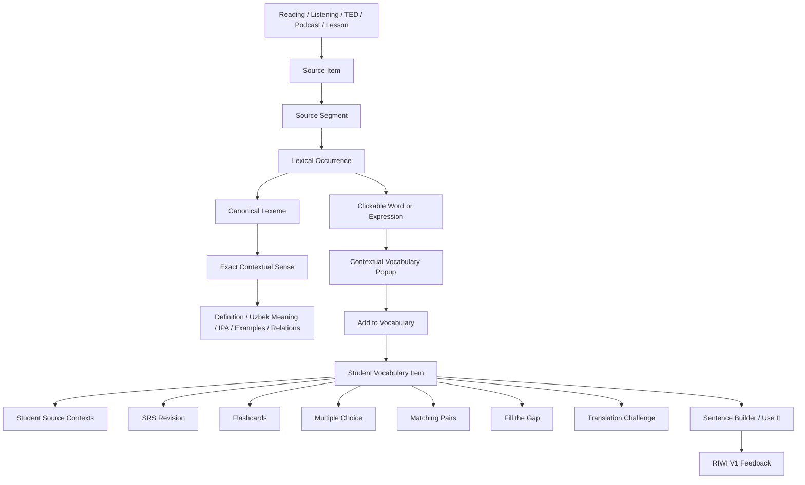
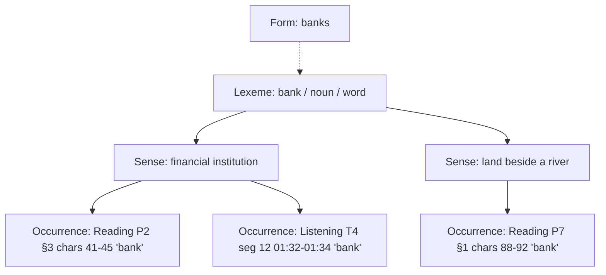
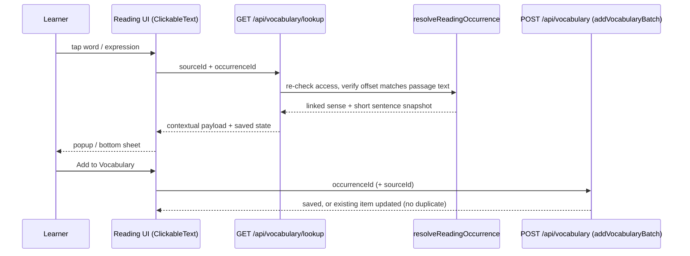
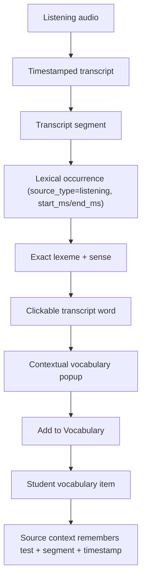
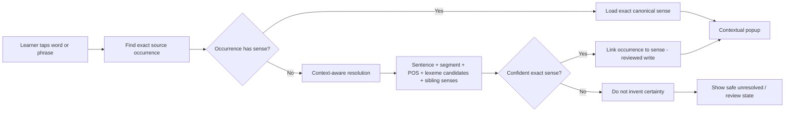
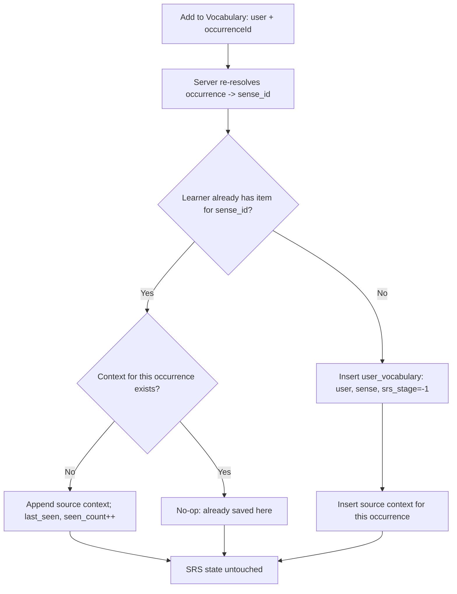
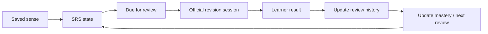
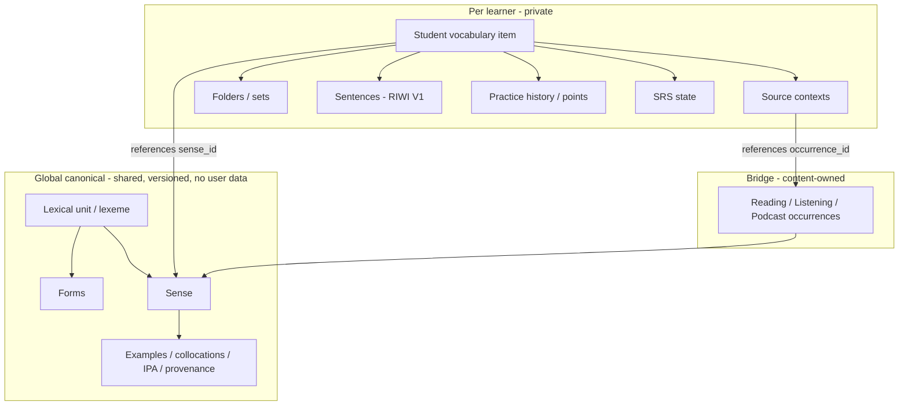
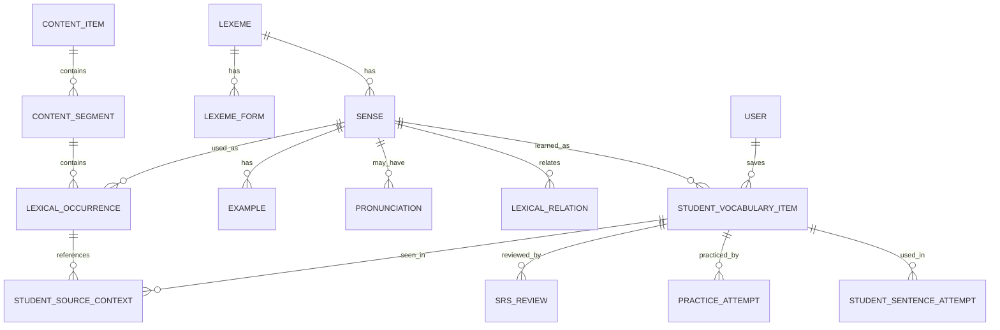
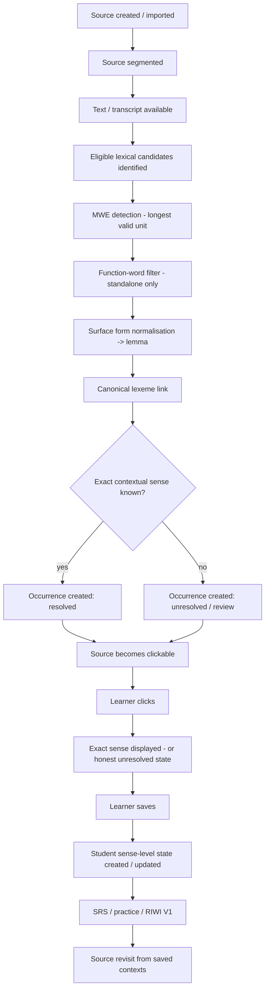

# Learners Area — Vocabulary System Architecture

Status: **architecture specification + audited gap analysis.** Audited at HEAD `5476015`.
This document does **not** claim the target architecture is implemented. Section B2 says,
row by row, what exists today and what does not. No schema change described here has been
applied; every migration in B12 is a proposal awaiting owner approval.

The four questions every part of the system must answer, and never mix up:

| Question | Layer | Today in the repo |
|---|---|---|
| WHAT lexical unit is this? | **Lexeme** | *not a separate table* — implied by `lexemes.term` + `part_of_speech` |
| WHICH meaning is intended? | **Sense** | `lexemes` row (one row = one sense, identity `sense_key`) |
| WHERE was it met? | **Occurrence** | `lexical_occurrences` (Reading only) |
| WHAT has THIS learner done with it? | **Student state** | `user_vocabulary`, `vocabulary_usages`, `vocab_point_events`, `vocab_folders` |

---

# LAYER A — The five-year-old explanation

### Toy boxes, toys and photographs

- A **lexeme** is a toy box with a name on it: **bank**.
- A **sense** is one toy inside the box. The "bank" box has two toys: a *money bank* and a
  *river bank*. Same name on the box, different toys.
- An **occurrence** is a photograph showing exactly where one toy was seen:
  "page 2 of the Reading, third sentence: *She put her salary in the bank.*"
  On the back of every photo we write which toy it shows.

### Why one word can mean two things
"She put money in the **bank**." → the money toy.
"They sat on the river **bank**." → the river toy.
The letters are the same. The toy is different. So Learners Area never asks
"what does *bank* mean?". It asks **"what does *bank* mean HERE?"**, and the photo
already tells it.

### How Reading sends words
When a Reading passage is added, a helper goes through it once and takes a photo of every
useful word or phrase, writing on the back which box and which toy it is.
Little words like *the*, *of*, *and* get no photo on their own. But phrases that are
useful as a whole, like *take into account*, get **one** photo as one toy.

### How Listening sends words
Listening does exactly the same with the transcript. Its photos also say *when* the word
was heard ("at 1 minute 32 seconds"). Listening does **not** get its own toy boxes. It
uses the same boxes as Reading.

### What happens when you tap a word
You tap "bank". The app looks at the **photo** for that exact spot and opens the toy written
on the back. It does **not** run to the box and grab whichever toy is on top.
If nobody has written on the back of the photo yet, the app says honestly
"we haven't checked this meaning yet". It never guesses.

### What happens when you press "Add to Vocabulary"
You don't get a copy of the toy. You get a **sticker in your own notebook** that says
"I am learning *this* toy" and "I first saw it *here*".
The toy itself stays in the shared toy room for everybody.

### Why you don't get duplicates
If you meet the money-bank toy again in Listening, the app sees you already have a sticker
for that toy. It just adds a second little picture next to your sticker: "also seen here".
If you meet the **river** bank, that's a different toy, so it gets its own sticker. Your
money-bank progress is never overwritten.

### How you practise later
Your notebook decides when each toy needs another look (**spaced repetition**).
Flashcards and games let you play with your toys. Writing your own sentence and having RIWI
check it shows you can really *use* the toy. And each sticker can take you back to the
photo where you first met the word.

---

# LAYER B — Engineering specification

## B1. Vocabulary
| Term | Meaning | Must never be confused with |
|---|---|---|
| word / surface form | the exact characters in the source: `running`, `Banks` | lemma |
| lemma | canonical citation form: `run`, `bank`, `take into account` | surface form |
| lexeme | language + normalized lemma + part of speech + lexical type | a sense |
| inflected form | a surface realisation of a lexeme (`ran` → `run`) | a new lexeme |
| sense | ONE meaning of ONE lexeme | the lexeme; the first dictionary result |
| occurrence | ONE appearance of a sense at ONE position of ONE source segment | a source; a sense |
| source context | the learner-visible snapshot of an occurrence attached to a saved item | an occurrence row |
| student vocabulary item | ONE learner × ONE sense learning state | a dictionary row |
| review state | SRS stage / interval / due date / history of a student item | dictionary data |

## B2. Current state map (audited, file by file)

| Concept | Current equivalent | Notes |
|---|---|---|
| Lexeme | **none as a table.** `lexemes.term` + `lexemes.part_of_speech` | The table named `lexemes` actually stores senses |
| Sense | `lexemes` row (`src/db/schema.ts`); identity `sense_key` = norm(term)+norm(POS)+norm(definition) (`services/vocabulary/dedupe.ts`), unique index `lexemes_sense_key_idx` | "bank (money)" and "bank (river)" already coexist as two rows ✔ |
| Lexeme forms / inflection | **none.** Surface→lemma mapping only happens inside an import package (`surface_form` stored on the occurrence) | no runtime lemmatiser, no `lexeme_forms` |
| Lexical type / MWE | **none as a column.** MWEs exist only as multi-word `term` strings; `occurrence_type` (free text) on occurrences | |
| Function-word status | **none as a column**; `is_target_vocabulary` on occurrence marks learnable spans | |
| Pronunciation / IPA | **none** | |
| Examples | `lexemes.example_sentence` (single) | |
| Relations / collocations | `lexemes.collocations` (text, "·"-separated) | |
| Provenance / verification | `lexemes.provenance`, `verification_status`, `import_batch` (0017) | `user_provided` rows excluded from catalogue lookup ✔ |
| Content item / segment | Reading: `reading_passages` + `reading_passage_paragraphs`. Listening: `listening_tests`, `listening_packages`. TED: video lessons | no universal content-segment table |
| Occurrence | `lexical_occurrences(lexeme_id, passage_id NOT NULL, segment_key, surface_form, start_char, end_char, sentence_text, occurrence_type, is_target_vocabulary)`, unique (passage, start, end) | **Reading only**: no Listening segment, no timestamps |
| Click resolution — Reading | `ClickableText` → `GET /api/vocabulary/lookup?sourceId&occurrenceId` → `resolveReadingOccurrence` (`services/lexical/context.ts`): re-checks access, verifies the offset still matches the passage text, returns the linked sense ✔ | deterministic, occurrence-first ✔ |
| Click resolution — Listening | `ClickableText` (`catalogueLookup`) → `GET /api/vocabulary/meaning?sourceId&q=<word>` → `enrichTerm(term)` | **string lookup** (see GAP-1) |
| Click resolution — fallback | `GET /api/vocabulary/search?q=<word>` | library search, not contextual |
| Enrichment boundary | `services/lexical/enrichment.ts`: catalogue first (returns **null if >1 sense** ✔), then registered adapters; empty definition rejected ✔ | |
| Student vocabulary item | `user_vocabulary(user_id, lexeme_id → sense, sense_key, state, srs_stage, mastery, counts, interval_days, next_review_at, …, source_type, source_id, source_snapshot jsonb, folder_id, topic_pack)` | SRS lives in student state, not the dictionary ✔ |
| Save / dedup | `addVocabularyBatch` (`services/vocabulary/engine.ts`): per-learner serialised transaction, dedup by `canonicalLexemeId` or `sense_key` ✔ | |
| Source contexts | `user_vocabulary.source_snapshot` — **one** jsonb | a second source cannot be appended (GAP-3) |
| SRS | `services/vocabulary/srs.ts` (intervals 1/3/7/16/35 d), `applyScheduledReview` | authoritative; keep |
| Practice / games | `services/vocabulary/game-round.ts`, `game-routes.ts`, `recordGameAnswer`, points ledger with dedupe keys | games do not schedule SRS ✔ |
| Sentence / RIWI V1 | `vocabulary_usages(user_vocabulary_id, sentence, origin, riwi_accepted, evaluation_id)`; `recordSentenceUse` → `confirmSentenceUse` | target sense reachable via `user_vocabulary.lexeme_id` ✔ |
| Search | `services/vocabulary/search.ts` (`matchRow`, `searchRows`) — lowercase + trim only | **no apostrophe folding in search** (GAP-10) |
| Tests | `lexical-context`, `lexical-enrichment`, `lexical-normalization`, `lexical-migration-db`, `vocabulary-engine`, `vocabulary-integrity-db`, `reading-105-dry-run`, … | |

### Gaps, ranked

| ID | Severity | Gap | Why it matters |
|---|---|---|---|
| **GAP-1** | **P0 correctness** | Listening click = `enrichTerm(word)`. If the catalogue holds exactly one sense for that spelling, it is returned as "contextual" even when the transcript uses a different sense (catalogue has only *bank = money*; transcript says *river bank*) | violates rule 14/16: shows a confidently wrong meaning |
| GAP-2 | P1 | No Listening/TED/podcast occurrences: `lexical_occurrences.passage_id` is NOT NULL; no transcript segment, no timestamps | rule 18: Listening cannot be occurrence-first |
| GAP-3 | P1 | One `source_snapshot` per saved item | rule 23: second source context is lost |
| GAP-4 | P1 | No lexeme layer above senses | sibling senses, "other meanings" view and POS-split lexemes are not representable |
| GAP-5 | P2 | No `lexeme_forms`; inflection handled only by import packages | rule 9 for runtime and new content |
| GAP-6 | P2 | No `lexical_type` / function-word flag | rules 11/12 enforced only by the importer's data |
| GAP-7 | P2 | No pronunciation table | popup IPA |
| GAP-8 | P3 | `first_seen/last_seen/seen_count` absent | exposure tracking |
| GAP-10 | P2 | Search does not fold Uzbek apostrophe variants (`ʻ ’ ‘ ʼ`); three separate normalisers disagree | "oʻqish" vs "o'qish" miss each other |
| GAP-9 | content | reading-105 import blocked by one sense-key collision ("literacy", noun) | see `docs/receipts/N16-reading-105-dry-run.md` |

## B3. Desired state map (target, mapped onto real names)

The key decision: **stable IDs are preserved by keeping today's `lexemes` table as the
SENSE table.** Every existing `user_vocabulary.lexeme_id`, `lexical_occurrences.lexeme_id`
and `vocabulary_usages` chain stays valid with no rewrite. A new parent table
(`lexical_units`) becomes the lexeme. Code may alias `lexemes` as `senses`; the
physical rename is optional and not required.

| Logical entity | Target physical table | New / existing |
|---|---|---|
| LEXEME | `lexical_units(id, language, lemma, lemma_norm, part_of_speech, lexical_type, is_function_word, provenance, release_version)`, unique (language, lemma_norm, part_of_speech, lexical_type) | **new** |
| LEXEME_FORM | `lexical_unit_forms(lexical_unit_id, form, form_norm, form_type)` | **new** |
| SENSE | `lexemes` (+ nullable `lexical_unit_id`, `sense_status`, `superseded_by`) | existing, extended |
| PRONUNCIATION | `sense_pronunciations` or unit-level `lexical_unit_pronunciations(ipa, variant, audio_key)` | **new** |
| EXAMPLE / RELATION | keep `example_sentence`, `collocations`; later `sense_examples`, `lexical_relations` | existing → optional new |
| CONTENT ITEM / SEGMENT | existing per-module tables; occurrence gets typed source columns (below) | existing |
| LEXICAL_OCCURRENCE | `lexical_occurrences` + `source_type`, nullable `passage_id`, `listening_source_id`, `segment_key`, `start_ms`, `end_ms`, `lexeme_id` **nullable** + `resolution_status` (`resolved` / `unresolved` / `review`) | existing, extended |
| STUDENT_VOCABULARY_ITEM | `user_vocabulary` (+ `first_seen_at`, `last_seen_at`, `seen_count`) and a unique index (user_id, lexeme_id) after a dedup audit | existing, extended |
| STUDENT_SOURCE_CONTEXT | `user_vocabulary_contexts(user_vocabulary_id, occurrence_id NULL, source_type, snapshot jsonb, seen_at)`, unique (user_vocabulary_id, occurrence_id) | **new**, backfilled from `source_snapshot` |
| SRS_REVIEW | `user_vocabulary` SRS columns (+ review events already in the points ledger) | existing |
| PRACTICE_ATTEMPT | game answers + `vocab_point_events` | existing |
| STUDENT_SENTENCE_ATTEMPT | `vocabulary_usages` | existing |

---

## Diagram 1 — Full Learners Area vocabulary architecture



Every box in plain words:
- **Source Item**: a whole Reading passage, Listening test, TED talk or podcast episode.
- **Source Segment**: the smallest addressable piece: a paragraph, or a transcript segment with a time range.
- **Lexical Occurrence**: "this exact span, in this segment, is this sense". The bridge between content and the dictionary.
- **Canonical Lexeme**: the one shared dictionary entry for the lexical unit (`run`, `take into account`).
- **Exact Contextual Sense**: the one meaning the occurrence points to.
- **Definition / Uzbek / IPA / Examples / Relations**: data that belongs to the sense (or its lexeme), stored once for all sources.
- **Clickable Word**: the rendered span. It carries the occurrence id, not just text.
- **Contextual Popup**: shows that sense and that sentence.
- **Add to Vocabulary**: creates or updates a student item that *references* the sense.
- **Student Vocabulary Item**: one learner × one sense.
- **Student Source Contexts**: every place this learner met this sense.
- **SRS Revision**: the official schedule (`srs.ts`).
- **Flashcards … Translation Challenge**: practice modes over saved senses. They award points but do not move the SRS schedule.
- **Sentence Builder / Use It → RIWI V1**: the learner writes their own sentence for the target sense; RIWI V1 judges it.

## Diagram 2 — Lexeme → Sense → Occurrence



One lexeme, two senses, three occurrences. Occurrences never point to a lexeme without a
sense in the resolved state; they point to the **sense**, and the sense knows its lexeme.

## Diagram 3 — Reading → Vocabulary flow



This path **exists today** and is occurrence-first. The client never sends a definition;
the server re-resolves the occurrence on save, so a tampered request cannot attach a
different meaning.

## Diagram 4 — Listening → Vocabulary flow (target)



**Today** Listening stops after step C and jumps to a string lookup (GAP-1/GAP-2). The
target reuses the same `lexical_occurrences` table and the same lookup route with an
occurrence id. Listening has no separate vocabulary store, today or in the target. The
established loop (Exam → Revision → Evidence/Transcript → Keywords/Paraphrases → Speed
Training → Vocabulary) feeds this same pipeline.

## Diagram 5 — Word click → exact contextual sense resolution



Rules:
- Forbidden: `search(clickedText)[0]`. Also forbidden: "the catalogue has exactly one sense,
  therefore it is the contextual one". Single-sense-in-catalogue is **not** evidence of context.
- The production path is the top line. Resolution runs at ingestion/enrichment, not per click.
- Runtime resolution, if ever enabled, may only *propose*. Writing `occurrence.lexeme_id`
  is a reviewed enrichment action, never a side effect of a learner's click.

## Diagram 6 — Add to Vocabulary deduplication



The whole flow runs inside the per-learner serialised transaction that `addVocabularyBatch`
already uses, so a double click or two tabs cannot create two items. A different sense of
the same lexeme (river vs money bank) takes the **No** branch and gets its own item; the
other item's progress is untouched.

## Diagram 7 — Student vocabulary + SRS flow



SRS lives only on `user_vocabulary` (`srs_stage`, `interval_days`, `next_review_at`,
`mastery`, counts), driven by `srs.ts` / `applyScheduledReview`. A new occurrence of an
already-saved sense updates exposure and contexts, **never** the schedule. Games award
points through the dedupe-keyed ledger and do not move `next_review_at`.

## Diagram 8 — Canonical dictionary vs student state



Arrows only point **from** student state **to** global data. Nothing in GLOBAL holds a
user id, an SRS field or a learner sentence. Saving copies no definition into the user
table.

## Diagram 9 — Logical ER diagram



Name mapping: LEXEME = `lexical_units` (new) · SENSE = `lexemes` · LEXICAL_OCCURRENCE =
`lexical_occurrences` · STUDENT_VOCABULARY_ITEM = `user_vocabulary` · STUDENT_SOURCE_CONTEXT =
`user_vocabulary_contexts` (new) · STUDENT_SENTENCE_ATTEMPT = `vocabulary_usages` ·
PRACTICE_ATTEMPT = game answers + `vocab_point_events` · CONTENT_ITEM/SEGMENT = module tables
(`reading_passages`/`_paragraphs`, Listening tables). Existing names win.

## Diagram 10 — End-to-end lifecycle



---

## B4. Lexeme and sense identity
- **Lexeme identity:** `(language, lemma_norm, part_of_speech, lexical_type)`. `record` noun
  and `record` verb are two lexemes. `shed pounds` (verb phrase) is its own lexeme, not
  `shed` + `pounds`. The same unit in Reading, Listening and TED is **one** lexeme with
  several occurrences.
- **Sense identity:** `(lexeme, sense_key)`. Today `sense_key` = normalized term + POS +
  definition (`dedupe.ts`). Distinct definitions ⇒ distinct senses; the same definition
  re-imported ⇒ the same row (`onConflictDoNothing` on `sense_key`). Released sense ids are
  durable; supersession uses `superseded_by`, never deletion or regeneration.
- **Known identity hazard:** two definitions that differ by a phrase become two senses.
  That's what currently blocks reading-105 ("literacy"). The resolution is an editorial
  decision, never an automatic merge.

## B5. Inflections, MWEs, function words
- **Inflection:** `lexical_unit_forms` maps `runs/running/ran → run`. The occurrence stores
  the surface form verbatim and points to the sense of `run`. No new dictionary row, no new
  student item.
- **MWE:** candidates are matched longest-first against known multi-word units (and their
  inflected forms: `shed/sheds/shedding pounds`). A matched MWE span suppresses the
  single-word occurrences inside it as *target* vocabulary.
- **Function words:** a standalone `the/of/to/and` is never `is_target_vocabulary`; a
  function word **inside** an accepted unit (`take into account`) does not disqualify it.

## B6. Click API contract
Request (occurrence-aware, existing route kept):
`GET /api/vocabulary/lookup?sourceId=<attempt|passage|listening source>&occurrenceId=<uuid>`

Response (existing names preserved; additions marked +):
```json
{
  "contextual": { "definitionEn": "...", "translationUz": "...", "verificationStatus": "verified|unverified|null", "sourceLabel": "Learners Area catalogue" },
  "known": { "id": "<user_vocabulary.id>", "mastery": "learning" },
  "+occurrence": { "surfaceForm": "running", "sentence": "...", "sourceType": "listening", "startMs": 92000 },
  "+sense": { "id": "<lexemes.id>", "lemma": "run", "partOfSpeech": "verb", "lexicalType": "word", "ipa": null },
  "+status": "resolved | unresolved"
}
```
- An `unresolved` occurrence returns `contextual: null` with `status: "unresolved"`, and the
  popup says the meaning is not checked yet. No adapter result is shown as contextual.
- `GET /api/vocabulary/meaning?q=` (string) must stop presenting a result as *contextual*
  (GAP-1). It may remain only as an explicitly labelled "dictionary search", never in the
  primary popup slot.

## B7. Save flow
`POST /api/vocabulary` with `occurrenceId` (+ `sourceId`): the server resolves the sense
from the occurrence (as `resolveReadingOccurrence` does today), then follows Diagram 6.
The client never supplies definition, translation or sense id for an occurrence save.

## B8. Student state, SRS, practice, RIWI V1
- Student-only fields: saved state, folder, topic pack, contexts, first/last seen,
  seen count, mastery, SRS fields, review history, sentences, practice history, points.
- **SRS:** `srs.ts` stays authoritative; no new algorithm.
- **Practice modes** (Flashcards, Multiple Choice, Matching Pairs, Fill the Gap, Typing Race,
  Translation Challenge, Sentence Builder) draw saved items and read sense data through
  `lexeme_id`. The existing flashcard design stays: 3D always on, Learned / Not yet,
  auto-advance, summary, pronunciation control.
- **RIWI V1:** a sentence attempt is `vocabulary_usages → user_vocabulary → lexemes(sense)`.
  The evaluator receives the **sense definition** as the target, not just the spelling, so
  "I ran the company" is judged against *run = operate*, not *run = move fast*. RIWI V2 is
  out of scope.

## B9. Search
Normalise case, whitespace and the Uzbek apostrophe variants (`'`, `’`, `‘`, `ʻ`, `ʼ`, `` ` ``)
to one form. **Audited today:** library search (`services/vocabulary/search.ts`) only
lowercases and trims, with no apostrophe folding at all. `dedupe.ts` folds `’‘\``, and
`grading.ts` folds `‘’ʼ\``. None of them folds `ʻ` (U+02BB, the standard Uzbek oʻ/gʻ).
Target: one shared normaliser used by search, dedup and grading. Ranking: exact EN → exact UZ → starts-with → normalised
starts-with → contains. Results are senses (with lemma + POS shown), never occurrences.

## B10. Performance and cache
- Runtime path: `occurrence_id` (PK) → `lexeme_id` → sense row (PK). Two indexed reads,
  no semantic search per click.
- Cache key = `sense_id + release_version` for sense data; plus `occurrence_id` for the
  sentence payload; the saved state is per learner and stays `private, no-store`.
- **Never** cache `surface string → meaning`.

## B11. Ingestion must not invent facts
Precedence: verified Learners Area catalogue → author/teacher metadata → captured source
context → approved dictionary releases → optional future provider. A weaker source never
overwrites a verified field. Missing definition, translation, IPA or example stays **null +
review-needed**. `provenance` / `verification_status` stay truthful internally; learner UI
shows only Learners Area branding.

## B12. Migration plan (proposal — NOT applied; needs owner approval)
All forward-only, additive, following the current drizzle journal; no historical migration
edited; nothing run on Preview or Production without the established guarded procedure.

1. **M1 `lexical_units` + `lexical_unit_forms`**; nullable `lexemes.lexical_unit_id`.
   Backfill deterministically: group existing senses by (norm(term), norm(POS)); create one
   unit per group, link. No sense ids change.
2. **M2 occurrences generalised:** `source_type` default `'reading'`; `passage_id` made
   nullable with a CHECK that exactly one source column is set; `listening_source_id`,
   `start_ms`, `end_ms`; `lexeme_id` nullable + `resolution_status` default `'resolved'`
   (every existing row is resolved by construction).
3. **M3 `user_vocabulary_contexts`**, backfilled 1:1 from non-null `source_snapshot`;
   `source_snapshot` kept (read-compatible) until the UI reads contexts.
4. **M4** `first_seen_at` (backfill `created_at`), `last_seen_at`, `seen_count` (backfill 1).
5. **M5** pre-check query for duplicate (user_id, lexeme_id) pairs. If zero, add a unique
   index; if not, a report for manual merge. **No automatic merge.**
6. **M6** `is_function_word`, `lexical_type` on units; pronunciation table.

Legacy rows whose sense can't be determined are marked `unresolved`, never assigned.

## B13. Test plan
✔ = existing test covers it today · ✚ = to add with the corresponding change.

| Behaviour | Coverage |
|---|---|
| same spelling + different meaning ⇒ two senses coexist | ✔ `lexical-normalization` / `vocabulary-engine` (sense_key) |
| same sense saved twice ⇒ one student item | ✔ `vocabulary-engine`, `vocabulary-integrity-db` |
| Reading click resolves via occurrence, re-checks access and offset | ✔ `lexical-context` |
| ambiguous catalogue spelling ⇒ null, not first row | ✔ `lexical-enrichment` |
| empty adapter definition rejected | ✔ `lexical-enrichment` |
| **BANK integration**: Reading A "deposited her salary in the bank" → financial; Reading B "rested on the river bank" → river; saving both ⇒ 2 senses, 2 occurrences, 2 student items, no overwrite | ✚ (PGlite + QA2 real PG) |
| **Listening single-sense trap**: catalogue has only *bank = money*; transcript "river bank" must **not** show money as contextual | ✚ (pins GAP-1 fix) |
| **INFLECTION**: run/runs/running/ran ⇒ 1 unit, 1 sense, 4 occurrences, 1 student item | ✚ (after M1) |
| **MWE**: "He wants to shed pounds." ⇒ one `shed pounds` occurrence; inner words not target | ✚ |
| standalone function word excluded; inside MWE allowed | ✚ |
| record (n) vs record (v) distinct | ✚ |
| same sense in Reading and Listening ⇒ 1 item, 2 contexts | ✚ (after M3) |
| SRS update never writes `lexemes` | ✚ (row-snapshot before/after) |
| unresolved occurrence ⇒ no meaning shown | ✚ (after M2) |
| apostrophe variants incl. `ʻ` `ʼ` ⇒ same search result | ✚ |
| search ranking order EN-exact > UZ-exact > prefix > norm-prefix > contains | ✚ |
| sentence attempt → exact sense passed to RIWI V1 | ✚ |
| zero regression of Reading / Listening / Vocabulary flows | full suites |

## B14. Failure cases that must be impossible
Wrong first dictionary meaning shown · single-catalogue-sense presented as contextual ·
duplicate word per passage / per test · duplicate item from inflected forms · different
senses collapsed · MWE split · standalone function word as target · source context or
timestamp lost · SRS in a dictionary row · dictionary copied into a user table · wrong sense
saved · popup relying only on clicked string · invented translation or example · learner
sentence judged against the wrong sense · weaker source overwriting verified data.

---

## Architectural truth table

| Statement | Target | Today |
|---|---|---|
| Reading and Listening share one dictionary | **YES** | YES (one `lexemes` table) |
| Each source creates a new lexeme | **NO** | NO |
| Each source context may create an occurrence | **YES** | Reading only (GAP-2) |
| Same word may have several senses | **YES** | YES |
| Occurrence points to exact contextual sense | **YES** | Reading YES; Listening NO (GAP-1) |
| Word click should search by text only | **NO** | Listening currently does (GAP-1) |
| Inflections create separate lexemes | **NO**, unless linguistically and structurally justified by canonical model | no forms table (GAP-5) |
| Useful MWEs can be first-class lexical units | **YES** | as terms only (GAP-6) |
| Standalone function words become target vocabulary | **NO** | enforced by import data only |
| Student vocabulary duplicates global dictionary | **NO** | NO |
| Student state references canonical lexeme/sense | **YES** | YES (`lexeme_id` = sense) |
| Same sense from multiple sources creates duplicate saved word | **NO** | NO, but the 2nd context is lost (GAP-3) |
| Same lexeme with different saved senses may have separate learning states | **YES** | YES |
| SRS belongs to student state | **YES** | YES |
| Games and SRS are identical | **NO** | NO |
| RIWI V1 evaluates student-created usage | **YES** | YES |
| RIWI V2 should be started | **NO** | NO |
| Missing sense should be guessed | **NO** | NO in Reading; Listening risk (GAP-1) |
| Internal provenance must remain truthful | **YES** | YES |
| Learner-facing branding | **LEARNERS AREA** | Learners Area |

**Completion status:** the chain SOURCE → OCCURRENCE → LEXEME → SENSE → CLICK → SAVE →
STUDENT STATE → SRS/PRACTICE/RIWI → SOURCE REVISIT is complete **for Reading only**, and
even there with a single saved context. It is **not** complete for Listening, TED or
podcasts. This document is the specification. It is not proof of completion.
