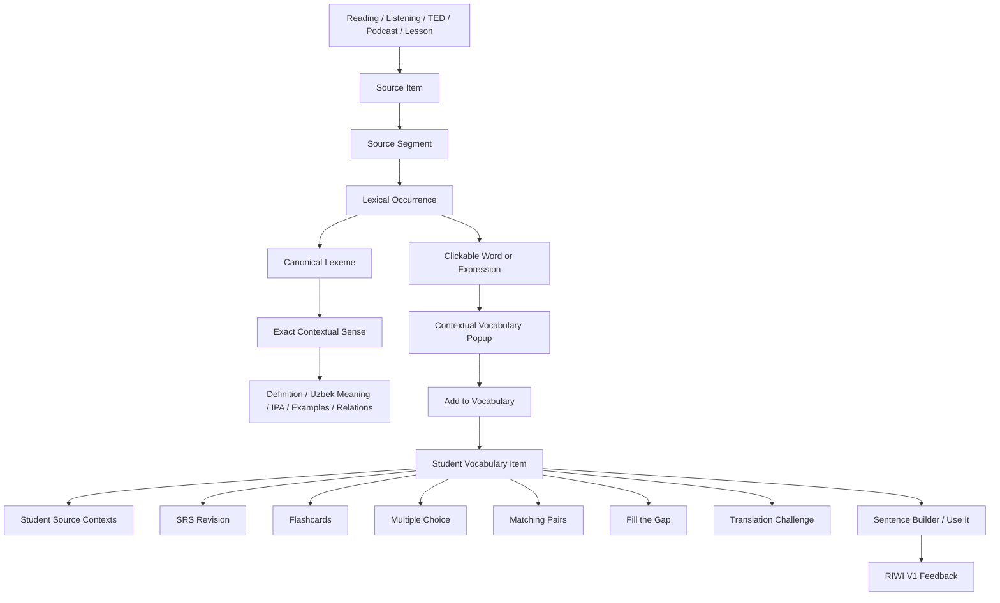
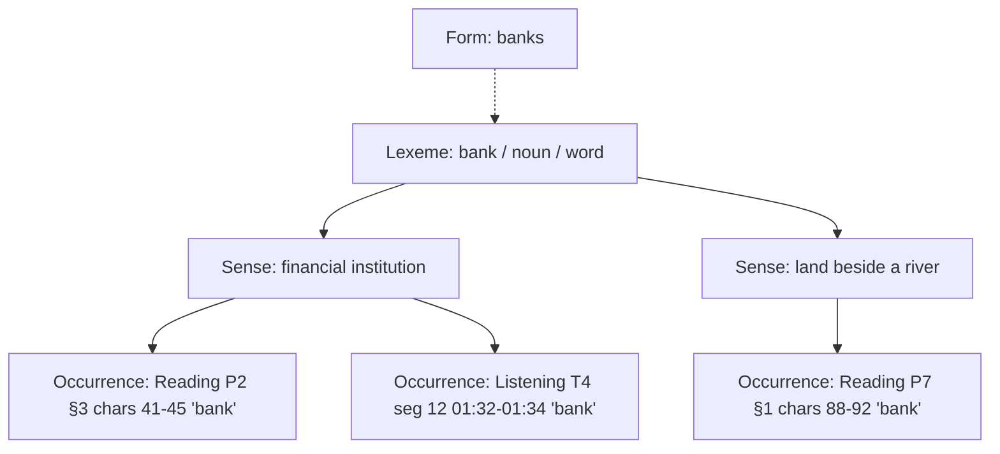
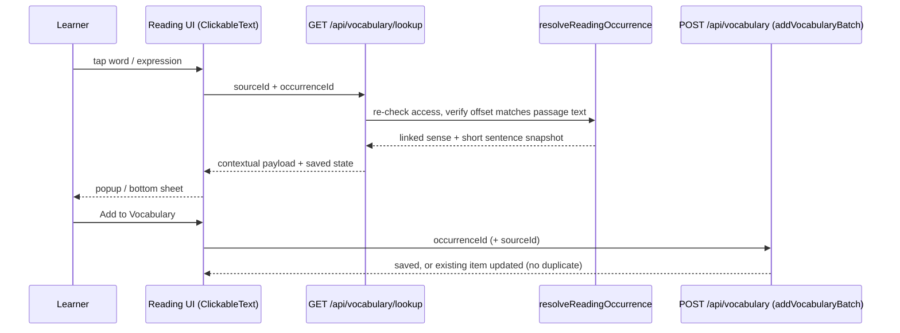
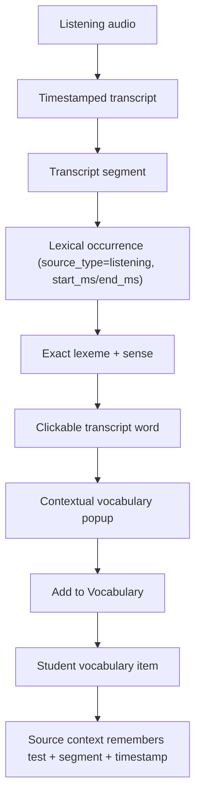
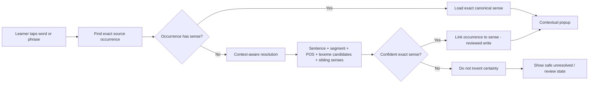
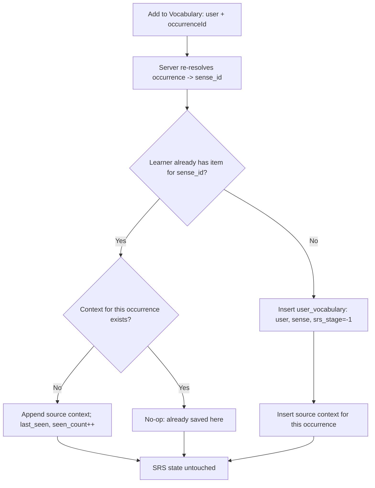
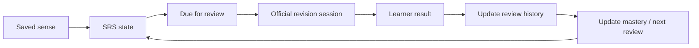
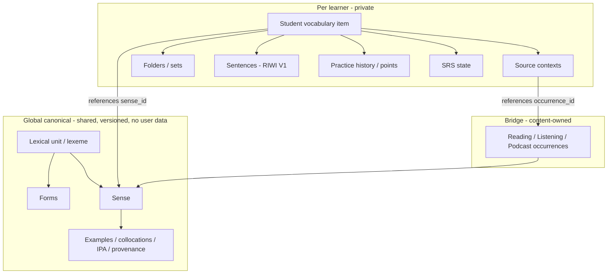
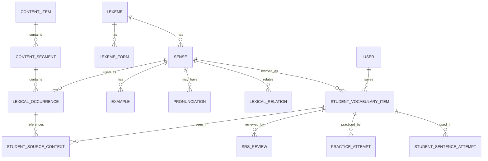
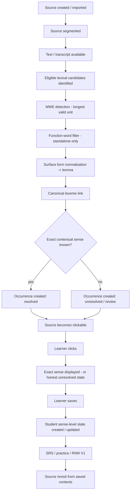

# Learners Area — Vocabulary System Architecture

Status: **specification + Phase 2 implementation.** Specified at `5476015`; Phase 2 code
adds migration `0029_vocabulary_architecture` and the services listed in **B15**. B15 says
exactly what is IMPLEMENTED NOW and what is FUTURE. Migration 0029 has been applied and
verified **only on isolated local databases** (PGlite and a local UTF8 PostgreSQL); it has
**not** been applied to Preview or Production.

The four questions every part of the system must answer, and never mix up:

| Question | Layer | Today in the repo |
|---|---|---|
| WHAT lexical unit is this? | **Lexeme** | `lexical_units` (0029) + `lexical_unit_forms`; senses link via `lexemes.lexical_unit_id` |
| WHICH meaning is intended? | **Sense** | `lexemes` row (one row = one sense, identity `sense_key`) |
| WHERE was it met? | **Occurrence** | `lexical_occurrences` — Reading and Listening (0029); TED/podcast columns are model-only |
| WHAT has THIS learner done with it? | **Student state** | `user_vocabulary`, `vocabulary_usages`, `vocab_point_events`, `vocab_folders` |

---

# LAYER A — The five-year-old explanation

### Toy boxes, toys and photographs

- A **lexeme** is a toy box with a name on it: **bank**.
- A **sense** is one toy inside the box. The "bank" box has two toys: a *money bank* and a
  *river bank*. Same name on the box, different toys.
- An **occurrence** is a photograph showing exactly where one toy was seen:
  "page 2 of the Reading, third sentence: *She put her salary in the bank.*"
  On the back of every photo we write which toy it shows.

### Why one word can mean two things
"She put money in the **bank**." → the money toy.
"They sat on the river **bank**." → the river toy.
The letters are the same. The toy is different. So Learners Area never asks
"what does *bank* mean?". It asks **"what does *bank* mean HERE?"**, and the photo
already tells it.

### How Reading sends words
When a Reading passage is added, a helper goes through it once and takes a photo of every
useful word or phrase, writing on the back which box and which toy it is.
Little words like *the*, *of*, *and* get no photo on their own. But phrases that are
useful as a whole, like *take into account*, get **one** photo as one toy.

### How Listening sends words
Listening does exactly the same with the transcript. Its photos also say *when* the word
was heard ("at 1 minute 32 seconds"). Listening does **not** get its own toy boxes. It
uses the same boxes as Reading.

### What happens when you tap a word
You tap "bank". The app looks at the **photo** for that exact spot and opens the toy written
on the back. It does **not** run to the box and grab whichever toy is on top.
If nobody has written on the back of the photo yet, the app says honestly
"we haven't checked this meaning yet". It never guesses.

### What happens when you press "Add to Vocabulary"
You don't get a copy of the toy. You get a **sticker in your own notebook** that says
"I am learning *this* toy" and "I first saw it *here*".
The toy itself stays in the shared toy room for everybody.

### Why you don't get duplicates
If you meet the money-bank toy again in Listening, the app sees you already have a sticker
for that toy. It just adds a second little picture next to your sticker: "also seen here".
If you meet the **river** bank, that's a different toy, so it gets its own sticker. Your
money-bank progress is never overwritten.

### How you practise later
Your notebook decides when each toy needs another look (**spaced repetition**).
Flashcards and games let you play with your toys. Writing your own sentence and having RIWI
check it shows you can really *use* the toy. And each sticker can take you back to the
photo where you first met the word.

---

# LAYER B — Engineering specification

## B1. Vocabulary
| Term | Meaning | Must never be confused with |
|---|---|---|
| word / surface form | the exact characters in the source: `running`, `Banks` | lemma |
| lemma | canonical citation form: `run`, `bank`, `take into account` | surface form |
| lexeme | language + normalized lemma + part of speech + lexical type | a sense |
| inflected form | a surface realisation of a lexeme (`ran` → `run`) | a new lexeme |
| sense | ONE meaning of ONE lexeme | the lexeme; the first dictionary result |
| occurrence | ONE appearance of a sense at ONE position of ONE source segment | a source; a sense |
| source context | the learner-visible snapshot of an occurrence attached to a saved item | an occurrence row |
| student vocabulary item | ONE learner × ONE sense learning state | a dictionary row |
| review state | SRS stage / interval / due date / history of a student item | dictionary data |

## B2. Current state map (audited, file by file)

| Concept | Current equivalent | Notes |
|---|---|---|
| Lexeme | **none as a table.** `lexemes.term` + `lexemes.part_of_speech` | The table named `lexemes` actually stores senses |
| Sense | `lexemes` row (`src/db/schema.ts`); identity `sense_key` = norm(term)+norm(POS)+norm(definition) (`services/vocabulary/dedupe.ts`), unique index `lexemes_sense_key_idx` | "bank (money)" and "bank (river)" already coexist as two rows ✔ |
| Lexeme forms / inflection | **none.** Surface→lemma mapping only happens inside an import package (`surface_form` stored on the occurrence) | no runtime lemmatiser, no `lexeme_forms` |
| Lexical type / MWE | **none as a column.** MWEs exist only as multi-word `term` strings; `occurrence_type` (free text) on occurrences | |
| Function-word status | **none as a column**; `is_target_vocabulary` on occurrence marks learnable spans | |
| Pronunciation / IPA | **none** | |
| Examples | `lexemes.example_sentence` (single) | |
| Relations / collocations | `lexemes.collocations` (text, "·"-separated) | |
| Provenance / verification | `lexemes.provenance`, `verification_status`, `import_batch` (0017) | `user_provided` rows excluded from catalogue lookup ✔ |
| Content item / segment | Reading: `reading_passages` + `reading_passage_paragraphs`. Listening: `listening_tests`, `listening_packages`. TED: video lessons | no universal content-segment table |
| Occurrence | `lexical_occurrences(lexeme_id, passage_id NOT NULL, segment_key, surface_form, start_char, end_char, sentence_text, occurrence_type, is_target_vocabulary)`, unique (passage, start, end) | **Reading only**: no Listening segment, no timestamps |
| Click resolution — Reading | `ClickableText` → `GET /api/vocabulary/lookup?sourceId&occurrenceId` → `resolveReadingOccurrence` (`services/lexical/context.ts`): re-checks access, verifies the offset still matches the passage text, returns the linked sense ✔ | deterministic, occurrence-first ✔ |
| Click resolution — Listening | `ClickableText` (`catalogueLookup`) → `GET /api/vocabulary/meaning?sourceId&q=<word>` → `enrichTerm(term)` | **string lookup** (see GAP-1) |
| Click resolution — fallback | `GET /api/vocabulary/search?q=<word>` | library search, not contextual |
| Enrichment boundary | `services/lexical/enrichment.ts`: catalogue first (returns **null if >1 sense** ✔), then registered adapters; empty definition rejected ✔ | |
| Student vocabulary item | `user_vocabulary(user_id, lexeme_id → sense, sense_key, state, srs_stage, mastery, counts, interval_days, next_review_at, …, source_type, source_id, source_snapshot jsonb, folder_id, topic_pack)` | SRS lives in student state, not the dictionary ✔ |
| Save / dedup | `addVocabularyBatch` (`services/vocabulary/engine.ts`): per-learner serialised transaction, dedup by `canonicalLexemeId` or `sense_key` ✔ | |
| Source contexts | `user_vocabulary.source_snapshot` — **one** jsonb | a second source cannot be appended (GAP-3) |
| SRS | `services/vocabulary/srs.ts` (intervals 1/3/7/16/35 d), `applyScheduledReview` | authoritative; keep |
| Practice / games | `services/vocabulary/game-round.ts`, `game-routes.ts`, `recordGameAnswer`, points ledger with dedupe keys | games do not schedule SRS ✔ |
| Sentence / RIWI V1 | `vocabulary_usages(user_vocabulary_id, sentence, origin, riwi_accepted, evaluation_id)`; `recordSentenceUse` → `confirmSentenceUse` | target sense reachable via `user_vocabulary.lexeme_id` ✔ |
| Search | `services/vocabulary/search.ts` (`matchRow`, `searchRows`) — lowercase + trim only | **no apostrophe folding in search** (GAP-10) |
| Tests | `lexical-context`, `lexical-enrichment`, `lexical-normalization`, `lexical-migration-db`, `vocabulary-engine`, `vocabulary-integrity-db`, `reading-105-dry-run`, … | |

### Gaps, ranked

| ID | Severity | Gap | Why it matters |
|---|---|---|---|
| **GAP-1** | **P0 correctness** | Listening click = `enrichTerm(word)`. If the catalogue holds exactly one sense for that spelling, it is returned as "contextual" even when the transcript uses a different sense (catalogue has only *bank = money*; transcript says *river bank*) | violates rule 14/16: shows a confidently wrong meaning |
| GAP-2 | P1 | No Listening/TED/podcast occurrences: `lexical_occurrences.passage_id` is NOT NULL; no transcript segment, no timestamps | rule 18: Listening cannot be occurrence-first |
| GAP-3 | P1 | One `source_snapshot` per saved item | rule 23: second source context is lost |
| GAP-4 | P1 | No lexeme layer above senses | sibling senses, "other meanings" view and POS-split lexemes are not representable |
| GAP-5 | P2 | No `lexeme_forms`; inflection handled only by import packages | rule 9 for runtime and new content |
| GAP-6 | P2 | No `lexical_type` / function-word flag | rules 11/12 enforced only by the importer's data |
| GAP-7 | P2 | No pronunciation table | popup IPA |
| GAP-8 | P3 | `first_seen/last_seen/seen_count` absent | exposure tracking |
| GAP-10 | P2 | Search does not fold Uzbek apostrophe variants (`ʻ ’ ‘ ʼ`); three separate normalisers disagree | "oʻqish" vs "o'qish" miss each other |
| GAP-9 | content | reading-105 import blocked by one sense-key collision ("literacy", noun) | see `docs/receipts/N16-reading-105-dry-run.md` |

## B3. Desired state map (target, mapped onto real names)

The key decision: **stable IDs are preserved by keeping today's `lexemes` table as the
SENSE table.** Every existing `user_vocabulary.lexeme_id`, `lexical_occurrences.lexeme_id`
and `vocabulary_usages` chain stays valid with no rewrite. A new parent table
(`lexical_units`) becomes the lexeme. Code may alias `lexemes` as `senses`; the
physical rename is optional and not required.

| Logical entity | Target physical table | New / existing |
|---|---|---|
| LEXEME | `lexical_units(id, language, lemma, lemma_norm, part_of_speech, lexical_type, is_function_word, provenance, release_version)`, unique (language, lemma_norm, part_of_speech, lexical_type) | **new** |
| LEXEME_FORM | `lexical_unit_forms(lexical_unit_id, form, form_norm, form_type)` | **new** |
| SENSE | `lexemes` (+ nullable `lexical_unit_id`, `sense_status`, `superseded_by`) | existing, extended |
| PRONUNCIATION | `sense_pronunciations` or unit-level `lexical_unit_pronunciations(ipa, variant, audio_key)` | **new** |
| EXAMPLE / RELATION | keep `example_sentence`, `collocations`; later `sense_examples`, `lexical_relations` | existing → optional new |
| CONTENT ITEM / SEGMENT | existing per-module tables; occurrence gets typed source columns (below) | existing |
| LEXICAL_OCCURRENCE | `lexical_occurrences` + `source_type`, nullable `passage_id`, `listening_source_id`, `segment_key`, `start_ms`, `end_ms`, `lexeme_id` **nullable** + `resolution_status` (`resolved` / `unresolved` / `review`) | existing, extended |
| STUDENT_VOCABULARY_ITEM | `user_vocabulary` (+ `first_seen_at`, `last_seen_at`, `seen_count`) and a unique index (user_id, lexeme_id) after a dedup audit | existing, extended |
| STUDENT_SOURCE_CONTEXT | `user_vocabulary_contexts(user_vocabulary_id, occurrence_id NULL, source_type, snapshot jsonb, seen_at)`, unique (user_vocabulary_id, occurrence_id) | **new**, backfilled from `source_snapshot` |
| SRS_REVIEW | `user_vocabulary` SRS columns (+ review events already in the points ledger) | existing |
| PRACTICE_ATTEMPT | game answers + `vocab_point_events` | existing |
| STUDENT_SENTENCE_ATTEMPT | `vocabulary_usages` | existing |

---

## Diagram 1 — Full Learners Area vocabulary architecture



Every box in plain words:
- **Source Item**: a whole Reading passage, Listening test, TED talk or podcast episode.
- **Source Segment**: the smallest addressable piece: a paragraph, or a transcript segment with a time range.
- **Lexical Occurrence**: "this exact span, in this segment, is this sense". The bridge between content and the dictionary.
- **Canonical Lexeme**: the one shared dictionary entry for the lexical unit (`run`, `take into account`).
- **Exact Contextual Sense**: the one meaning the occurrence points to.
- **Definition / Uzbek / IPA / Examples / Relations**: data that belongs to the sense (or its lexeme), stored once for all sources.
- **Clickable Word**: the rendered span. It carries the occurrence id, not just text.
- **Contextual Popup**: shows that sense and that sentence.
- **Add to Vocabulary**: creates or updates a student item that *references* the sense.
- **Student Vocabulary Item**: one learner × one sense.
- **Student Source Contexts**: every place this learner met this sense.
- **SRS Revision**: the official schedule (`srs.ts`).
- **Flashcards … Translation Challenge**: practice modes over saved senses. They award points but do not move the SRS schedule.
- **Sentence Builder / Use It → RIWI V1**: the learner writes their own sentence for the target sense; RIWI V1 judges it.

## Diagram 2 — Lexeme → Sense → Occurrence



One lexeme, two senses, three occurrences. Occurrences never point to a lexeme without a
sense in the resolved state; they point to the **sense**, and the sense knows its lexeme.

## Diagram 3 — Reading → Vocabulary flow



This path **exists today** and is occurrence-first. The client never sends a definition;
the server re-resolves the occurrence on save, so a tampered request cannot attach a
different meaning.

## Diagram 4 — Listening → Vocabulary flow (target)



**Today** Listening stops after step C and jumps to a string lookup (GAP-1/GAP-2). The
target reuses the same `lexical_occurrences` table and the same lookup route with an
occurrence id. Listening has no separate vocabulary store, today or in the target. The
established loop (Exam → Revision → Evidence/Transcript → Keywords/Paraphrases → Speed
Training → Vocabulary) feeds this same pipeline.

## Diagram 5 — Word click → exact contextual sense resolution



Rules:
- Forbidden: `search(clickedText)[0]`. Also forbidden: "the catalogue has exactly one sense,
  therefore it is the contextual one". Single-sense-in-catalogue is **not** evidence of context.
- The production path is the top line. Resolution runs at ingestion/enrichment, not per click.
- Runtime resolution, if ever enabled, may only *propose*. Writing `occurrence.lexeme_id`
  is a reviewed enrichment action, never a side effect of a learner's click.

## Diagram 6 — Add to Vocabulary deduplication



The whole flow runs inside the per-learner serialised transaction that `addVocabularyBatch`
already uses, so a double click or two tabs cannot create two items. A different sense of
the same lexeme (river vs money bank) takes the **No** branch and gets its own item; the
other item's progress is untouched.

## Diagram 7 — Student vocabulary + SRS flow



SRS lives only on `user_vocabulary` (`srs_stage`, `interval_days`, `next_review_at`,
`mastery`, counts), driven by `srs.ts` / `applyScheduledReview`. A new occurrence of an
already-saved sense updates exposure and contexts, **never** the schedule. Games award
points through the dedupe-keyed ledger and do not move `next_review_at`.

## Diagram 8 — Canonical dictionary vs student state



Arrows only point **from** student state **to** global data. Nothing in GLOBAL holds a
user id, an SRS field or a learner sentence. Saving copies no definition into the user
table.

## Diagram 9 — Logical ER diagram



Name mapping: LEXEME = `lexical_units` (new) · SENSE = `lexemes` · LEXICAL_OCCURRENCE =
`lexical_occurrences` · STUDENT_VOCABULARY_ITEM = `user_vocabulary` · STUDENT_SOURCE_CONTEXT =
`user_vocabulary_contexts` (new) · STUDENT_SENTENCE_ATTEMPT = `vocabulary_usages` ·
PRACTICE_ATTEMPT = game answers + `vocab_point_events` · CONTENT_ITEM/SEGMENT = module tables
(`reading_passages`/`_paragraphs`, Listening tables). Existing names win.

## Diagram 10 — End-to-end lifecycle



---

## B4. Lexeme and sense identity
- **Lexeme identity:** `(language, lemma_norm, part_of_speech, lexical_type)`. `record` noun
  and `record` verb are two lexemes. `shed pounds` (verb phrase) is its own lexeme, not
  `shed` + `pounds`. The same unit in Reading, Listening and TED is **one** lexeme with
  several occurrences.
- **Sense identity:** `(lexeme, sense_key)`. Today `sense_key` = normalized term + POS +
  definition (`dedupe.ts`). Distinct definitions ⇒ distinct senses; the same definition
  re-imported ⇒ the same row (`onConflictDoNothing` on `sense_key`). Released sense ids are
  durable; supersession uses `superseded_by`, never deletion or regeneration.
- **Known identity hazard:** two definitions that differ by a phrase become two senses.
  That's what currently blocks reading-105 ("literacy"). The resolution is an editorial
  decision, never an automatic merge.

## B5. Inflections, MWEs, function words
- **Inflection:** `lexical_unit_forms` maps `runs/running/ran → run`. The occurrence stores
  the surface form verbatim and points to the sense of `run`. No new dictionary row, no new
  student item.
- **MWE:** candidates are matched longest-first against known multi-word units (and their
  inflected forms: `shed/sheds/shedding pounds`). A matched MWE span suppresses the
  single-word occurrences inside it as *target* vocabulary.
- **Function words:** a standalone `the/of/to/and` is never `is_target_vocabulary`; a
  function word **inside** an accepted unit (`take into account`) does not disqualify it.

## B6. Click API contract
Request (occurrence-aware, existing route kept):
`GET /api/vocabulary/lookup?sourceId=<attempt|passage|listening source>&occurrenceId=<uuid>`

Response (existing names preserved; additions marked +):
```json
{
  "contextual": { "definitionEn": "...", "translationUz": "...", "verificationStatus": "verified|unverified|null", "sourceLabel": "Learners Area catalogue" },
  "known": { "id": "<user_vocabulary.id>", "mastery": "learning" },
  "+occurrence": { "surfaceForm": "running", "sentence": "...", "sourceType": "listening", "startMs": 92000 },
  "+sense": { "id": "<lexemes.id>", "lemma": "run", "partOfSpeech": "verb", "lexicalType": "word", "ipa": null },
  "+status": "resolved | unresolved"
}
```
- An `unresolved` occurrence returns `contextual: null` with `status: "unresolved"`, and the
  popup says the meaning is not checked yet. No adapter result is shown as contextual.
- `GET /api/vocabulary/meaning?q=` (string) must stop presenting a result as *contextual*
  (GAP-1). It may remain only as an explicitly labelled "dictionary search", never in the
  primary popup slot.

## B7. Save flow
`POST /api/vocabulary` with `occurrenceId` (+ `sourceId`): the server resolves the sense
from the occurrence (as `resolveReadingOccurrence` does today), then follows Diagram 6.
The client never supplies definition, translation or sense id for an occurrence save.

## B8. Student state, SRS, practice, RIWI V1
- Student-only fields: saved state, folder, topic pack, contexts, first/last seen,
  seen count, mastery, SRS fields, review history, sentences, practice history, points.
- **SRS:** `srs.ts` stays authoritative; no new algorithm.
- **Practice modes** (Flashcards, Multiple Choice, Matching Pairs, Fill the Gap, Typing Race,
  Translation Challenge, Sentence Builder) draw saved items and read sense data through
  `lexeme_id`. The existing flashcard design stays: 3D always on, Learned / Not yet,
  auto-advance, summary, pronunciation control.
- **RIWI V1:** a sentence attempt is `vocabulary_usages → user_vocabulary → lexemes(sense)`.
  The evaluator receives the **sense definition** as the target, not just the spelling, so
  "I ran the company" is judged against *run = operate*, not *run = move fast*. RIWI V2 is
  out of scope.

## B9. Search
Normalise case, whitespace and the Uzbek apostrophe variants (`'`, `’`, `‘`, `ʻ`, `ʼ`, `` ` ``)
to one form. **Audited today:** library search (`services/vocabulary/search.ts`) only
lowercases and trims, with no apostrophe folding at all. `dedupe.ts` folds `’‘\``, and
`grading.ts` folds `‘’ʼ\``. None of them folds `ʻ` (U+02BB, the standard Uzbek oʻ/gʻ).
Target: one shared normaliser used by search, dedup and grading. Ranking: exact EN → exact UZ → starts-with → normalised
starts-with → contains. Results are senses (with lemma + POS shown), never occurrences.

## B10. Performance and cache
- Runtime path: `occurrence_id` (PK) → `lexeme_id` → sense row (PK). Two indexed reads,
  no semantic search per click.
- Cache key = `sense_id + release_version` for sense data; plus `occurrence_id` for the
  sentence payload; the saved state is per learner and stays `private, no-store`.
- **Never** cache `surface string → meaning`.

## B11. Ingestion must not invent facts
Precedence: verified Learners Area catalogue → author/teacher metadata → captured source
context → approved dictionary releases → optional future provider. A weaker source never
overwrites a verified field. Missing definition, translation, IPA or example stays **null +
review-needed**. `provenance` / `verification_status` stay truthful internally; learner UI
shows only Learners Area branding.

## B12. Migration plan (implemented as `0029`; local-only verification, see B15)
All forward-only, additive, following the current drizzle journal; no historical migration
edited; nothing run on Preview or Production without the established guarded procedure.

1. **M1 `lexical_units` + `lexical_unit_forms`**; nullable `lexemes.lexical_unit_id`.
   Backfill deterministically: group existing senses by (norm(term), norm(POS)); create one
   unit per group, link. No sense ids change.
2. **M2 occurrences generalised:** `source_type` default `'reading'`; `passage_id` made
   nullable with a CHECK that exactly one source column is set; `listening_source_id`,
   `start_ms`, `end_ms`; `lexeme_id` nullable + `resolution_status` default `'resolved'`
   (every existing row is resolved by construction).
3. **M3 `user_vocabulary_contexts`**, backfilled 1:1 from non-null `source_snapshot`;
   `source_snapshot` kept (read-compatible) until the UI reads contexts.
4. **M4** `first_seen_at` (backfill `created_at`), `last_seen_at`, `seen_count` (backfill 1).
5. **M5** pre-check query for duplicate (user_id, lexeme_id) pairs. If zero, add a unique
   index; if not, a report for manual merge. **No automatic merge.**
6. **M6** `is_function_word`, `lexical_type` on units; pronunciation table.

Legacy rows whose sense can't be determined are marked `unresolved`, never assigned.

As built in `drizzle/0029_vocabulary_architecture.sql` (differences from the proposal above):
M2 uses `listening_test_id` and `video_lesson_id` columns (not one `listening_source_id`),
plus `section_number`, `lexical_unit_id` and `resolution_source`; M6's `lexical_type` and
`is_function_word` live on `lexical_units` from M1; the backfill creates no helper object
(nothing is dropped); the migration refuses to run on a non-UTF8 database.

## B13. Test plan
✔ = existing test covers it today · ✚ = to add with the corresponding change.

| Behaviour | Coverage |
|---|---|
| same spelling + different meaning ⇒ two senses coexist | ✔ `lexical-normalization` / `vocabulary-engine` (sense_key) |
| same sense saved twice ⇒ one student item | ✔ `vocabulary-engine`, `vocabulary-integrity-db` |
| Reading click resolves via occurrence, re-checks access and offset | ✔ `lexical-context` |
| ambiguous catalogue spelling ⇒ null, not first row | ✔ `lexical-enrichment` |
| empty adapter definition rejected | ✔ `lexical-enrichment` |
| **BANK integration**: Reading A "deposited her salary in the bank" → financial; Reading B "rested on the river bank" → river; saving both ⇒ 2 senses, 2 occurrences, 2 student items, no overwrite | ✚ (PGlite + QA2 real PG) |
| **Listening single-sense trap**: catalogue has only *bank = money*; transcript "river bank" must **not** show money as contextual | ✚ (pins GAP-1 fix) |
| **INFLECTION**: run/runs/running/ran ⇒ 1 unit, 1 sense, 4 occurrences, 1 student item | ✚ (after M1) |
| **MWE**: "He wants to shed pounds." ⇒ one `shed pounds` occurrence; inner words not target | ✚ |
| standalone function word excluded; inside MWE allowed | ✚ |
| record (n) vs record (v) distinct | ✚ |
| same sense in Reading and Listening ⇒ 1 item, 2 contexts | ✚ (after M3) |
| SRS update never writes `lexemes` | ✚ (row-snapshot before/after) |
| unresolved occurrence ⇒ no meaning shown | ✚ (after M2) |
| apostrophe variants incl. `ʻ` `ʼ` ⇒ same search result | ✚ |
| search ranking order EN-exact > UZ-exact > prefix > norm-prefix > contains | ✚ |
| sentence attempt → exact sense passed to RIWI V1 | ✚ |
| zero regression of Reading / Listening / Vocabulary flows | full suites |

## B14. Failure cases that must be impossible
Wrong first dictionary meaning shown · single-catalogue-sense presented as contextual ·
duplicate word per passage / per test · duplicate item from inflected forms · different
senses collapsed · MWE split · standalone function word as target · source context or
timestamp lost · SRS in a dictionary row · dictionary copied into a user table · wrong sense
saved · popup relying only on clicked string · invented translation or example · learner
sentence judged against the wrong sense · weaker source overwriting verified data.

---

## Architectural truth table

"Now" = this branch after Phase 2 (local verification only; not yet on Preview).

| Statement | Target | Now |
|---|---|---|
| Reading and Listening share one dictionary | **YES** | YES (one `lexemes` table; Listening reuses an existing equal sense) |
| Each source creates a new lexeme | **NO** | NO |
| Each source context may create an occurrence | **YES** | Reading YES; Listening YES (authored vocabulary, `ingestListeningOccurrences`); TED/podcast model-only |
| Same word may have several senses | **YES** | YES |
| Occurrence points to exact contextual sense | **YES** | Reading YES; Listening YES only where the author checked it (example sentence), otherwise `unresolved` |
| Word click should search by text only | **NO** | NO — `/api/vocabulary/meaning` now always answers `unresolved` |
| Inflections create separate lexemes | **NO**, unless linguistically and structurally justified by canonical model | NO — `lexical_unit_forms` (lemma/regular/irregular) |
| Useful MWEs can be first-class lexical units | **YES** | YES (`lexical_type` phrase/phrasal_verb/…; longest span wins) |
| Standalone function words become target vocabulary | **NO** | NO — filtered at ingestion; MWEs containing them kept |
| Student vocabulary duplicates global dictionary | **NO** | NO |
| Student state references canonical lexeme/sense | **YES** | YES (`lexeme_id` = sense) |
| Same sense from multiple sources creates duplicate saved word | **NO** | NO — one item + N rows in `user_vocabulary_contexts` |
| Same lexeme with different saved senses may have separate learning states | **YES** | YES |
| SRS belongs to student state | **YES** | YES (meeting a word again changes `seen_count`, never SRS) |
| Games and SRS are identical | **NO** | NO |
| RIWI V1 evaluates student-created usage | **YES** | YES, tied to the exact saved sense |
| RIWI V2 should be started | **NO** | NO |
| Missing sense should be guessed | **NO** | NO in Reading and Listening |
| Internal provenance must remain truthful | **YES** | YES (`listening_package` + `unverified`; `backfill_0029`) |
| Learner-facing branding | **LEARNERS AREA** | Learners Area |

**Completion status:** SOURCE → OCCURRENCE → LEXEME → SENSE → CLICK → SAVE → STUDENT STATE
→ SRS/PRACTICE/RIWI → SOURCE REVISIT is implemented for **Reading** and **Listening** on this
branch and proven on local databases and a local production build. It is **not**
implemented for TED or podcasts (schema columns only). Preview/Production proof is pending.

## B15. Implementation status (Phase 2)

### IMPLEMENTED NOW

| Area | Where |
|---|---|
| One shared normalizer (Uzbek apostrophes `'` U+2018 U+2019 U+02BB U+02BC U+0060 U+00B4 U+2032; NFKC; case; whitespace) used by search, dedup, grading, enrichment | `src/lib/text/lexical-normalize.ts` |
| Lexical units, forms (incl. irregular verbs/nouns, verbal MWE heads), function-word list | `lexical_units`, `lexical_unit_forms`; `src/lib/services/lexical/forms.ts`, `units.ts` |
| Listening occurrences from authored package vocabulary, inside the import transaction; example-sentence rule; ambiguous → unresolved; idempotent | `src/lib/services/lexical/listening-occurrences.ts`; `api/admin/listening/import` |
| Occurrence-first click for Reading and Listening; unresolved state; POS, type, IPA only when stored | `resolveOccurrence` in `context.ts`; `api/vocabulary/lookup`; `ClickableText` |
| Spelling-only Listening lookup never returns a meaning | `api/vocabulary/meaning` |
| Unresolved occurrence / Listening word without definition is never saved under a guessed sense | `POST /api/vocabulary` (`needs_definition`) |
| One item + many contexts; replay-safe; `seen_count`/`last_seen_at`; SRS untouched | `addVocabularyBatch`, `user_vocabulary_contexts` |
| Context revisit (Reading attempt, Listening test + section) | `GET /api/vocabulary/:id/contexts`, `sourceRevisitHref` |
| DB uniqueness: `(user_id, lexeme_id)` index (created only if no duplicates), contexts `(item, occurrence)`, Listening offsets | `0029` M3/M5, M2 |
| Backfill for already-imported Listening packages and unit forms (`--dry-run` supported) | `scripts/backfill-vocabulary-0029.ts` |
| Read-only duplicate report if M5 could not create its index | `scripts/vocabulary-duplicate-report.mjs` |
| Real-PostgreSQL upgrade check with hard gates | `scripts/qa2-vocabulary-0029-upgrade.mjs` |

### FUTURE (not built)

- TED / video-lesson and podcast occurrences: columns exist (`video_lesson_id`, `source_type` CHECK), no ingestion, no UI.
- Audio timestamps: `start_ms`/`end_ms` exist; current transcripts have no word timing, so they stay null. No estimated timings.
- Pronunciations: table exists; no importer. The popup shows IPA only from that table.
- A UI page listing a saved word's contexts (the API exists; the vocabulary page does not render it yet).
- Applying 0029 to Preview: `scripts/preview-qa-migrate.mjs` approves only 0025–0028; 0029 needs an explicit owner approval before it can be added there.

### Verification evidence (local only)

- `tests/vocabulary-architecture.test.ts` (PGlite, every `npm test`) and
  `tests/vocabulary-architecture-qa2.test.ts` (real PostgreSQL, `QA2_DATABASE_TESTS=1`).
- `qa2-vocabulary-0029-upgrade.mjs` on a seeded 0028 database, then `drizzle-kit migrate`:
  EXISTING_LEXEME_IDS_CHANGED=0, READING_OCCURRENCES_BROKEN=0, USER_VOCABULARY_OR_SRS_CHANGED=0,
  DESTRUCTIVE_DATA_LOSS=0, LEXEMES_WITHOUT_UNIT=0, contexts 2/2.

## B16. Listening runtime modes — exam integrity vs study/control

Precomputed occurrence data is **data availability**; showing it to a learner is a
**permission**. One policy (`src/lib/listening/lexical-policy.ts`) decides the
permission, and both the pages and the API routes call it — hiding a popup is never
the only barrier.

| Mode | Surface | Contextual vocabulary |
|---|---|---|
| `FULL_EXAM` | Activity 1 (`NativeListeningExam`, legacy `ListeningExam`), attempt page while `in_progress` | **Never.** No word click, popup, tooltip, translation, pronunciation, highlighting or pointer. The exam components receive no transcript and import no lexical code. |
| `REVIEW_CONTROL` | Activity 2 Review & Revision transcript, `/listening/tests/[id]/study` controlled practice | Only after a **submitted** exam for the test (or staff), and **not while an exam attempt is open** (a second tab cannot be a dictionary for a retake). Click → `occurrence_id` → exact sense; otherwise "Meaning not checked yet". |
| `KEYWORD_PRACTICE` | Activities 3–4 | No popups (unchanged paraphrase training). |
| `VOCABULARY_STUDY` | Activity 5 Vocabulary Session | Same gate as review. Items are package-curated, lexical truth is the **canonical sense**. |

Server enforcement: `resolveOccurrence` returns `{status:"locked"}` for a forbidden
Listening mode. `/api/vocabulary/lookup`, `/api/vocabulary/meaning`, `POST
/api/vocabulary` (by occurrence or by `sessionSenseId`) answer **403
`lexical_assistance_locked`**. Pages without permission render `ClickableText` with
`lexicalAssistance={false}`: plain text, no `data-word`/`data-token`, no keyboard stop,
and occurrence ids are not sent to the browser at all.

Spelling is never contextual truth for Listening: a Listening word without a
server-proven occurrence makes **no** meaning/library request; the popup goes
straight to the unresolved state and only the learner's own meaning can be saved.

Vocabulary Session (activity 5): `listeningVocabularySession` maps each package
entry (in package order — quiz answers are graded by index) to its canonical sense
by the same rule as ingestion. Display of term/POS/definition/Uzbek/IPA comes from
the canonical sense; the package keeps only presentation (example sentence, "also
said as", quiz). Saving sends `sessionSenseId`; the server re-derives the session
list for that test, rejects any sense not on it (404), applies the policy, and saves
the canonical sense with its first resolved occurrence in the test as the source
context — so a review save and a session save of the same sense are one item.
Entries not yet ingested (no sense) keep the old authored-text save path.

Question-evidence highlighting (`questions[].evidence.at`) is answer-review data and
is independent of vocabulary occurrences: occurrence ingestion never reads evidence,
and evidence never creates or selects a sense.

Timing: the package carries no word timings, so `startMs`/`endMs` stay `null`; the
revisit target is test + section. Nothing is estimated.

```
FULL TEST (FULL_EXAM: plain exam, no lexical help — server returns 403)
   │ submit
   ▼
REVIEW / CONTROL (REVIEW_CONTROL)
   click word → occurrence_id → exact sense → popup → Add to Vocabulary
   (no occurrence / other sense → "Meaning not checked yet")
   │
   ▼
VOCABULARY SESSION (VOCABULARY_STUDY: canonical sense_id, package = presentation)
   │ save (one item per sense, one context per source occurrence)
   ▼
SRS (per user) / RIWI V1 (sentence use tied to the saved sense)
```

Tests: `tests/vocabulary-architecture-qa2.test.ts` M21–M28 (real Postgres),
`tests/ui/full-listening-controls.test.tsx` (plain study text before submission;
canonical session save), `tests/ui/word-popover.test.tsx` (no spelling request), and
a local HTTP run against the production build (A never-taken / B exam open → 403;
C submitted → resolved, river trap unresolved, save, contexts; D session canonical,
forged sense rejected, one item). Local evidence only — not Preview, not browser.

## B17. Reading runtime modes — IELTS Academic exam vs review vs general reading

Same principle as B16: lexical data may exist without being exposed. The Reading
policy lives in `src/lib/reading/lexical-policy.ts` and is enforced in
`resolveOccurrence` (server) as well as in the UI.

```
READING
│
├── IELTS ACADEMIC EXAM  (in-progress attempt, ReadingExam)
│       └── Vocabulary assistance OFF — plain passage, plain attached materials,
│           no word targets/keyboard stop/pointer/underline/hint text,
│           no occurrence data in the page; lookup/save → 403
│
├── ACADEMIC REVIEW / CONTROL  (submitted attempt, ReadingAnalysis → RetentionCheck passage, evidence quotes)
│       └── Contextual vocabulary ON — only if no attempt of the passage is open
│
└── GENERAL READING  (policy: ON — implemented by migration 0030, see B18)
        └── occurrence → exact sense → popup → Add to Vocabulary → student learning state
```

| Mode | Decided by | Lexical help |
|---|---|---|
| `ACADEMIC_EXAM` | lookup source is the learner's attempt with `status = in_progress` | never |
| `ACADEMIC_REVIEW` | a submitted attempt id, or a bare passage id (all current passages are Academic tests) | only with a submitted attempt of that passage AND no open attempt of it (staff may inspect) |
| `GENERAL_READING` | `general_reading_passages` row (`reading_mode = general_practice`) | allowed: implemented in B18 (0030). The hub's "IELTS General" tab is still the IELTS General Training placeholder and topic code `general` is a topic, not a mode — neither grants anything. |

Implemented now:
- `ReadingExam` takes no occurrence prop and imports no lexical component; the
  attempt page sends no occurrence/sense data while the attempt is open. Attached
  materials render through `ResourceBlocks lexicalAssistance={false}`.
- The bare-passage-id path that used to resolve any live passage now requires a
  submitted attempt — calling the endpoint with the passage id during an exam is 403.
- An open retake re-locks the old review attempt id as well.
- Reading words with no occurrence never trigger a spelling search
  (`/api/vocabulary/search`): the popup shows "Meaning not checked yet" and only
  the learner's own meaning can be saved. Library search stays a separate flow
  (Vocabulary page, attached-material text outside exams).
- Question evidence highlighting in `ReadingExam` is unchanged and carries no
  vocabulary interaction; in review, evidence quotes are interactive only through
  occurrences mapped into them — evidence never creates or selects a sense.
- Saved contexts keep the occurrence, passage, sentence and the learner's own
  attempt (revisit link `/reading/attempts/{id}`); the item references the
  canonical sense (no copied truth). Same sense from two passages or from Reading
  and Listening → one item, several contexts.

Existing product behavior intentionally kept: the exam's whole-passage Read Aloud
button and native text selection/copy (not vocabulary features, not changed here).

Tests: `tests/ui/reading-mode-separation.test.tsx` (exam plain + no requests +
keyboard; same content interactive in review; MWE; policy table),
`tests/vocabulary-architecture-qa2.test.ts` R23/R27–R32 (real Postgres), and a
local HTTP run against the production build (exam 403 by attempt and passage id,
no lexical ids in exam HTML, review resolves/saves, retake re-locks). Local
evidence only — not Preview, not a browser.

## B18. General Reading — learning mode (migration 0030)

> Academic Reading measures reading; General Reading develops reading.

### Mode decision (server, from persisted data only)

A Reading passage is **General** if and only if it has a row in
`general_reading_passages` with `reading_mode = 'general_practice'` (CHECK-constrained).
Everything else — all content that existed before 0030 — is **Academic**. The mode is
never taken from the route, the request body/query, a title, the passage count or a
timer. `readingLexicalAccess` (src/lib/services/lexical/context.ts) looks up the
membership first; the lookup and save endpoints ignore any `mode` / `readingMode` /
`generalSetId` the client sends.

| Situation | Persisted evidence | Mode | Vocabulary help | Server answer |
|---|---|---|---|---|
| Academic passage, own attempt in progress | attempt `in_progress` | ACADEMIC_EXAM | off | 403 `lexical_assistance_locked` |
| Academic passage id instead of attempt id while an attempt is open | open attempt for passage | ACADEMIC_EXAM | off | 403 |
| Academic retake open after a completed attempt | newer `in_progress` attempt | ACADEMIC_EXAM | off | 403 |
| Academic request carrying `mode=GENERAL_PRACTICE` (forged) | no membership row | ACADEMIC_EXAM | off | 403 |
| Academic, submitted attempt, no open retake | `completed` attempt | ACADEMIC_REVIEW | on | 200 |
| General passage, published set | membership + live set | GENERAL_READING | on from the first second, P1/P2/P3 and Full | 200 |
| General passage, draft set, learner | membership, set not live | — | off | not found (no existence signal) |
| General passage, draft set, staff preview | membership + staff role | GENERAL_READING | on | 200 |
| Academic occurrence id sent with a General passage id | occurrence not in that passage | — | — | rejected |
| General occurrence outside its authored example (one-meaning trap) | `lexeme_id IS NULL` | GENERAL_READING | "Meaning not checked yet" | 200 `unresolved`, save refused |

### Migration 0030 (additive, forward-only)

`drizzle/0030_general_reading.sql` creates three tables and nothing else:

* `general_reading_sets` — title, description, level, publication state, unique `source_ref`.
* `general_reading_passages` — `passage_id` (PK, FK → reading_passages, cascade), `set_id`,
  `passage_no` 1–3 (unique per set), `reading_mode` CHECK `= 'general_practice'`.
* `general_reading_progress` — per learner × passage: answers JSON, score/total, `checked_at`;
  unique `(user_id, passage_id)`.

No column is added to or changed on existing tables; no DROP; no data rewrite. The app
detects the tables with `to_regclass` (`generalReadingSchemaReady`), so code deployed
before the migration keeps every Academic surface working. Verified on the isolated
local QA2 PostgreSQL by `scripts/qa2-general-reading-0030-upgrade.mjs` (seed at 0029 →
real `drizzle-kit migrate` → verify): 10 tables (reading, lexical, learner vocabulary,
contexts, usages) — 0 rows changed, 0 missing, 0 added; 0 passages classified General.

### What the learner gets

* `/reading/general` and the hub tab **General Reading** list published sets.
* `/reading/general/{set}` offers Passage 1, Passage 2, Passage 3 and Full Reading
  (`?passage=1|2|3|full` only selects what to show; it grants nothing).
* The passage uses the shared `ClickableText` → occurrence id → canonical sense → popup
  → save path (sourceType `reading`, sourceId = passage id; no attempt is created or
  invented). Read Aloud and text selection stay. No timer.
* Questions (TFNG/YNNG, multiple choice, short answer) autosave per passage; **Check
  answers** grades with the existing Reading grader and shows the correct answer and
  the evidence quote. The answer key is not sent before Check. Full Reading keeps each
  passage's progress independently.
* Saved context: source type, set id, passage id + number, occurrence, sentence,
  `readingMode: general_practice`, no attempt id; revisit → `/reading/general/{set}?passage=N`.
* Dedup is learner × canonical sense, so General P1/P3, Academic review and Listening
  saves of the same sense are one item with several contexts; SRS state is never reset.
* Question evidence is never a vocabulary input (no sense is created from it).
* Content arrives only from authored bundles: `scripts/import-general-reading.ts`
  (zod-validated, draft by default, idempotent on `source_ref`, `--dry-run`). Authored
  vocabulary goes through the same canonical-sense rule as Listening
  (`ingestReadingPassageOccurrences`): exact sense only inside the author's example
  sentence, longest span wins (MWE), inflections via `formsOf`, function words skipped.

### Status

* **IMPLEMENTED NOW** — 0030, data layer, policy, progress API, pages, hub tab, importer, en + uz (Latin) copy.
* **LOCAL VERIFIED** — isolated QA2 PostgreSQL: 0030 upgrade gates PASS; 25 General Reading
  semantic tests (`tests/general-reading-qa2.test.ts`); UI interaction tests
  (`tests/ui/general-reading.test.tsx`); HTTP E2E against a local production build (both modes).
  No browser test was run (no browser available in the sandbox).
* **PREVIEW NOT VERIFIED** — 0029 and 0030 are not applied to Preview or Production; that needs
  explicit owner approval. Until then the General surfaces show an empty state there.
* **FUTURE** — no General Reading content exists in any shared database (none was fabricated);
  an owner-authored bundle must be imported. Admin editing UI for sets is not built.
