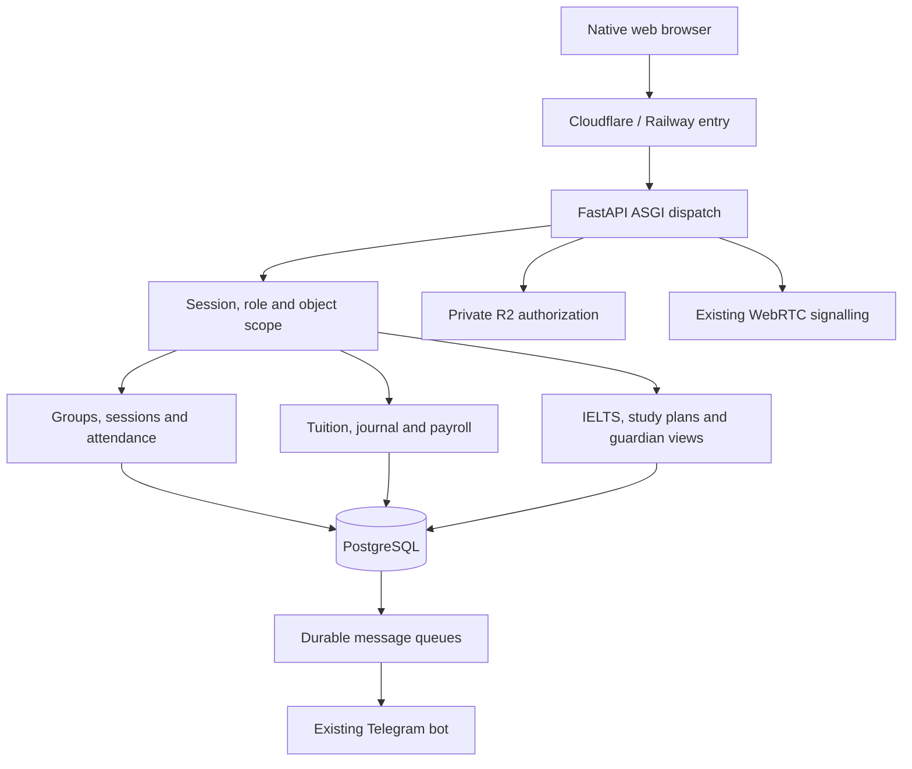

# Sale-ready architecture — current state and the finance slice

**Audit:** `arena/learners-area-next@c7519c0c` + `main@1231d6fa` · **Date:** 2026-11-15. [Current acceptance scope](../verification/MAIN_MERGE_AUDIT_20261115.md).

> **Uzbek qisqacha:** Platforma bitta Python FastAPI "modular monolith" ichida ishlaydi
> (bitta jarayon: API + native frontend + WebSocket signalling). PostgreSQL yagona haqiqat
> manbasi. Bu hujjat hozirgi arxitekturani va yangi qo'shilgan moliya qatlamini kod
> fayllari bilan bog'lab ko'rsatadi. Yangi server, yangi freymvork yoki mikroservis
> qo'shilmadi — mavjud tuzilma kengaytirildi.

## 2026-11-15 akademiya kengaytmasi

| Oqim | Egasi | Saqlash |
|---|---|---|
| O‘quvchi va o‘qituvchi katalogi | FastAPI `academy_groups_port.py`, egaga cheklangan | `academy_directory_imports`, `academy_directory_records`, `audit_log` |
| O‘quv tarixi | FastAPI `academy_journey.py` | Guruh, davomat, attempt, Writing feedback, assignment va onboarding jadvallari |
| Ota-ona ko‘rinishi | FastAPI `guardian_actor` va `child_user` | Faqat faol tasdiqlangan `guardian_links` |

Faylni tahlil qilish va XLSX eksporti cheklangan worker yordamida bajariladi. Bitta import ichidagi yozuvlar 500 qatorlik PostgreSQL buyruqlari bilan bitta tranzaksiyada yoziladi. O‘quv ko‘rinishi amaldagi ma’lumotlardan o‘qiladi. [Qabul tekshiruvi](../verification/SALE_READY_ACCEPTANCE.md)

## Coin va brauzer regressiyasi

`coin_policy.py` faol vaqtni hisoblaydi. `coin_rewards.py` serverdagi media yozuvi va PostgreSQL ledger’i bilan mukofotni bog‘laydi. Media davomiyligidan qat’i nazar, TED va Podcast uchun yagona 300 000 ms qoidasi qo‘llanadi. Native CSS va ikonka resurslari Python asset build’i orqali tarqatiladi. Chromium regressiyasi ayni native UI’ni ikkala OS-motion sozlamasida ochadi.

## 1. Verified current runtime (not the README's prose)



This is a code-level runtime map, not a fresh production-integration receipt.

| Component | File | Note |
|---|---|---|
| Entrypoint | `server.py` | mounts `app.asgi.application`; no Node in the runtime path |
| Request pipeline | `app/asgi.py` | `IndexingPolicy(OriginBoundary(RequestBudget(dispatch)))` |
| Identity/authorization | `app/main.py::_load_authority`, `current_authority`, `current_user` | session cookie → `users` row + `auth_version` + `auth_session_revocations` |
| Guardian allow-list | `app/guardian_port.py::guardian_path_allowed` | central 403 for every non-`/api/guardian/*` route |
| DB access | `app/db.py` | bounded asyncpg pool, acquire timing, failure classification |
| Static frontend | `app/frontend_static.py` + `scripts/build_native_assets.py` | 1,028 files, revision-stamped |
| Migrations | `services/backend/migrations/*.sql` (131 SQL files) | applied by `scripts/apply-test-migrations.mjs`; `drizzle/` is the older typed chain |

**Deliberately unchanged:** no framework migration, no new service, no microservice split,
no multi-tenant conversion. Academy/Tuition use the existing application, additive migrations 1115–1131 and domain modules. The managed-environment feature gate defaults off until a separately approved rollout.

## 2. What was added in this branch

```
services/backend/migrations/1115_tuition_finance.sql   ← schema + invariants in the database
services/backend/app/tuition_ledger.py                 ← transactional money commands (no HTTP)
services/backend/app/tuition_port.py                   ← HTTP surface + authorization
services/backend/app/main.py                           ← one-line router registration
src/db/schema.ts                                       ← typed definitions (117 columns verified)
services/backend/tests/test_tuition_ledger.py          ← 18 invariant tests on real PostgreSQL
services/backend/tests/test_tuition_port_authorization.py ← 26 authorization tests
services/backend/tests/migration-additions.json        ← 1115 registered for the integrity gate
services/backend/tests/current-route-inventory.json    ← 16 new routes appended (0 removed)
```

### Secure request path for every money write

```
Request
  → session validation (cookie → users row, auth_version, revocation list)
  → role check (owner/admin only for writes; teacher read-scoped; guardian centrally blocked)
  → input validation (integer minor units, uuid parsing, enum membership, length caps)
  → rate limit (RULES['finance_write'] = 120/60s per identity)
  → domain command in ONE transaction (@transactional)
        → object lock (SELECT … FOR UPDATE)
        → idempotency/dedupe (unique indexes + savepoint recovery)
        → subledger rows + balanced journal lines
  → COMMIT (deferred trigger proves SUM(debits) = SUM(credits))
  → response (private, no-store) with the authoritative position
```

No route computes money in the browser and no route writes outside `tuition_ledger`.

## 3. Domain ownership after this change

| Context | Owns authoritative writes | Reads via contract | Prohibited coupling (enforced) |
|---|---|---|---|
| Identity | `users`, sessions, `guardian_*` links | everything | payment provider never decides role |
| Academics | attempts, evaluations, study plans | finance read models | grades never write the ledger |
| **Finance (new)** | contracts, discounts, charges, payments, allocations, refunds, journal, cash closes | owner dashboards | UI never computes official debt; posted history is never edited |
| Communications | guardian batches/deliveries/replies | student links | retries never duplicate a chat |
| Reporting | derived read models (`finance_summary`, `student_position`) | all sources | no independent authoritative writes |

## 4. Trust boundaries

| Boundary | Control | Evidence |
|---|---|---|
| Anonymous → API | session cookie + origin check (`app/security.py::check_origin`) | existing suite |
| Student → other students | object-level check per route; `/api/finance/me` returns only the caller's own position | `test_tuition_port_authorization.py` |
| Teacher → unlinked student | `teacher_student_links` check; a miss returns `404 student_not_found`, identical to a non-existent id | same file |
| Guardian → finances | central allow-list refuses `/api/finance/*` and `/api/staff/finance/*` before the handler runs | `test_guardian_is_blocked_before_reaching_any_finance_route` |
| Provider → money | unique `(provider, provider_transaction_id)` + `idempotency_key`; a redirect alone posts nothing (`confirm=False` writes no journal) | 100× duplicate and 20-way race tests |
| Application → posted history | `BEFORE UPDATE OR DELETE` trigger raises `finance_journal_is_append_only` | immutability test |
| Any caller → unbalanced entry | deferred constraint trigger at COMMIT | `test_unbalanced_journal_transaction_cannot_commit` |

## 5. Trade-off decisions taken (and why)

1. **Net discount presentation.** A charge posts `gross − approved discount` to A/R and
   deferred revenue, matching the worked example. `scholarship_discounts` remains in the
   chart for a buyer who prefers gross presentation; switching is a configuration decision,
   not a silent change.
2. **Refunds limited to unallocated funds.** Refunding an amount already applied to a charge
   would require reversing that charge; that is a documented correction, so the code refuses
   (`refund_exceeds_available_funds`) instead of guessing.
3. **Revenue recognition is manual and bounded.** It can never exceed the deferred balance and
   is never a side effect of collecting cash. The ratable policy itself is the buyer's
   accounting decision (see manual actions).
4. **Vendor adapter remains engineering work.** `payments_sandbox.py` is a signed synthetic protocol, not a Click/Payme implementation. CAP-22 tracks the missing vendor code; MA-01 tracks only merchant onboarding and credentials.
5. **Postgres enforces the invariants, not Python.** Triggers and unique indexes mean a future
   code path (or a hand-run SQL session) cannot silently break the ledger.

## 6. Target architecture (unchanged ambition, bounded scope)

The logical target remains the existing modular monolith plus PostgreSQL as source of truth.
A durable outbox/worker is only justified when a queue-backed delivery path is measured to be
necessary — Telegram delivery already has its own durable queue tables
(`telegram_notifications`, `guardian_message_deliveries`). No Redis, no message broker, no new
service was added, because nothing measured required one.
