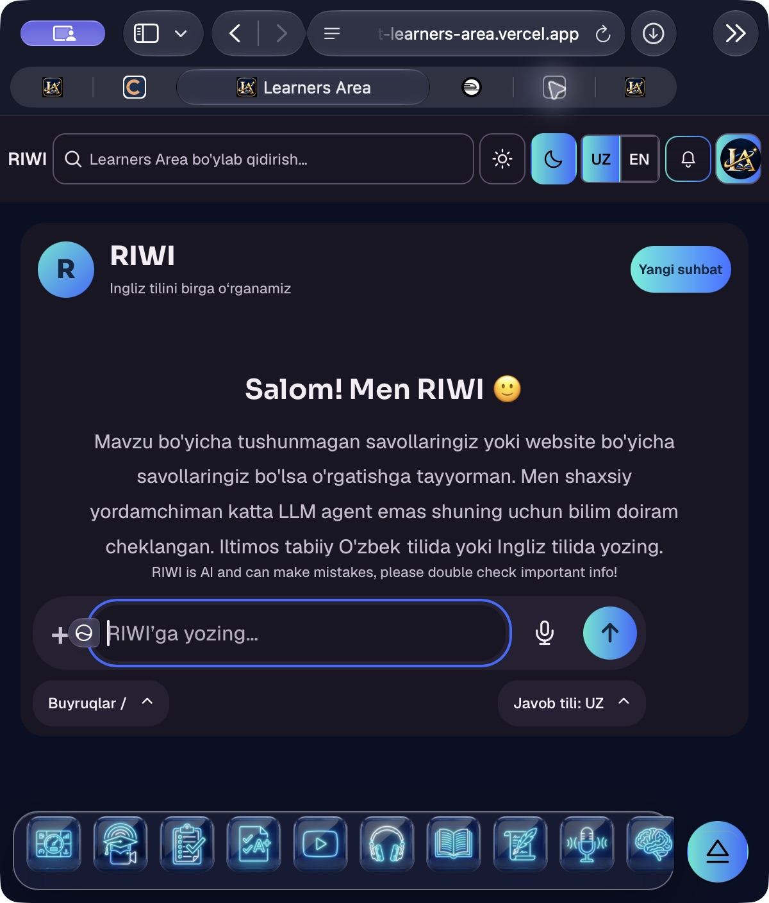
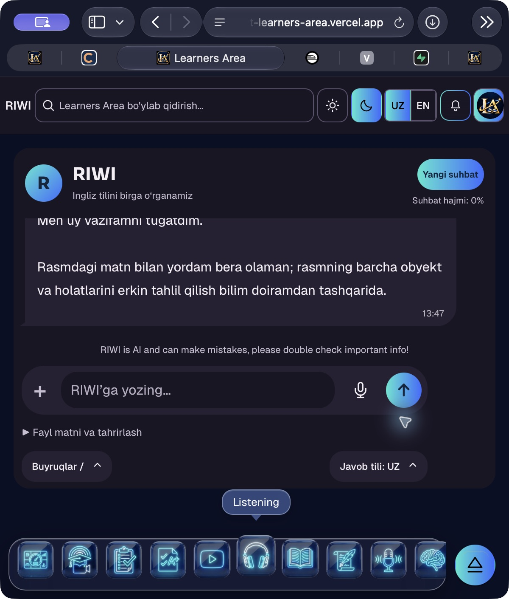
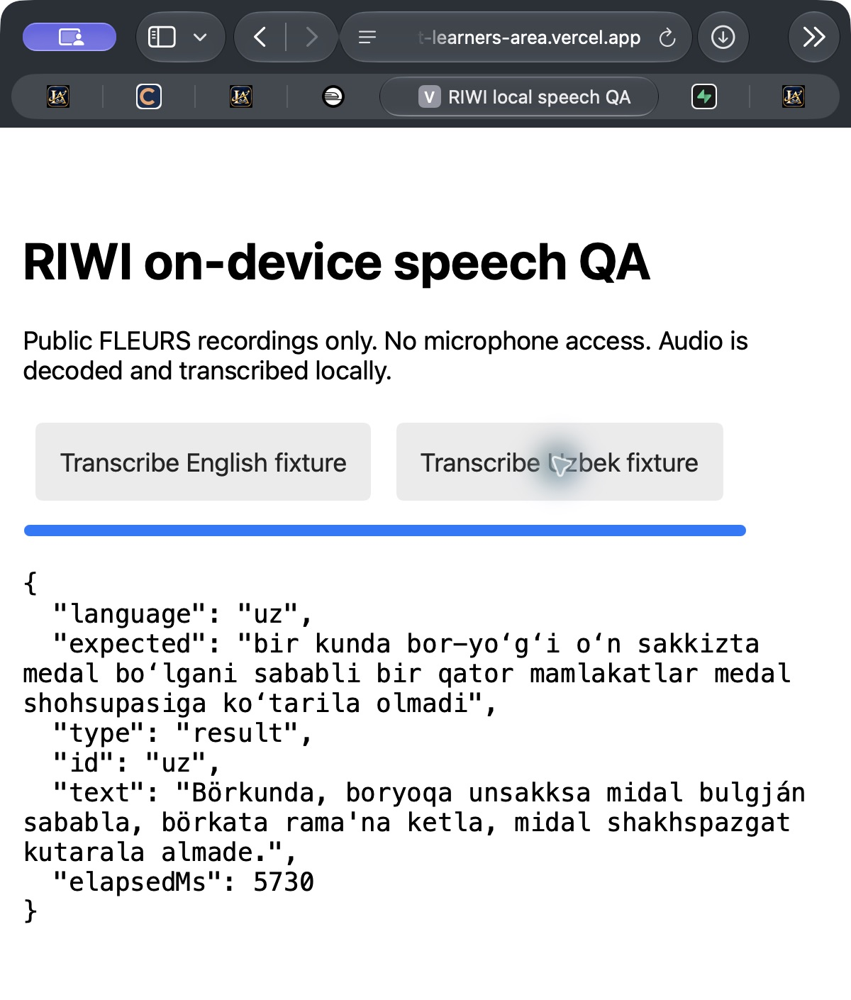

# RIWI adaptive language and chat lifetime acceptance — 2026-11-04

Tested application: `d87f7e3bbb23e18271c9b2b946d288eac3eb5881`.
Main incorporated into the feature: `66d09169802c1fde16df344cd893858b43acad6f`.
Branch: `arena/learners-area-next`. PR #114 remains draft and unmerged.

Stable Preview: https://learners-area-git-arena-learners-area-next-learners-area.vercel.app/app/riwi
Tested immutable Preview: https://learners-area-j8sfrk8qv-learners-area.vercel.app/app/riwi
Deployment: `dpl_5zAwi3a1WjLYNAxAz4VFRSXJ1aSA`, READY, Preview target.
Any following checkpoint commit changes these QA documents only.

## Result

Active-chat messages expire individually after seven days. New Chat gives the
previous chat a fixed thirty-minute whole-chat lifetime; later archives cannot
extend it. Seven-day cleanup does not split that retired chat. A 128,000 Unicode
character budget bounds retained user/assistant text. Characters/4 is an estimated
token count, not a usage bill. Oversized turns fail atomically and retain drafts.

Reviewed Uzbek dialects and explicit private phrase mappings improve retrieval.
New valid corrections replace earlier interpretations with revision/history.
Older retiring-chat writing cannot undo a newer correction. Limits, user scope,
active-lesson references, assessment gates and unsafe-input filters select what
may be remembered. Arbitrary chat assertions do not become shared factual truth.
See [architecture](../../../riwi-language-memory.md).

Audio remains transient device memory. Dictation does not save an audio file,
upload audio, call a browser speech vendor or auto-send a message. The decoded
PCM input is cleared after processing. Only editable text reaches the composer.
The accuracy line is exactly:

> RIWI is AI and can make mistakes, please double check important info!

The newest Main Dock work is preserved. Floating AI Coach opens `/app/riwi`.
Temporary speech QA tabs were closed; Safari Owner was left in a fresh UZ chat,
with the user's night theme preserved.

## Evidence

- **Automated:** 2,695 RIWI backend tests passed; 38 core tests passed; the full
  native frontend suite passed 1,324 tests with 11 existing legacy-fixture skips.
  Later affected checks passed: 13 footer/dictation/chat tests, six CDN/build
  checks and five dictation/cache checks. These are separate runs, not one
  aggregate count. No test failures remain from those runs.
- **Build:** Python-only native build, 812 files and 125 routes. The same-origin
  model has 55 hash-checked parts, totalling 101,260,210 bytes. Public copies are
  tracked before static collection; all 55 share existing Git blob IDs with the
  pinned source parts. They remain excluded from the function bundle.
- **Real QA PostgreSQL, rollback-only:** actual generated SQL on temporary tables
  passed ownership/IDOR, exact message deadlines, whole-chat expiry, repeated
  archive, scheduler boundary, private-memory correction/isolation and stale
  retirement review. All fixture writes were rolled back.
- **Live Owner learning:** `san kimsan` was understood. `qilesan` was learned as
  `nima qilyapsan`, changed to `qalaysan`, and the corrected interpretation was
  used after New Chat. A factual assertion was refused. The QA test later restored
  `qilesan` to its initial interpretation; no shared knowledge was promoted.
- **Live deletion independence:** at 08:51:59 UTC the original teaching turn was
  physically absent, the accepted private mapping still had revision 2, expired
  Owner conversations counted zero, and the latest minute job had succeeded.
- **Live tutoring:** the original past-simple/present-perfect question returned a
  simple explanation, three English examples with Uzbek explanations, and a short
  exercise. The stored synthetic answer and internal-provider provenance were
  independently inspected.
- **Native Safari UI:** slash suggestions and the physical @ attachment picker
  opened. A real PNG selection stayed staged without OCR. After Send it appeared
  as an image bubble with Thinking; OCR correctly read its English/Uzbek text.
  The final accuracy line and visible composer/microphone controls were observed.
- **Protected Preview speech:** same-origin credentials avoid SSO redirects;
  tracked static inputs make model parts available; one bounded GET reload repairs
  an old cached 404. A public FLEURS English fixture produced the expected words
  in Safari. [Raw speech results](safari-speech-fixtures.json) include both languages.

## Material limitations

The Uzbek speech fixture produced substantial transcription errors. Voice Uzbek
is explicitly experimental; users must review/edit its text. English fixture
success is not a general accuracy score. The first English run took 79,479 ms,
including model download; the Uzbek run took 5,730 ms after model loading.
Physical microphone, iPhone hardware and separate role-browser sessions have
not been accepted manually. Test fixtures use public audio, not recorded user
speech. No physical native drag gesture is claimed; mounted-drop tests and a
real native picker cover the attachment path. Fresh unreadable-photo behavior is
covered by automated checks, not a claimed final native photo pass. OCR reads
text and does not imply free scene understanding.

QA's minute scheduler may reclaim rows up to one interval after the exact API/UI
visibility deadline. Only QA project `bpexpsugmuhwmztacbqd` was changed. No new
application migration is needed for this follow-up; production scheduler/schema/
knowledge activation remains separate approved release work. No main merge,
production deployment or production data write was performed.

## Captures

Static deployment approach follows Vercel's documented
[public-directory CDN serving](https://vercel.com/docs/frameworks/backend/fastapi#serving-static-assets).
