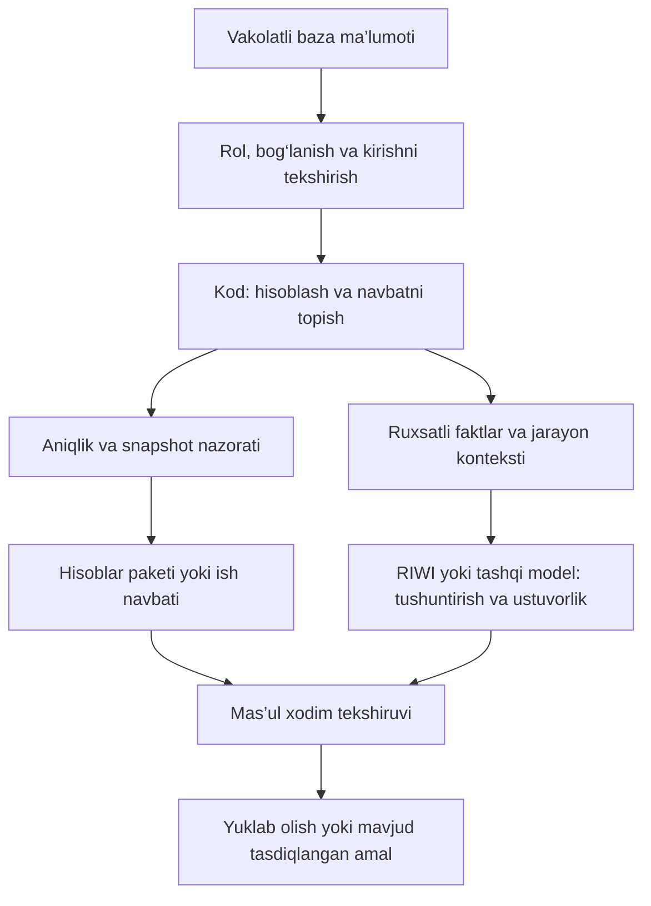

# Video asosida Learners Area avtomatlashtirish tahlili

Sana: 2026-11-17, Asia/Tashkent. Tekshirilgan boshlang‘ich holat: main
`a44480469dba3993846b811187f2e204ec9fa868`.

Manba: Azamat Muratov,
[40 Minutli Biznesi AI Avtomatlashtirish Bepul LIVE Kurs — Dokumentlar bilan ishlash](https://www.youtube.com/watch?v=JGT5icZ3IVw).
Video davomiyligi 37:34. YouTube’dagi o‘zbekcha avtomatik subtitrning 1 146 bo‘lagi
boshidan oxirigacha o‘qildi; 8 storyboard varag‘ida jarayon chizmasi, kod muharriri,
fayllar va natija namoyishining tanlangan kadrlari tekshirildi. Bu barcha kadrlarni
uzluksiz ko‘rish yoki ovozni mustaqil tinglash dalili emas. Avtomatik subtitrda
o‘zbekcha/ruscha terminlar xato tanilgan joylar bor. Ko‘rsatilgan mijoz hujjatlari,
tokenlar yoki shaxsiy ma’lumotlar ko‘chirilmadi.

## Asosiy xulosa

Videodagi foydali model — hamma ishni modelga berish emas. Manbani aniqlash,
ma’lumotni tekshirish, aniq hisoblash, hujjatga ajratish va natijani yetkazish
alohida bosqichlar bo‘lishi kerak. Raqamlar va takroriy ishni kod bajaradi. AI
noaniqlikni ko‘rsatishi, ustuvorlik tanlashi yoki qoralama berishi mumkin.

Learners Area’da ledger, takroriy to‘lov himoyasi, butun so‘mdagi hisoblash,
vakolat tekshiruvi va backup/restore shu tamoyilga allaqachon mos. Asosiy kamchilik
tayyor raqamlar ustiga AI qo‘shishdan ko‘ra jarayonning o‘zini yetkazishda edi:
RIWI umumiy bosqichlarni bilmasdi, tashqi model faqat fakt ID’larini saralardi,
davomatdagi tugallanmagan ish alohida navbatga chiqmasdi, hisoblarni fayllarga
ajratish esa xodimning qo‘shimcha ishi edi.

## Videoning muhim nuqtalari va bizdagi taqqoslash

| Video va vaqt | Amaliy mazmun | Boshlang‘ich sayt holati | Ushbu o‘zgarishdagi yechim |
|---|---|---|---|
| [01:49–04:29](https://youtu.be/JGT5icZ3IVw?t=109) | Avval ma’lumot qayerdan kelishi va kim natijani olishini aniqlash | Pulning manbasi ledger edi; ish jarayonlari turli sahifalarda tushuntirilgan | Bitta tekshirilgan jarayon katalogi: kirish ma’lumoti, boshlanish sharti, avtomatik qadam, tekshirish va natija |
| [04:44–06:19](https://youtu.be/JGT5icZ3IVw?t=284) | Dastlab natijani mas’ul odam tekshiradi | Draft/approve/post va xabar preview/send chegaralari bor | Shu chegaralar RIWI’ning har bir tegishli qo‘llanmasiga kiritildi; avtomatik yuborish deb ko‘rsatilmaydi |
| [06:36–07:25](https://youtu.be/JGT5icZ3IVw?t=396) | Ikki manbani birlashtirishni oddiy tasniflashdan ajratish | Ichki jurnal mosligi bank bilan to‘liq tashqi solishtirish degani emas | Reconciliation qo‘llanmasi manba yetishmasligini aniq ajratadi; AI yoki eksport bank dalilini o‘ylab topmaydi |
| [08:00–08:17](https://youtu.be/JGT5icZ3IVw?t=480) | Integratsiya yo‘q bo‘lsa, tekshirilgan eksportdan boshlash | Bank/Didox uchun tasdiqlangan yangi ulanish yo‘q | Mavjud, vakolatli baza yozuvlaridan ishlovchi paket; mavjud bo‘lmagan bank API’si uydirilmadi |
| [09:08–10:46](https://youtu.be/JGT5icZ3IVw?t=548) | Katta umumiy ma’lumotni alohida hisoblar/hujjatlarga bo‘lish | Debtor navbati bor, bir sahifani tayyor hujjatlarga ajratish yo‘q | Ko‘rinib turgan 20 tagacha hisob uchun alohida CSV’lar, umumiy CSV va manifestli ZIP |
| [12:31–13:18](https://youtu.be/JGT5icZ3IVw?t=751) | Odam boshlatadigan ish 24/7 scheduler bilan bir xil emas | Calendar buyrug‘i bor, scheduler provision qilinmagan | Qo‘llanma triggerni ochiq aytadi; yangi navbatlar sahifa ochilganda hisoblanadi, ZIP tugma orqali yaratiladi |
| [13:24–13:44](https://youtu.be/JGT5icZ3IVw?t=804) | Oldin ishlangan kirishni qayta ta’sir ettirmaslik | To‘lov, callback, xizmat va xabar buyruqlarida deduplikatsiya bor | Moliyaviy himoya saqlandi; eksport pul yozmaydi. Bir xil snapshotni qayta render qilish bir xil ZIP beradi |
| [14:01–17:49](https://youtu.be/JGT5icZ3IVw?t=841) | Vazifa, termin, namunaviy kirish va chiqishni aniq yozish | `question` maydoni Academy yordamchisining javob yo‘liga ta’sir qilmasdi | Savol tekshirilgan jarayon mavzusiga moslanadi yoki foydalanuvchi ro‘yxatdan tanlaydi. Mos kelmasa, umumiy qo‘llanma ekanligi aytiladi |
| [17:50–18:38](https://youtu.be/JGT5icZ3IVw?t=1070) | Summalar va sanalarni model xotirasi orqali ko‘chirmaslik | To‘g‘ri: summalar serverda hisoblanadi, model faqat evidence ID tanlaydi | Shu qoida saqlandi; hujjatlarni kod yaratadi. Model saralashi qolgan moliyaviy faktlarni yashira olmaydi |
| [18:40–20:32](https://youtu.be/JGT5icZ3IVw?t=1120) | Haqiqiy format va kerakli manbalarni tekshirish | Saytda typed API va jadval kontraktlari mavjud | Paket summalari to‘g‘ridan-to‘g‘ri `student_position`dan olinadi; soxta namunalar production’ga kiritilmaydi |
| [22:38–25:59](https://youtu.be/JGT5icZ3IVw?t=1358) | Bank ko‘chirmasi, faktura, kontragent va shartnomani bir xil ma’lumot deb olmaslik | Qarz, tushum, daromad, avans va refund allaqachon alohida | Jarayon konteksti bu farqlarni tashqi AI’ga ham beradi; eksport har bir miqdorni o‘z ustunida saqlaydi |
| [27:38–28:34](https://youtu.be/JGT5icZ3IVw?t=1658) | Boshlang‘ich qoldiq va davr ma’lumoti yetishmasligi | Joriy ledger holati bor; istalgan tashqi davrning boshlang‘ich qoldig‘i bor deb bo‘lmaydi | Manifest `current_ledger_positions`, `historicalOpeningBalanceIncluded=false`, `amountUnit=whole_UZS` deb belgilaydi |
| [28:49–29:36](https://youtu.be/JGT5icZ3IVw?t=1729) | Kod asosiy ishni, AI esa tekshirish/tahlil qismini bajaradi | RIWI va asosiy moliya amallari ajratilgan | Oflayn jarayon qo‘llanmasi, AI’siz paket va davomat exception navbati qo‘shildi; tashqi model uzilsa asosiy ish davom etadi |
| [30:43–33:42](https://youtu.be/JGT5icZ3IVw?t=1843) | Natijani kerakli oluvchiga yuborish va maxfiy ma’lumotni saqlash | Ota-ona bog‘lanishi va xabar preview/send bor | Ular saqlandi. Paket faqat owner/admin yuklashi uchun; Telegram’ga yangi avtomatik jo‘natish qo‘shilmadi |
| [34:26–35:11](https://youtu.be/JGT5icZ3IVw?t=2066) | Chiqish namunasi va nomlash qoidasi muhim | Hujjat yaratish va moliyaviy ko‘rsatkichlar alohida edi | Fayl nomi xavfsizlashtirilgan ism va UUID’dan olinadi; vaqt bir xil snapshotdan, manifest fayl hajmi va SHA-256’ni beradi |
| [35:41–37:20](https://youtu.be/JGT5icZ3IVw?t=2141) | Telegram transport, asosiy ishni Python qiladi; model vaqti/xarajati alohida | Tashqi AI credential/verification gate’i va usage metrikalari bor | Hisob paketiga model umuman chaqirilmaydi. Mavjud tashqi chaqiruvlarga joriy rol va jarayon konteksti beriladi; kalit yoki flag avtomatik yoqilmaydi |

## Videodan ko‘r-ko‘rona olinmagan maslahatlar

1. `.env` faylga yozishning o‘zi agent tokenni o‘qiy olmaydi degani emas. Bizda secret
   qiymati serverda qoladi; provayderga credential, oilaviy ID, xabar qoralamasi yoki
   erkin Academy savoli yuborilmaydi. Runtime holati faqat kerakli boolean sifatida beriladi.
2. Boshlang‘ich qoldiq bo‘lmasa, davr aylanmasidan to‘liq yakuniy qoldiqni ishonchli
   chiqarib bo‘lmaydi. Mavjud davr harakati bilan to‘liq qarzdorlik turli natijalar.
3. Python ishlatish parsing xatosi bo‘lmasligini kafolatlamaydi. Valyuta birligi,
   sana, manba qamrovi, duplicate va umumiy summalarni alohida sinash kerak.
4. Katta fayl uchun har doim ko‘p agent kerak emas. Typed ma’lumotni kod bilan
   chegaralangan paketlarga bo‘lish tezroq va kam xarajatli bo‘lishi mumkin.
5. Domenning muhim tafsilotini chetga surish xato. Bizda `draft`, `approved`,
   `posted`, `settled` va `sent` holatlari moliyaviy yoki xabar ta’sirini belgilaydi.
6. Videoda aytilgan 240 ta hujjat / 40 daqiqa bizning server uchun throughput yoki
   SLA dalili emas. Avvalgi load hisobotida maqsadga yetmagan darajalar saqlangan.

## Nima to‘g‘ri qurilgan edi

- `tuition_ledger.py` — pulning yagona manbasi, debit/kredit muvozanati, alohida
  refund/credit/revenue holatlari va append-only tarix.
- `b3460a19` — hisob komponentlari bitta SQL snapshotidan olinadi. Bu AI bilan
  almashtiriladigan kod emas, saqlanishi kerak bo‘lgan moliyaviy kafolat.
- `40fb974e` — haqiqiy narx va birlik soniga mos prepaid shartlari. 200 000 / 7 kun
  misol, qat’iy tarif emas.
- `63635867` va `a4448046` — backup, tiklash sinovi, tekshirilgan migratsiyalar va
  production dalili. Yangi AI funksiyasi bu reliz himoyasini chetlab o‘tmaydi.
- Har bir rol, farzand bog‘lanishi, o‘qituvchi biriktiruvi va provayder tasdig‘i
  serverda tekshiriladi. Model so‘rovi bu vakolatlarni bermaydi.

## Qaysi kamchiliklar tuzatildi

### Bitta jarayon katalogi va joriy kontekst

[`riwi_workflows.py`](../../services/backend/app/riwi_workflows.py) to‘lov,
olingan pul, oylik hisob, davomat, qabul, ota-ona xabari, prepaid, reconciliation va
hujjat paketi uchun 9 ta tekshirilgan jarayonni saqlaydi. Har birida trigger,
kirish, sayt bajaradigan ish, tekshirish va natija bor. Lokal RIWI shu manbadan
javob beradi; Academy yordamchisi shu manbani ko‘rsatadi; tashqi model ham shu
rolga ruxsatli kontekstni oladi.

Model parametrlarini qayta o‘qitish bajarilmadi. Kontekst so‘rov vaqtida beriladi.
Versiya jarayon ta’rifi va build’da yaratilgan sayt manbalari xeshlariga bog‘liq.
Shu sababli relizdagi manbalar almashganda kontekst versiyasi ham almashadi.
Bu yangi, hujjatlashtirilmagan funksiyani model o‘zi koddan tushunadi degani emas:
jarayon ta’rifi xatti-harakat o‘zgarganda birga yangilanadi, katalog yaxlitligi esa
test bilan tekshiriladi.

Tashqi Academy modeli ruxsatli evidence va workflow ID’larini ustuvorlashtiradi.
U pulni, linkni, qoralamani yoki approval holatini yarata olmaydi. Saralangan
faktlar oldinga chiqadi, qolgan qarz/refund faktlari yo‘qolmaydi. Noma’lum ID,
takror, ortiqcha buyruq yoki timeout to‘liq lokal natijaga qaytaradi. Oddiy tashqi
RIWI tutor chaqiruviga ham joriy jarayon va modul holati qo‘shiladi.

### AI’siz aniqlanadigan tugallanmagan davomat

[`academy_workbench.py`](../../services/backend/app/academy_workbench.py) oxirgi
7 kalendar kundagi `held` darslarning muzlatilgan ro‘yxatida `not_marked` qolgan
darslarni topadi. `scheduled`/`cancelled` yoki eski darsni qo‘shmaydi. Belgilanmagan
o‘quvchini `absent` deb hisoblamaydi. O‘qituvchiga faqat hozir biriktirilgan darslar
ko‘rinadi; tuzatish oynasi yopilgan bo‘lsa xodim tekshiruvi kerakligi aytiladi.
Navbat paginatsiyalangan va bo‘sh sahifa umumiy sonni nolga aylantirmaydi.

### Hisoblarni hujjatlarga ajratish

[`finance_balance_packets.py`](../../services/backend/app/finance_balance_packets.py)
bir xil repeatable-read, read-only baza snapshotidan 20 tagacha tanlangan
o‘quvchining joriy hisobini oladi. Har biri alohida CSV, hammasi bir CSV va
tekshiruv manifesti bilan ZIP’ga yig‘iladi. Summa butun so‘mda, AI aralashuvisiz.
Eksport orasida boshqa to‘lov commit bo‘lsa ham bir paket ichidagi hisoblar har
xil snapshotdan olinmaydi. CSV matni spreadsheet formulasi bo‘lib ishlamaydi.

`GET /api/staff/finance/balance-packets.zip` faqat owner/admin uchun. Tanlov
aniq va chegaralangan; noto‘g‘ri yoki takror ID, 20 dan ortiq hisob yoki o‘quvchi
bo‘lmagan ID rad etiladi. Qisman, yashirin eksport yaratilmaydi. Javob private,
no-store. Hech qanday moliyaviy yozuv yoki tashqi xabar yaratilmaydi.

## Avtomatlashtirish oqimi

## Qamrov va qolgan chegaralar

Bu o‘zgarishda yangi DB sxemasi, scheduler, bank/Didox integratsiyasi, merchant
kaliti, model krediti yoki avtomatik Telegram yuborish yoqilmaydi. Sayt o‘zidagi
aniq ma’lumot bilan ko‘proq ish bajaradi; tashqi AI shu ishni qaytadan hisoblamaydi.
Erkin hujjat tahlili yoki OCR imkoniyati yo‘q joyda RIWI buni bor deb ko‘rsatmaydi.

Davomat belgilari, haqiqatan olingan pul, xabarni yuborish va tasdiqlash — mas’ul
odamning qarori. Calendar buyrug‘i borligi ishlayotgan scheduler borligini
anglatmaydi. Haqiqiy davr siyosati va manbalar aniqlanmasdan yangi avtomatik
moliyaviy scheduler yoqilmaydi. Tashqi qabul bandlari avvalgidek
[yagona ro‘yxatda](../SALE_READY_MANUAL_ACTIONS.md) saqlanadi.

## Tekshiruv dalili

Mahalliy muhit: Python 3.12 va ajratilgan PostgreSQL 18.6. Yakuniy maqsadli
tekshiruvda 63 ta test va 25 ta subtest o‘tdi: yangi paket/navbat/kontekst,
avvalgi Academy yordamchisi, vakolatlar, gateway transporti va sayt qo‘llanmasi.
Oldingi kengaytirilgan document/help/site tekshiruvi 204 ta testdan o‘tgan;
bu ikki to‘plamdagi bir xil testlar qo‘shib sanalmaydi. Frontendning shu ishga
tegishli 8 ta testi o‘tdi. Ular real pul summasi, parallel settlement snapshoti,
fayl xeshi, xavfsiz nom, rol/farzand doirasi, modeldagi soxta workflow,
frontenddagi tashqi URL, stale download va davomatning `not_marked` holatini sinaydi.

To‘liq CI PostgreSQL 17 bilan relizdan oldingi majburiy tekshiruvdir. Aniq commit,
CI va reliz natijalari ushbu o‘zgarishning PR daliliga biriktiriladi. Jonli audio
va inson tomonidan brauzer qabuli bajarildi deb ko‘rsatilmaydi.
