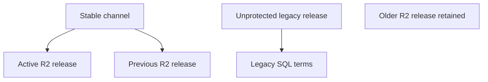

# Learners Area dictionary optimization engineering report

Current follow-up: [production verification continuation](PRODUCTION_VERIFICATION_20261026.md). Runtime fixes are deployed on main, live protected R2 bytes and current baselines are verified, and a full private archive was captured. Restore and destructive cleanup remain blocked. The report below preserves the earlier audit snapshot.

Prepared 26 October 2026. Final read at 22:04:33 Asia/Tashkent, UTC+5. Decision: production cleanup is BLOCKED. Audit, a minimal runtime patch, regression tests and a guarded operations package are ready for review. Storage reclaimed by this task: 0 bytes.

## DONE

### Production inventory and storage

Production is Learners Area, tuoeabrrnsiuxpjmslxp, ap-southeast-1, PostgreSQL 17.6. The separate QA project is learners-area-qa, bpexpsugmuhwmztacbqd. This audit made no changes to either database. The subsequent owner-approved main merge changes application code and adds the operator package.

| Measurement | Observed value |
| --- | ---: |
| Database at initial audit | 467,504,275 bytes, 445.85 MiB |
| Database at final read | 467,856,531 bytes, 446.18 MiB |
| Headroom against the app's 500,000,000-byte guard at final read | 32,143,469 bytes, 30.65 MiB |
| dictionary_search_terms total | 282,279,936 bytes, 269.20 MiB |
| Search heap | 121,577,472 bytes |
| Search indexes | 160,636,928 bytes |
| dictionary_entries total | 140,730,368 bytes, 134.21 MiB |
| Existing dictionary entries across four releases | 256,986 |
| Sense mappings | 3,851 |
| Running publish jobs | 0 |

The final database allocation increased by 352,256 bytes while the application remained live. No reclaim operation ran. pg_database_size measures database allocation; it does not measure the entire attached disk or WAL. No physical disk-usage measurement is claimed. The query found no replication slots at audit time.

All 1,201,156 search-term rows belong to legacy release rel-v1-a834010a6ccc72c8b3cd8db9: EN 65,669 and UZ 1,135,487. Index sizes are primary key 111,058,944 bytes, entry lookup 12,533,760 bytes and prefix 37,044,224 bytes. Historical statistics show seven legacy search executions. Those counters do not establish when they ran or prove decommissioning.

The legacy release is referenced by no channel and no publish job. No incoming FK or dependent view was found for dictionary_search_terms. Its outgoing FK points to dictionary_entries. All dictionary tables have RLS enabled and neither anon nor authenticated has direct SELECT privileges. Public function-body inspection found no reference to dictionary_search_terms. Existing mutable-search-path function advisories are recorded as pre-existing concerns; this task changes no grants, functions or policies.

### Release lifecycle

| Role | Release | Delivery and state |
| --- | --- | --- |
| Active stable | rel-v1-977bce7f8dab7e773955238e | r2-worker-v1, validated |
| Previous rollback release | rel-v1-cfadf47e87701f627f3270ce | r2-worker-v1, validated |
| Older retained R2 release | rel-v1-e7fa84dde5eec2f502957489 | r2-worker-v1, validated |
| Legacy search owner | rel-v1-a834010a6ccc72c8b3cd8db9 | legacy, validated |

No release, entry, mapping or R2 artifact was removed. The earlier dictionary import remains complete: 118 additions, five existing headwords retained and 123 successful exact English searches in its production receipt. This earlier validation is distinct from the broader EN/UZ and performance gates required for cleanup.

### Protected release metadata

Both current manifests reproduce their stored SHA-256 using the native ICU English collation canonicalizer. A generic code-point-sorted JSON serializer would not reproduce these hashes. The metadata validator checked 512 complete shard descriptors and 3,307 search-object descriptors, their counts, hashes, route references and release identities.

| Release | Entries | Shards | Search objects | Routes | Logical terms |
| --- | ---: | ---: | ---: | ---: | ---: |
| Active | 65,056 | 256 | 1,655 | 93 | 1,226,256 |
| Previous | 64,938 | 256 | 1,652 | 93 | 1,224,846 |

Active manifest SHA: 3e2f1638bc4127da5fb359093ea97aeacdeebdc2d4d293dc161e174be4ad845c.

Previous manifest SHA: 756134d493381bae1bbf66f3c910f3590da1ef0ad2a8b1b92fcede2229eedfdf.

The review ZIP file evidence/manifests.json.gz is a captured metadata inventory. It contains no full database backup or dictionary payload export. This task's metadata check does not claim a fresh read of every R2 object's bytes.

### API and consumer audit

The main deployment config selects Python FastAPI and excludes src and workers from the deployed function bundle. The retained TypeScript dictionary route is a transport adapter to the backend. Legacy TypeScript store logic remains in source, and the Python adapters retain an explicit SQL fallback. Learner and owner searches pin to stable; current stable and previous both have R2 search indexes. Owner summary still reads the retained legacy manifest as a baseline, so its registry and entries must remain.

Worker source verifies the HMAC proof before accessing the runtime cache. Immutable cache keys include the release object path and descriptor checksum. Gateway search responses use private, no-store. Recent searches remain in Supabase and are filtered by the authenticated user. Worker/bucket names in the repository are learnersarea-dictionary, learnersarea-media and learners-area. The deployed Worker version and live bindings were not obtained. No cache, CORS, route, binding or secret was changed.

A fault condition was identified: a missing R2 search-index registry row could enter the legacy SQL branch and return an empty result. The staged patch restricts that fallback to validated legacy releases in both learner and owner adapters. R2, building, retired and missing release metadata produce the existing 503 error behavior. The healthy R2 path adds no database query. The patch adds six runtime lines across two files.

### Verification

119 tests passed against the patched runtime: 72 existing backend regression cases, 13 new missing-index/read-path cases and 34 operator integrity, comparison and gate cases. See evidence/tests.log. Existing coverage includes immutable R2 publication, hashes/ranges, dictionary owner/edit authorization and normalization parity. New tests cover EN/UZ missing-index failures, retained legacy compatibility, unchanged healthy query count, wrong-release rejection, manifest corruption, missing/duplicate shards, altered routes, unsafe origins, missing receipts and p95/error/response-parity failures.

The forward patch applies cleanly to the pinned source and its reverse applies cleanly to the staged files. This verifies patch applicability, rather than a production deployment. The 24-query search cohort includes exact EN/UZ, prefixes, case, idioms, a phrasal verb, apostrophe/hyphen variants, spelling forms and empty/unknown queries. Its current-release identity fixtures were checked against production metadata. Full live expected ordering and translations still require validation.

| Contract area | Evidence | State |
| --- | --- | --- |
| Manifest identities and inventories | Current metadata hashes and descriptor checks | PASS for metadata |
| Missing/corrupt R2 data and ranges | Existing regression fixtures | PASS in fixtures |
| Learner and owner access gates | Existing and new backend tests | PASS in fixtures |
| EN/UZ stable search and complete entry details | Broader authenticated live cohort | BLOCKED |
| Empty/error/release-mismatch and top-20 behavior | Fixtures and prepared search cohort | Partial |
| Personal recent searches and user isolation | Source audit and auth tests; two-user live test pending | Partial |
| Pagination | Current search API has fixed top 20 and no cursor | Existing contract retained |
| Production API anonymous request | HTTP 401 unauthenticated | PASS |
| Live cold start, stale-cache rollback and Worker error rate | Production telemetry and QA rollback exercise | BLOCKED |

## BLOCKED

1. No recovery-grade database backup was created or restored. PostgreSQL client/server binaries are absent and Docker access is denied in this environment. The available Supabase connector permits SQL inspection but provides no verified backup/restore artifact. The existing QA project's contents were preserved.
2. The existing Railway access token is expired. Its connection must be reauthenticated through the normal login flow before using existing backend/R2 credentials. No credential was exposed, changed or replaced. Public API access correctly requires authentication. No student session was manufactured.
3. Deployed Cloudflare Worker version, live bindings, R2 byte verification and actual request/error telemetry remain unavailable. Repository configuration is captured separately from live configuration.
4. No measured p50, p95 or p99 baseline/optimized comparison exists. No throughput, cold-start, cache-hit or Worker error rate is asserted. Historical pg_stat_statements mean execution time is not an API latency distribution. The comparison tool refuses unequal cohorts, changed releases/query sets, insufficient samples, failures, altered responses and p95 growth above 10 percent.
5. Full live EN/UZ parity, definitive decommissioning of legacy readers, restore/rollback testing and maintenance lock rehearsal remain open. These are hard stops from the supplied playbook.
6. The playbook requires separate approval for GitHub push/merge and destructive production actions. Neither approval was inferred from the earlier, completed content-upload task. At the audit snapshot, no ref, deployment or production data had changed. The owner subsequently explicitly authorized merging the prepared code into main; destructive database cleanup is still blocked.

evidence/gates.json intentionally reports BLOCKED. A completed fixture suite cannot override these missing live receipts.

## PROPOSED

Retain the current Worker/R2 architecture and all personal/transaction data in Supabase. D1 and replacement services are unnecessary for the identified storage issue. Restore existing read access, verify the private full backup in an approved QA target, complete live parity and telemetry, then rehearse the cleanup and performance comparison in QA before requesting production approval.

The draft operation is in operations/cleanup.PROPOSED.sql and begins with an unconditional stop. It locks the native publisher advisory key 387384, checks release/manifests/counts/dependencies, retires only the unprotected legacy release through its existing registry trigger, then truncates only its obsolete search-term table. It keeps table structure, FK, indexes, RLS, triggers, all entries, sense mappings, current/previous and older R2 releases. TRUNCATE does not fire row DELETE triggers; an explicit guarded retirement must precede it.

TRUNCATE needs ACCESS EXCLUSIVE on the search table. The draft uses a 2-second lock timeout and a 30-second statement timeout. Actual lock duration and downtime are unmeasured. Batch DELETE is the alternative if only part of the table can be removed; its allocated space requires separate reclaim. VACUUM FULL requires a table rewrite, exclusive locks and additional space. No strategy switch should happen automatically after a failed gate.

The theoretical reduction is about 269.2 MiB, less empty relation overhead. Using the final database allocation, the arithmetic target is about 177.0 MiB. These values are estimates. The actual database and disk/WAL impact must be measured after an approved commit.

Rollback before COMMIT is transactional. After retirement, the immutable registry rejects an in-place unretire. A term-only INSERT/COPY restore into that retired release also fails. Full data recovery therefore depends on the verified recovery procedure; availability rollback uses the protected previous R2 release through the existing owner operation. Both procedures require a QA rehearsal. RUNBOOK.md defines the complete recovery and monitoring steps.

After an actual cutover, record immediate and 0–15-minute validation, then 1-hour and 24-hour checks for latency, errors, R2 reads, database size and user-specific behavior. No monitoring job was scheduled against an unknown cutover time.

## Git snapshot and approved integration

At the audit snapshot, main pointed to adb66249b36517d401d57c5987b9d14e4f9e329f and arena/learners-area-next pointed to ba1671c724da389ba373e494d71241230500afb9. GitHub comparison shows that discovered preview branch is 423 commits behind the pinned main, so the playbook's earlier branch-position assumption is stale. No other branch named learners-area-next was returned by the full branch inventory.

The owner subsequently requested a main merge. The code is integrated directly on that current main parent without changing arena/learners-area-next. This approval covers the prepared code and documentation. It does not execute or approve the blocked production cleanup.

The repository package contains the read-only operator script, query cohort, guarded SQL drafts and selected audit evidence. The delivered full review ZIP retains captured source snapshots, full manifest metadata and the original forward/reverse patch; its SHA-256 is d33335c1b6507955244fa19b172303e40f99ca1d2fb723214f1cbd368408707c. The repository does not duplicate those larger snapshots.

## Sources and reproducibility

- User execution playbook: current supplied nine-page optimization document.
- SQL results: evidence/audit.json and evidence/final-read.json. Reproduction queries: operations/audit.READ_ONLY.sql.
- Release manifest metadata: evidence/manifests.json.gz inside the full review ZIP; selected validation result: evidence/inventory-check.json.
- Pinned source snapshots and manifest metadata are in the full review ZIP. Integrated runtime changes and tests are in services/backend; read-only operator tooling and selected evidence are in tools/dictionary-optimization.
- Supabase database/disk accounting: https://supabase.com/docs/guides/platform/database-size
- Supabase backup/restore requirements: https://supabase.com/docs/guides/platform/migrating-within-supabase/backup-restore
- Supabase safe data deletion: https://supabase.com/docs/guides/database/postgres/data-deletion
- PostgreSQL 17 TRUNCATE locking and trigger behavior: https://www.postgresql.org/docs/17/sql-truncate.html
- Cloudflare cache semantics: https://developers.cloudflare.com/workers/runtime-apis/cache/
- Current Supabase changelog was fetched and relevant database/backup changes scanned. No database upgrade or extension change is part of this proposal.
